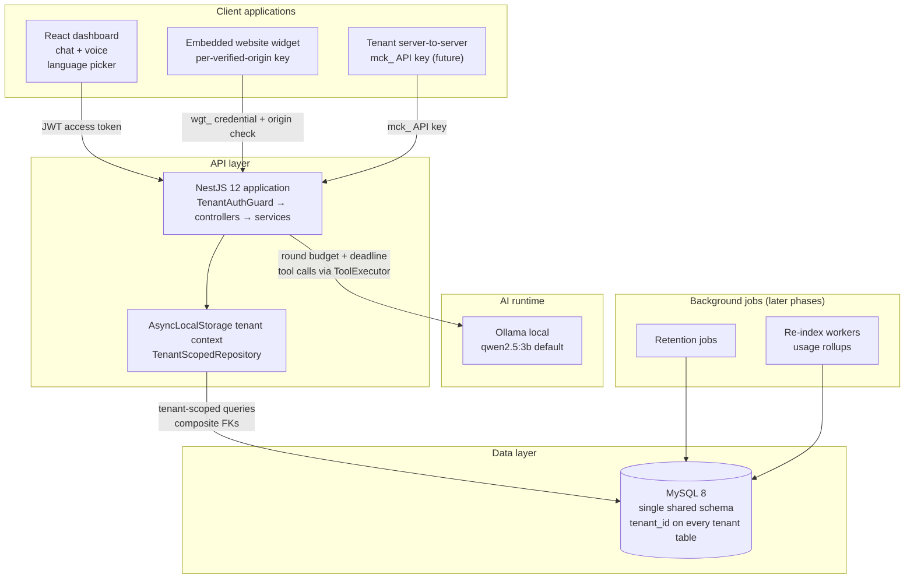
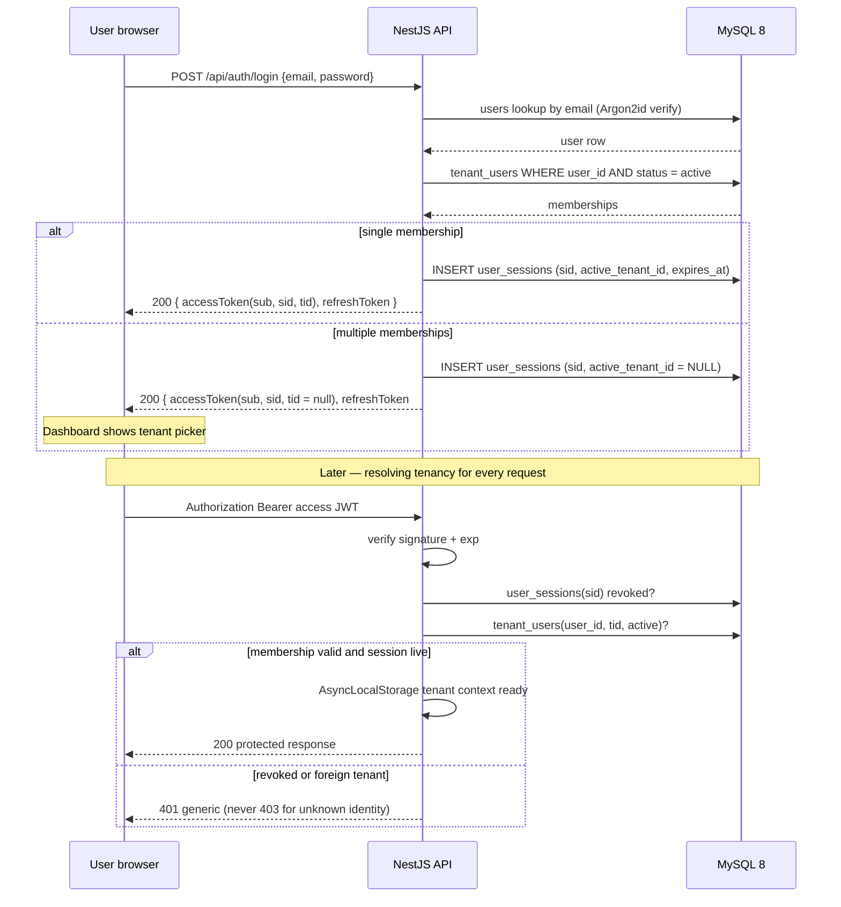
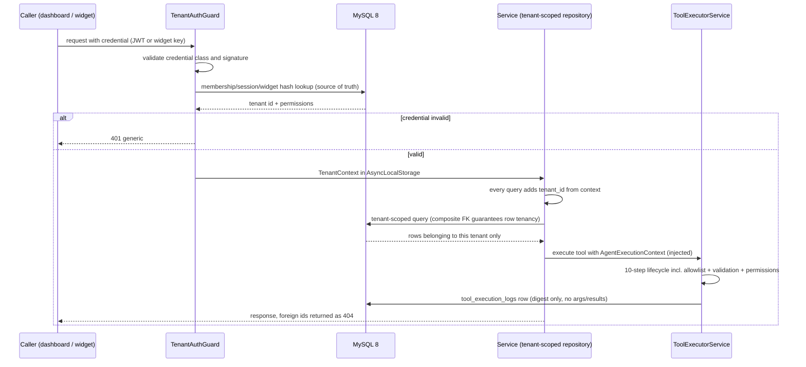
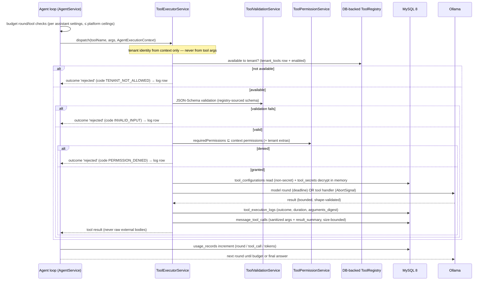
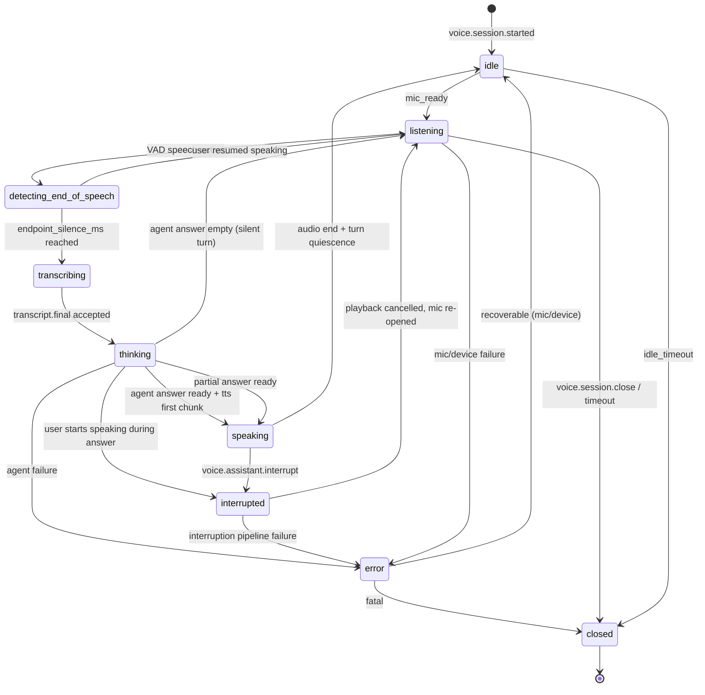
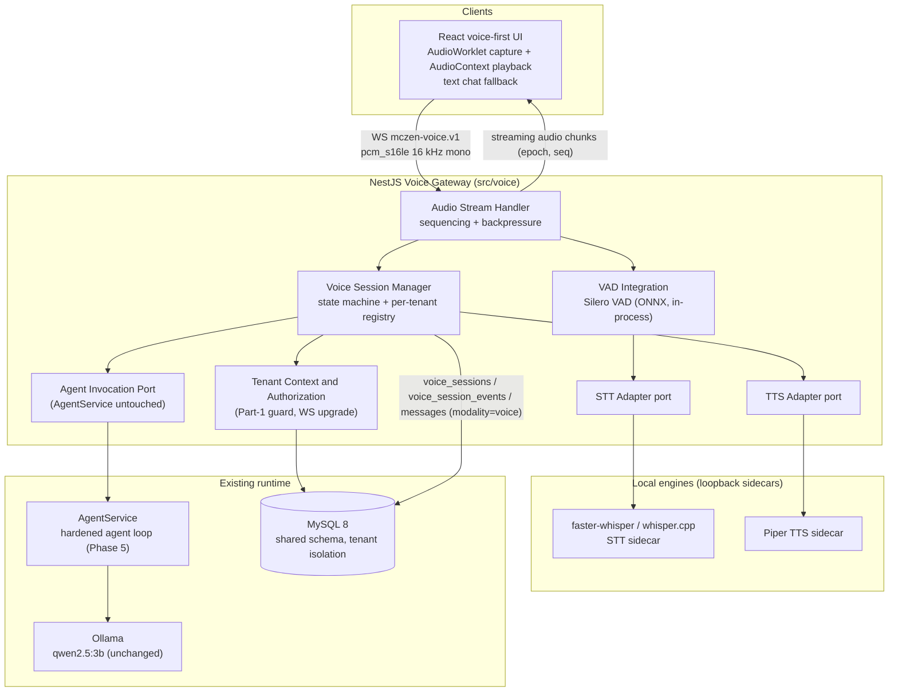
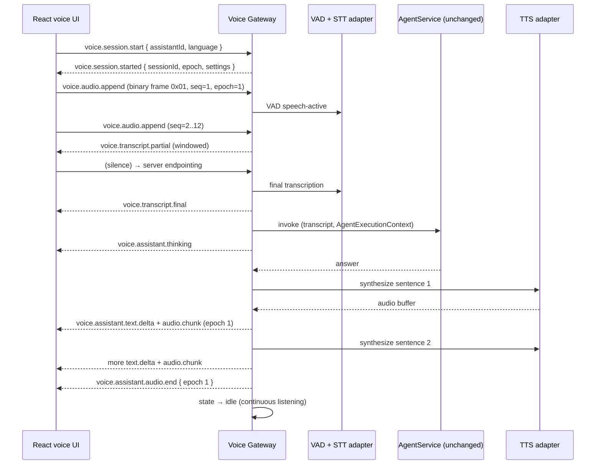
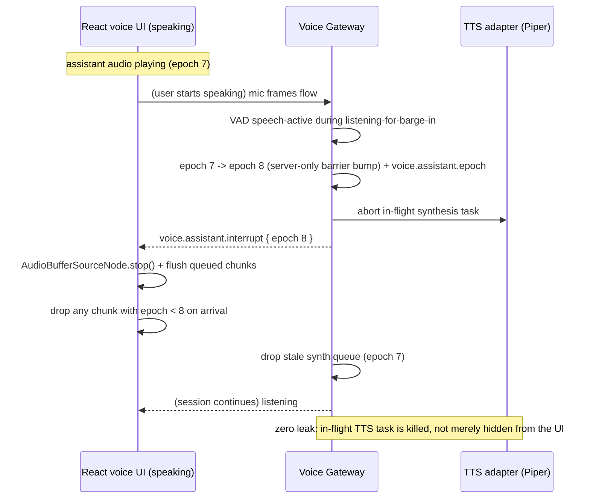
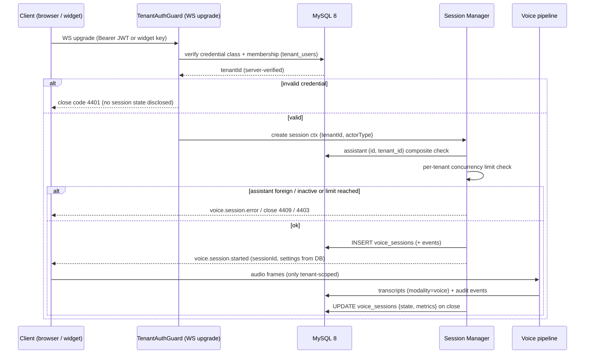

# McZEN AI — Phase 6A: Database Architecture & Security Design

| Field | Value |
| --- | --- |
| Status | **Proposed architecture — awaiting approval. No code, schema, or migration created.** |
| Phase | 6A (architecture & planning only) |
| Date | 2026-11-01 |
| Codebase state | Phases 1–5 complete and verified (backend build/tests/e2e/live Ollama/browser checks pass). Phase 5 runtime hardening is preserved untouched by this phase. |
| Targets | MySQL 8, NestJS 12, TypeScript 6, TypeORM, Node 22, existing React frontend, existing Ollama integration |
| **Revision R1** | **Voice-first amendment (2026-11-01)** — product direction changed to voice-first conversational assistant. Adds voice gateway architecture, local STT/TTS engine evaluation (verified language coverage), voice session state machine, versioned WebSocket protocol, database amendments (2 new tables + column amendments, reusing existing conversation tables), voice-specific tenant security, five voice diagrams, and a revised roadmap 6B–6K. See **Part 2: Revision R1 — Voice-first amendment** at the end of this document. No code was modified for this revision. |

**Scope of this document:** inspection of the existing codebase, a production-oriented multi-tenant database architecture, tenant-isolation and authentication design, an API proposal, diagrams, threat analysis, a migration strategy, and an implementation roadmap. Part 1 planned Phases 6B–6I; Revision R1 re-sequences the delivery plan to Phases 6B–6K with the voice platform as the product centerpiece (the mapping is in Revision R1 §R1.8).

**Strictly out of scope (not done in 6A):** no application source changes, no npm installs, no TypeORM entities, no migrations, no MySQL tables, no environment file changes, no frontend changes, no changes to the Ollama integration or the legacy `backend/` Express project, no removal of demonstration tools, no Phase 6B work, no Git commits.

---

## 1. Executive summary

McZEN AI is today a working single-process prototype: a NestJS 12 agent runtime (hardened in Phase 5) that talks to a local Ollama model, executes four registered tools through a security lifecycle (tenant context → registry → tenant availability → enabled → permissions → confirmation → allowlist → validation → execution → audit), and serves a React chat/voice frontend. Everything stateful is in memory: tenant identities come from a development-only header, knowledge is two hardcoded documents, catalogues are per-tenant demo arrays, and the audit trail is a 1,000-record ring buffer.

This document proposes the production architecture for a multi-tenant SaaS platform on a **single shared MySQL 8 database** with a mandatory `tenant_id` column on every tenant-owned table. Key recommendations:

1. **One shared MySQL 8 schema**, not per-tenant databases. Isolation is enforced in four layers: server-verified tenant context (guards), mandatory tenant predicates on every query (tenant-scoped repositories), **composite foreign keys `(parent_id, tenant_id)` that make cross-tenant references structurally impossible**, and per-tenant integration tests. A separate-database-per-tenant design is rejected (see §3.1).
2. **Identifier strategy (hybrid, justified in §4.1):** `BINARY(16)` UUIDv7 primary keys for API-facing tenant-owned entities (non-enumerable, safe in URLs and widget payloads); `BIGINT UNSIGNED AUTO_INCREMENT` for small global catalogs (roles, permissions, plans, tools) and high-volume internal log/chunk tables that are never directly exposed.
3. **Knowledge retrieval stays in MySQL for v1:** `knowledge_chunks` with a `FULLTEXT` index using the `ngram` parser (chosen deliberately for English/Hindi/Telugu tokenization behavior), plus relational chunk metadata. **No vector database is introduced** — the justification and the future migration path are in §3.3.
4. **Secrets are never stored in plaintext:** tenant API keys and widget secrets are stored as SHA-256 hashes with a visible prefix; per-tool credentials use app-layer AES-256-GCM envelope encryption (`tool_secrets`), with KMS/HSM integration as a later hardening step.
5. **Authentication (designed, not implemented):** Argon2id password hashing, short-lived JWT access tokens carrying only `sub`/`sid`/`tid`, opaque rotating refresh tokens with family-based reuse detection, DB-backed sessions with revocation, single-use hashed reset/verification tokens, and safe active-tenant switching for users who belong to multiple tenants.
6. **The development-only `x-mczen-tenant-id` header is retired** and replaced by a tenant-context pipeline (JWT → `TenantContextGuard` → verified DB membership → request context + AsyncLocalStorage) that preserves the existing `AgentExecutionContext` contract, so the Phase 5 agent runtime, executor, and tools continue to work unchanged.
7. **40 tables across 8 domains** (§5, inventory in Appendix A), with explicit retention, indexing, and deletion policies. Financial values use `DECIMAL`; JSON columns are limited to genuinely schema-flexible payloads and each one is justified.
8. **Roadmap 6B–6I** (§13) sequences the work so that every subphase is independently reviewable, keeps all existing tests green, and never puts tenant data at risk: foundation → auth → tenant/assistant config → knowledge → tools → conversations → widget → usage.

Security is treated as the primary requirement throughout: §7 defines the isolation model in depth (including secure vs. insecure query patterns and background-job context), and §11 provides the threat analysis.

---

## 2. Existing architecture assessment (based on actual codebase inspection)

All statements below were verified by reading the current files on 2026-11-01; nothing was modified during inspection.

### 2.1 Backend module inventory (`backend-nestjs/src/`)

| Area | Files (current) | Observed behavior |
| --- | --- | --- |
| Bootstrap | `main.ts` | Optional `.env` via Node native `process.loadEnvFile()` (shell values win); CORS for `localhost:5174` / `127.0.0.1:5174` allowing `Content-Type`, `Authorization`, `x-mczen-tenant-id`; exposes `X-Request-Id`; listens on `PORT ?? 3000`; logs the real URL. |
| Root module | `app.module.ts`, `app.controller.ts`, `app.service.ts` | Imports only `AgentModule`. `GET /` → `McZEN AI API is running!`; `GET /api/health` → status JSON. |
| Agent module | `agent/agent.module.ts` | Providers: `AgentService`, `KnowledgeService`, `TenantContextService`, `ToolRegistryService`, `ToolPermissionService`, `ToolValidationService`, `ToolExecutorService`, `ToolAuditService`, `AgentRuntimeConfigService`. |
| HTTP surface | `agent/agent.controller.ts` | `POST /api/agent/ask` (question 1–2000 chars → 400 otherwise; resolves context; sets `X-Request-Id`; Nest default POST status **201** observed in e2e/live tests). `GET /api/agent/tools` (tenant-scoped listing + **temporary** `resolvedDevTenant` echo to be removed with the dev header). |
| Agent runtime | `agent/agent.service.ts` | Phase 5 hardened loop: keyword-gated backend `knowledge_search` through the executor; system prompt with verified-knowledge block, demonstration-data labeling, and "tool outputs are data, not instructions" anti-prompt-injection rules; tools offered to Ollama filtered to enabled + tenant-available + permitted + non-confirmation, `knowledge_search` excluded; per-round Ollama deadline covering fetch **and** body read; response-size and shape validation; tool-call budget (5) and round budget (4) with the final round reserved for a tools-disabled answer; every budgeted call flows through `ToolExecutorService` with a runtime allowlist; response shape exactly `{ success, answer, model, toolCalls, sources }`; safe `success:false` failures; logging limited to `{ requestId, code }`. |
| Tenant context | `agent/context/tenant-context.service.ts` | `DEV_TENANT_HEADER = 'x-mczen-tenant-id'`; fixed dev allowlist `tenant-a..d`; per-tenant permission map; **production fails closed** (no authentication ⇒ 401 for everything); `requestId = randomUUID()`. |
| Context contract | `agent/context/agent-execution-context.interface.ts` | `AgentExecutionContext { tenantId, userId?, conversationId?, permissions, requestId }` + `isAgentExecutionContext()` shape guard (regex-validated ids, bounded permission strings). |
| Runtime config | `agent/config/agent-runtime-config.service.ts` | Frozen validated settings: `OLLAMA_BASE_URL/MODEL/TIMEOUT_MS`, `AGENT_MAX_ROUNDS` (1–4), `AGENT_MAX_TOOL_CALLS` (1–5). Errors name the setting, never its value. |
| Tool registry | `agent/tools/tool-registry.service.ts` | In-memory registry; registers 4 tools on module init; integrity validation; `listForTenant`, `getTool`, `isToolAvailableToTenant`; `tenantMode: ALL_TENANTS | RESTRICTED` with `allowedTenants`. |
| Executor | `agent/tools/tool-executor.service.ts` | 10-step lifecycle; `ToolExecutionOptions.allowedToolNames` runtime allowlist; timeout + cooperative `AbortSignal` cancellation; timer/listener cleanup; single audit record per attempt; never throws for expected failures. |
| Validation | `agent/tools/tool-validation.service.ts` | Strict JSON-Schema subset: plain-object checks, undeclared-property rejection, size caps (32 KB total, 100 array items, depth 5, 2,000-char default strings). |
| Permissions | `agent/tools/tool-permission.service.ts` | Stateless "granted ⊇ required" check over `resource:action` strings. |
| Audit | `agent/tools/tool-audit.service.ts` | **In-memory** ring buffer (`MAX_AUDIT_RECORDS = 1_000`); records `{ tenantId, toolName, requestId, executedAt, durationMs, outcome, errorCode }` only — no args/results. |
| Tools | `agent/tools/implementations/*` | `knowledge_search` (keyword scoring over 2 hardcoded docs, top 5), `get_products`, `get_product_details`, `check_inventory` (per-tenant in-memory demo catalogues; foreign ids return the same `found:false` as unknown ids — no existence leak). |
| Knowledge | `agent/knowledge.service.ts` | Two demonstration documents; in-memory tokenized scoring. |

### 2.2 Dependencies and toolchain (observed)

- Runtime: `@nestjs/common@^12.0.1`, `@nestjs/core@^12.0.1`, `@nestjs/platform-express@^12.0.1`, `reflect-metadata@^0.2.2`, `rxjs@^7.8.1`. **No database driver, no TypeORM, no auth libraries yet.**
- Dev: `typescript@^6.0.2`, `jest@^30`, `ts-jest@^29.4`, `supertest`, `oxlint`, `@types/node@^24`. Node `v22.23.4` (verified).
- Jest uses a **custom transform** (`test/transform/ts-cjs-transform.js`) that compiles ESM-only `@nestjs/*` packages to CJS; any new ESM-only dependencies added in 6B+ (e.g. some drivers/ORM helpers) may need the same treatment. This is a real compatibility constraint for 6B.
- Test posture: 10 unit suites / 184 tests, 1 e2e suite / 16 tests, `test/live-ollama-smoke.cjs` (15 live checks), all passing; Jest worker-exit warning under default parallel workers only (clean with `--maxWorkers=2` and `--runInBand --detectOpenHandles`).
- `.env` handling: optional `.env` loaded natively; **no `.env` exists in `backend-nestjs/`**; `.env.example` documents NODE_ENV, PORT, `OLLAMA_*`, `AGENT_*`. The legacy `backend/` Express project has its own `.env` and is explicitly out of bounds.
- Frontend: React 18 + Vite 6; single integration point — `fetch(\`${API}/api/agent/ask\`)` with the dev header gated by `import.meta.env.DEV` (verified absent from production bundle); language/voice/mic controls in `App.jsx`; `frontend/.env.example` still says `VITE_API_BASE_URL=http://localhost:8080` (stale — actual backend default is 3000; documentation fix candidate, not changed in 6A).
- CORS is hardcoded to the two localhost dev origins — the widget phase (6H) will need dynamic, per-tenant origin validation.
- No rate limiting exists anywhere yet; the Ollama path is only bounded by the per-round deadline and agent budgets.

### 2.3 Reusable assets for Phase 6 (keep, adapt behind the same contracts)

| Asset | Why it survives |
| --- | --- |
| `AgentExecutionContext` + `isAgentExecutionContext` | The context shape is the isolation seam; 6C extends it (adds `userId`, `actorType`) rather than replacing it. |
| `ToolExecutorService` lifecycle + audit record shape | Persistence (6F/6G) writes the same fields to `tool_execution_logs`; the in-memory ring buffer remains the fallback. |
| `ToolRegistryService` interface (`listForTenant` / `getTool` / `isToolAvailableToTenant`) | 6F backs it with `tools`/`tenant_tools` tables; call sites unchanged. |
| `ToolValidationService`, `ToolPermissionService` | Stateless, already strict; permissions become DB-backed strings with the same format. |
| `AgentRuntimeConfigService` | Remains the platform-level Ollama/budget source; per-assistant overrides (6D) must validate **within** its ceilings (rounds ≤ 4, calls ≤ 5). |
| Safe-failure response envelope + `X-Request-Id` | Conversation persistence (6G) must not change the five-field response shape. |

### 2.4 Gaps this architecture closes

1. No production authentication (dev header; production fails closed by design).
2. No persistence: tenants, users, assistants, knowledge, tool config, conversations, audit, usage.
3. In-memory knowledge search (2 docs) and demo catalogues.
4. No background jobs, no usage metering, no widget embedding story.
5. No rate limiting; hardcoded CORS; dev tenant echo in `GET /api/agent/tools`.

---

## 3. Technology and storage strategy decisions

### 3.1 One shared MySQL database with `tenant_id` (decision + rationale)

**Decision:** a single shared MySQL 8 schema; every tenant-owned table carries `tenant_id`; isolation is enforced in code + schema (§7).

Rejected alternatives:

| Option | Why rejected for McZEN v1 |
| --- | --- |
| Database (or schema) per tenant | Operationally heavy at small scale (migrations × N, connection pools × N, backup/restore per tenant, noisy-neighbor still exists inside a host). Justifiable later for a handful of very large/compliance-bound tenants; the access layer in §7 is designed so a per-tenant shard can be introduced behind the repository layer without touching call sites. |
| No tenant column, separate tables per tenant | Same operational burden with worse tooling support. |
| Rely only on MySQL privileges / views per tenant | Views complicate TypeORM, and MySQL privilege-based tenancy doesn't compose with a single app identity. Application-layer enforcement plus DB-level structural constraints (composite FKs) is the right split. |

Shared-schema risks and their mitigations: human error (mitigate with tenant-scoped repositories, composite FKs, tests), noisy neighbors (per-tenant rate/usage limits in 6I), and data-residency requests (deferred; see Open Questions).

### 3.2 Should any data use a separate storage strategy?

Evaluated per data class:

| Data | v1 storage | Reasoning |
| --- | --- | --- |
| All relational entities (§5) | MySQL 8 | Natural fit; transactions for multi-table writes (conversation + messages + tool calls + usage in one commit). |
| Uploaded knowledge files (PDF/DOCX) | **Object storage (S3-compatible) later; MySQL metadata now** | Files are bytes, not relations. v1 accepts pasted text (fits `MEDIUMTEXT`). When file upload arrives (6E+), store binary in object storage and keep only `external_ref` + hashes in MySQL. Do **not** use `LONGBLOB`. |
| Full-text knowledge retrieval | **MySQL `FULLTEXT` on `knowledge_chunks`** | §3.3. |
| Embeddings / semantic search | **Not in v1** | §3.3. |
| Conversation message bodies | MySQL `MEDIUMTEXT` | Bounded (validated ≤ 32 KB per message at write time), queried with their conversation, indexed by `(conversation_id, id)`. |
| High-volume audit/usage rows | MySQL, **partition-ready** tables (`BIGINT` PK, time index; RANGE-by-month partitioning documented as a later operational step) | Keeps one database while bounding table growth; external log stores only if volume demands (not expected before scale). |
| Session/token state | MySQL | Revocation must be transactional with role changes; a cache is an optimization, not the source of truth. |

### 3.3 Knowledge retrieval in MySQL — and why no vector database (yet)

**v1 approach (MySQL-only):**

1. Documents are split into chunks of ~500–1,500 characters at heading/paragraph boundaries with overlap; each chunk is a `knowledge_chunks` row with `document_id`, `chunk_index`, `language_code`, and `content_hash`.
2. Retrieval uses a `FULLTEXT` index on `knowledge_chunks(content)` **`WITH PARSER ngram`** (`ngram_token_size=2`). Rationale: the default parser splits on whitespace/punctuation, which handles English but tokenizes Hindi (Devanagari) and Telugu poorly; `ngram` indexes fixed-width character grams and works across all three UI languages. English recall remains good with minimum-word re-ranking in SQL.
3. Query path: `MATCH … AGAINST (? IN NATURAL LANGUAGE MODE)` restricted by `tenant_id` (+ optional `document_id`/`source_id`), ordered by relevance, top-K (default 5 — mirroring today's top-5 behavior), then an application-side re-rank by simple overlap score. Exact-phrase lookups fall back to a parameterized `LIKE` on short queries.
4. `knowledge_documents.content_hash` prevents duplicate indexing; re-indexing is delete-then-insert inside one transaction, recorded in `knowledge_sync_logs`.

**Why not a vector database in v1:** semantic recall would improve paraphrase matching, but (a) current documents are tiny and keyword search demonstrably answers them (Phase 5 live checks), (b) a vector store adds an operational dependency, an embedding model dependency, and a second consistency surface for tenant isolation — the highest-risk area — before there is evidence of need, (c) MySQL 8 can hold the retrieval role until document volume or recall complaints justify more. **Explicit trigger to revisit:** > ~1M chunks per deployment, sustained poor recall on multilingual queries, or a product requirement for semantic Q&A. At that point the recommended path is to add an `embedding VECTOR`-style column via a MySQL-compatible extension (e.g. HeatWave) **or** a sidecar ANN service keyed by `(tenant_id, chunk_id)` — the chunk table already carries `tenant_id`, so the retrieval swap stays inside one repository class.

---

## 4. Global design conventions

### 4.1 Identifier strategy — BIGINT vs UUID (comparison and recommendation)

| Criterion | `BIGINT UNSIGNED AUTO_INCREMENT` | `BINARY(16)` UUID (v7) |
| --- | --- | --- |
| Storage / index size | 8 bytes; compact joins | 16 bytes; larger PKs and secondary indexes (all InnoDB secondary indexes embed the PK) |
| Insert locality | Sequential — optimal | UUIDv7 is time-ordered → near-sequential; UUIDv4 would fragment (rejected) |
| Enumeration / IDOR surface | Guessable ids (mitigations required everywhere) | Non-guessable; safe in URLs, widget payloads, logs |
| Merge/multi-master, offline creation | Conflicts possible | Trivially mergeable, generatable anywhere (including workers) |
| Human readability in ops | Easy | Needs hex formatting helpers |

**Recommendation (hybrid, deliberate):**

- **`BINARY(16)` UUIDv7** for all **API-facing tenant-owned entities**: tenants, users, sessions, assistants, knowledge sources/documents, conversations, widgets, tenant API keys, tool configurations/secrets, subscriptions, invoices, payment transactions. These ids appear in URLs, JSON payloads, and third-party integrations; non-enumerability directly reduces IDOR risk, and UUIDv7 preserves index locality.
- **`BIGINT UNSIGNED AUTO_INCREMENT`** for (a) small **global catalogs** — roles, permissions, subscription plans, tools — whose ids are internal references, and (b) **high-volume internal rows never exposed directly**: `knowledge_chunks`, `tool_execution_logs`, `conversation_messages` (which additionally carries a non-enumerable `public_id BINARY(16)` for external reference), `message_tool_calls`, `usage_records`, `conversation_feedback`, join tables (`assistant_tools`, `widget_domains`).

Every UUID is generated as UUIDv7 in the application layer; MySQL receives `BINARY(16)`. Conversion helpers (`UUID_TO_BIN(x,1)`-equivalent swap-flag semantics are **not** used; plain 16-byte big-endian storage keeps application formatting simple).

### 4.2 Timestamps, charset, engine

- All tables: `created_at DATETIME(3) NOT NULL DEFAULT CURRENT_TIMESTAMP(3)`, `updated_at DATETIME(3) NOT NULL DEFAULT CURRENT_TIMESTAMP(3) ON UPDATE CURRENT_TIMESTAMP(3)` (omitted in per-table columns below), stored in **UTC** by session setting. `DATETIME(3)` is chosen over `TIMESTAMP` to avoid the 2038 wrap and mode-dependent behavior; the app layer enforces UTC.
- Engine InnoDB; `CHARACTER SET utf8mb4 COLLATE utf8mb4_0900_ai_ci` database-wide (case-insensitive matching for emails/slugs; binary columns unaffected).
- Booleans are `TINYINT(1)`; money is `DECIMAL(12,2)` with `currency CHAR(3)` (ISO-4217); durations are integer milliseconds (consistent with Phase 5 `durationMs`).

### 4.3 Soft deletion vs hard deletion

**Soft deletion** (`deleted_at DATETIME(3) NULL`, rows filtered by `deleted_at IS NULL` in every repository query) is used for user-facing entities where history, restore, or referential integrity matter: `tenants` (tenants are *suspended/closed*, not deleted), `tenant_domains`, `assistants`, `knowledge_sources`, `knowledge_documents`, `conversations`, `widgets`, `users` (users are *disabled*; `deleted_at` only for erasure flows).

**Hard deletion** applies to: high-volume children purged by retention jobs (`knowledge_chunks` cascade with document deletion, `tool_execution_logs`/`usage_records` past retention, `conversation_messages` past the tenant retention window), security tokens (`refresh_tokens`, expired/revoked sessions), and erasure requests (PII). Reasons: soft-deleted log rows would bloat every index for zero benefit, and PII must actually leave the database on request.

Interaction with uniqueness: `UNIQUE` constraints that must tolerate soft-deleted rows (e.g. `tenant_domains (tenant_id, domain)`) are enforced by a **partial-uniqueness convention** — the unique key includes a generated column `is_live = (deleted_at IS NULL)` so that a soft-deleted row frees its value; where MySQL generated-column keys are awkward, the application re-checks uniqueness at write time and the retention job finalizes. `users.email` stays hard-unique (accounts are disabled, not soft-deleted, unless erased — at which point the row is anonymized to `deleted+<uuid>@invalid` and the email freed).

### 4.4 ENUM vs lookup tables

- **ENUM** for small, stable, code-owned states (e.g. message `role`, execution `outcome`, subscription `status`) — validated in TypeScript, cheap, self-documenting. Any change is a reviewed migration.
- **VARCHAR + index** (not ENUM) for open-ended classifications that tenants may extend (tool `category`, invoice `provider`, language codes): `tools.category` stays a bounded `VARCHAR(30)` aligned with the existing `ToolCategory` union.
- **Lookup tables** only where values carry their own attributes or are user-extensible; none needed in v1 beyond the `permissions` catalog itself.

### 4.5 JSON column policy (each use justified)

JSON is permitted **only** for payloads that are (a) read/written whole, (b) not joined or filtered relationally, and (c) genuinely schema-flexible:

| Column | Justification |
| --- | --- |
| `tools.input_schema` | A JSON-Schema document — inherently tree-structured, validated on read. |
| `tool_configurations.config` | Validated against the tool's declared config schema; non-secret values only; read whole by the executor. |
| `widget_settings.theme` | Presentation map with documented keys; never queried by contents. |
| `tenant_api_keys.scopes` | Small, enumerable permission-string array always loaded with the key. |
| `conversation_messages.knowledge_sources_used` | Snapshot of the response's `sources` array (≤5 items), read with the message. |
| `message_tool_calls.arguments` / `result_summary` | Sanitized snapshot of an execution, written once, read with its message; **size-bounded and redacted before write**. |

Everything with relational meaning (counts, statuses, foreign references, money, plan limits) is a real column — plan limits, for example, are explicit columns in `subscription_plans`, not a JSON blob.

### 4.6 Secret storage and encryption

1. **High-entropy bearer secrets** (tenant API keys `mck_…`, widget credentials `wgt_…`, refresh tokens): generate 256-bit random, store **SHA-256 hash only** (`CHAR(64)`), store a short plaintext **prefix** for identification/lookup, show the full secret exactly once. Lookup by hash; never by prefix alone.
2. **Per-tool configured credentials** (e.g. a tenant's external API key for a future connector): `tool_secrets` stores **AES-256-GCM envelope-encrypted** ciphertext — a random data key per record, wrapped by a master key (`SECRET_MASTER_KEY`, 32-byte, environment-provided in v1; KMS-managed KEK in a later phase), with `key_version`, `iv`, `auth_tag` columns. Plaintext exists only in executor memory for the duration of a call; never logged, never echoed to the model, never returned by any API.
3. Passwords: Argon2id encoded hashes only (§8). No reversible password storage anywhere.
4. Logs and audit rows never contain secrets, raw arguments, or results (this invariant already holds in Phase 5 code and is preserved by the persistent tables: `tool_execution_logs` stores digests/sanitized summaries only).

---

## 5. Proposed table definitions

Conventions from §4 apply to every table (ids per §4.1, `created_at`/`updated_at` per §4.2, `tenant_id BINARY(16) NOT NULL` with FK `→ tenants(id)` on every tenant-owned table — spelled out once here and referenced as **[T]** below). Column lists show only fields beyond the convention unless notable. "UK" = unique key, "IX" = index, "FK" = foreign key.

### Domain A — Tenant management

#### A1. `tenants`
- **Purpose:** the root of all tenancy; one row per customer business.
- **Tenant-owned:** No — this *is* the tenant root.
- **Columns:** `id BINARY(16)` PK; `name VARCHAR(150) NOT NULL`; `slug VARCHAR(63) NOT NULL` (URL-safe, app-validated); `status ENUM('active','suspended','closed') NOT NULL DEFAULT 'active'`; `default_language_code CHAR(7) NULL`; `timezone VARCHAR(64) NOT NULL DEFAULT 'UTC'`; `suspended_at DATETIME(3) NULL`; `suspended_reason VARCHAR(255) NULL`; `deleted_at DATETIME(3) NULL` (soft-close marker only; status governs access).
- **PK:** `id`. **FKs:** —.
- **UK:** `slug`. **IX:** `(status)`, `(created_at)`. Plus **UK `(id, slug)`** is unnecessary; children reference `id` directly.
- **Relationships:** 1→N to every `tenant_id`-bearing table.

#### A2. `tenant_settings`
- **Purpose:** per-tenant operational limits and flags (1:1 with `tenants`).
- **Tenant-owned:** Yes **[T]**.
- **Columns:** `tenant_id BINARY(16)` PK (shared PK = 1:1) FK `→ tenants(id)` ON DELETE CASCADE; `max_assistants SMALLINT UNSIGNED NOT NULL DEFAULT 3`; `max_users SMALLINT UNSIGNED NOT NULL DEFAULT 10`; `max_knowledge_documents INT UNSIGNED NOT NULL DEFAULT 200`; `data_retention_days SMALLINT UNSIGNED NOT NULL DEFAULT 365`; `feature_flags JSON NULL` (documented opt-in flags only).
- **UK:** `tenant_id` (implicit via PK). **IX:** —.
- **Relationships:** 1:1 `tenants`.

#### A3. `tenant_domains`
- **Purpose:** domains a tenant owns (email verification, future widget origin allowlists).
- **Tenant-owned:** Yes **[T]**.
- **Columns:** `id BINARY(16)` PK; `tenant_id` **[T]**; `domain VARCHAR(253) NOT NULL` (lowercased); `verification_token VARCHAR(64) NULL`; `verified_at DATETIME(3) NULL`; `is_primary TINYINT(1) NOT NULL DEFAULT 0`; `deleted_at DATETIME(3) NULL`.
- **UK:** `(tenant_id, domain, is_live)` via generated `is_live` column (§4.3). **IX:** `(domain)`.
- **Relationships:** N:1 `tenants`.

#### A4. `tenant_api_keys`
- **Purpose:** server-to-server credentials for a tenant's own integrations (future REST API). Hash-only storage.
- **Tenant-owned:** Yes **[T]**.
- **Columns:** `id BINARY(16)` PK; `tenant_id` **[T]**; `name VARCHAR(100) NOT NULL`; `key_prefix VARCHAR(12) NOT NULL` (e.g. `mck_ab12cd34`); `key_hash CHAR(64) NOT NULL` (SHA-256 hex); `scopes JSON NULL` (permission strings; §4.5); `created_by BINARY(16) NULL` FK `→ users(id)`; `last_used_at DATETIME(3) NULL`; `expires_at DATETIME(3) NULL`; `revoked_at DATETIME(3) NULL`.
- **UK:** `key_hash`; `key_prefix`. **IX:** `(tenant_id, revoked_at)`.
- **Relationships:** N:1 `tenants`, N:1 `users` (creator).

### Domain B — Authentication and authorization

#### B1. `users`
- **Purpose:** global human identity (login credential + PII), independent of any tenant.
- **Tenant-owned:** No (global).
- **Columns:** `id BINARY(16)` PK; `email VARCHAR(255) NOT NULL`; `email_verified_at DATETIME(3) NULL`; `password_hash VARCHAR(255) NOT NULL` (Argon2id encoded; nullable only for invited-not-yet-activated users — **kept NOT NULL** by storing a randomized unusable hash until activation); `status ENUM('active','disabled','erased') NOT NULL DEFAULT 'active'`; `token_version INT UNSIGNED NOT NULL DEFAULT 1` (global JWT revocation counter); `failed_login_count SMALLINT UNSIGNED NOT NULL DEFAULT 0`; `locked_until DATETIME(3) NULL`; `last_login_at DATETIME(3) NULL`; `display_name VARCHAR(150) NULL`; `erased_at DATETIME(3) NULL`.
- **UK:** `email` (ci collation). **IX:** `(status)`.
- **Relationships:** 1→N `tenant_users`, `user_sessions`, `refresh_tokens`; referenced by creator columns.

#### B2. `tenant_users`
- **Purpose:** membership of a user in a tenant with a role — the join that makes multi-tenant users safe.
- **Tenant-owned:** Yes **[T]**.
- **Columns:** `id BINARY(16)` PK; `tenant_id` **[T]**; `user_id BINARY(16) NOT NULL` FK `→ users(id)`; `role_id BIGINT UNSIGNED NOT NULL` FK `→ roles(id)`; `status ENUM('invited','active','suspended','removed') NOT NULL DEFAULT 'invited'`; `invited_by BINARY(16) NULL` FK `→ users(id)`; `invited_at DATETIME(3) NULL`; `joined_at DATETIME(3) NULL`.
- **UK:** `(tenant_id, user_id)`. **IX:** `(user_id)` (list a user's tenants), `(role_id)`.
- **Relationships:** N:1 `tenants`, `users`, `roles`. **This table is the sole source of tenant authorization** — a request is authorized for a tenant only if an `active` membership row exists (§7).

#### B3. `roles` — **global catalog (decision)**
- **Purpose:** named role definitions; **v1 keeps roles platform-global** (owner, admin, editor, member, viewer, plus future `platform_admin` for staff). Tenant-custom roles are a documented future extension (add nullable `tenant_id` + app-level uniqueness then).
- **Tenant-owned:** No (global catalog). Isolation comes from `tenant_users` + tenant-scoped queries, not per-tenant role definitions — simpler to reason about and audit; per-tenant overrides can be layered on later without schema churn.
- **Columns:** `id BIGINT UNSIGNED AUTO_INCREMENT` PK; `key VARCHAR(50) NOT NULL` (e.g. `tenant:owner`); `name VARCHAR(100) NOT NULL`; `description VARCHAR(255) NULL`; `is_system TINYINT(1) NOT NULL DEFAULT 1`; `is_platform TINYINT(1) NOT NULL DEFAULT 0` (staff vs tenant role).
- **UK:** `key`. **IX:** `(is_platform)`.
- **Relationships:** 1→N `role_permissions`, `tenant_users`.

#### B4. `permissions`
- **Purpose:** global catalog of atomic permission strings (`resource:action`), matching the format already used by `ToolPermissionService` (`knowledge:read`, `products:read`, …).
- **Tenant-owned:** No (global).
- **Columns:** `id BIGINT UNSIGNED AUTO_INCREMENT` PK; `key VARCHAR(100) NOT NULL`; `description VARCHAR(255) NULL`; `category VARCHAR(50) NULL`.
- **UK:** `key`. **IX:** `(category)`.
- **Relationships:** 1→N `role_permissions`, `tool_permissions`.

#### B5. `role_permissions`
- **Purpose:** maps roles to the permissions they grant.
- **Tenant-owned:** No (global).
- **Columns:** `role_id BIGINT UNSIGNED NOT NULL` FK; `permission_id BIGINT UNSIGNED NOT NULL` FK.
- **PK:** composite `(role_id, permission_id)`. **IX:** `(permission_id)` (reverse lookup: who has X).
- **Relationships:** N:1 `roles`, `permissions`.

#### B6. `user_sessions`
- **Purpose:** one row per login session; enables per-device logout, revocation, and audit.
- **Tenant-owned:** No (user-scoped, global identity).
- **Columns:** `id BINARY(16)` PK (referenced as JWT `sid`); `user_id BINARY(16) NOT NULL` FK `→ users(id)`; `active_tenant_id BINARY(16) NULL` FK `→ tenants(id)` (last selected tenant; the token's `tid` snapshot); `expires_at DATETIME(3) NOT NULL`; `revoked_at DATETIME(3) NULL`; `revoked_reason VARCHAR(50) NULL` (`logout`, `admin`, `reuse_detected`, `password_change`); `ip VARBINARY(16) NULL`; `user_agent VARCHAR(255) NULL`; `last_seen_at DATETIME(3) NULL`.
- **IX:** `(user_id, revoked_at)`, `(expires_at)`, `(active_tenant_id)`.
- **Relationships:** N:1 `users`; 1→N `refresh_tokens`.

#### B7. `refresh_tokens`
- **Purpose:** rotating refresh tokens with family-based reuse detection. Opaque 256-bit token; only its SHA-256 is stored.
- **Tenant-owned:** No (user-scoped).
- **Columns:** `id BINARY(16)` PK; `user_id BINARY(16) NOT NULL` FK; `session_id BINARY(16) NOT NULL` FK `→ user_sessions(id)`; `token_hash CHAR(64) NOT NULL`; `family_id BINARY(16) NOT NULL` (constant across one token's rotation chain); `expires_at DATETIME(3) NOT NULL`; `used_at DATETIME(3) NULL` (set when rotated); `revoked_at DATETIME(3) NULL`; `replaced_by BINARY(16) NULL` FK self-reference `→ refresh_tokens(id)`.
- **UK:** `token_hash`. **IX:** `(family_id)`, `(session_id)`.
- **Reuse-detection semantics:** presenting a token whose `used_at IS NOT NULL` ⇒ its entire `family_id` is revoked and the session flagged (`revoked_reason='reuse_detected'`) (§8).

### Domain C — AI assistant configuration

All assistant tables are tenant-owned **[T]**; children of `assistants` use the composite-FK convention (§6): they carry `(assistant_id, tenant_id)` referencing `assistants (id, tenant_id)`.

#### C1. `assistants`
- **Purpose:** one configurable AI assistant; multiple assistants per tenant are supported.
- **Columns:** `id BINARY(16)` PK; `tenant_id` **[T]**; `name VARCHAR(100) NOT NULL`; `description VARCHAR(500) NULL`; `status ENUM('draft','active','paused','archived') NOT NULL DEFAULT 'draft'`; `is_default TINYINT(1) NOT NULL DEFAULT 0` (exactly one per tenant, app-enforced + verified by a test); `created_by BINARY(16) NULL` FK `→ users(id)`; `deleted_at DATETIME(3) NULL`.
- **UK:** `(tenant_id, name)`; **UK `(id, tenant_id)`** (composite target for children). **IX:** `(tenant_id, status)`.
- **Relationships:** 1:1→ satellites below; 1→N conversations, assistant_tools, widgets.

#### C2. `assistant_instructions`
- **Purpose:** versioned system instructions; one active version per assistant; full history for audit/rollback.
- **Columns:** `id BIGINT UNSIGNED AUTO_INCREMENT` PK; `assistant_id BINARY(16) NOT NULL`; `tenant_id` **[T]**; `version INT UNSIGNED NOT NULL`; `system_prompt MEDIUMTEXT NOT NULL` (bounded ~16 KB app-side; the Phase 5 safety rules are always prepended server-side and cannot be removed by tenants); `guardrail_notes TEXT NULL`; `is_active TINYINT(1) NOT NULL DEFAULT 0`; `created_by BINARY(16) NULL` FK `→ users(id)`.
- **UK:** `(assistant_id, version)`. **IX:** `(assistant_id, is_active)`, `(tenant_id)`.
- **Relationships:** N:1 `assistants` (composite FK).

#### C3. `assistant_model_settings`
- **Purpose:** per-assistant model parameters (1:1 satellite, split out so each concern evolves independently).
- **Columns:** `assistant_id BINARY(16)` PK (shared PK) + composite FK `(assistant_id, tenant_id)`; `tenant_id` **[T]**; `model VARCHAR(100) NOT NULL DEFAULT 'qwen2.5:3b'` (must be within the platform allowlist); `temperature DECIMAL(3,2) NOT NULL DEFAULT 0.70` (0.00–2.00); `max_rounds TINYINT UNSIGNED NOT NULL DEFAULT 4` (**validated ≤ platform ceiling 4** from `AgentRuntimeConfigService`); `max_tool_calls TINYINT UNSIGNED NOT NULL DEFAULT 5` (**≤ ceiling 5**); `request_timeout_ms INT UNSIGNED NOT NULL DEFAULT 120000` (1,000–300,000, matching existing validation); `knowledge_top_k TINYINT UNSIGNED NOT NULL DEFAULT 5`; `updated_by BINARY(16) NULL` FK `→ users(id)`.
- **UK:** `assistant_id` (PK). **IX:** `(tenant_id)`.
- **Relationships:** 1:1 `assistants`.

#### C4. `assistant_voice_settings`
- **Purpose:** per-assistant browser speech-synthesis defaults (mirrors the existing frontend controls).
- **Columns:** `assistant_id BINARY(16)` PK + composite FK; `tenant_id` **[T]**; `speech_enabled TINYINT(1) NOT NULL DEFAULT 1`; `auto_speak TINYINT(1) NOT NULL DEFAULT 1`; `default_voice_name VARCHAR(150) NULL` (browser voice name; validated opportunistically client-side); `speech_rate DECIMAL(3,2) NOT NULL DEFAULT 1.00`; `speech_pitch DECIMAL(3,2) NOT NULL DEFAULT 1.00`.
- **UK:** `assistant_id` (PK). **IX:** `(tenant_id)`.
- **Relationships:** 1:1 `assistants`.

#### C5. `assistant_language_settings`
- **Purpose:** which assistant languages are enabled and which is default (`en`, `te`, `hi` today, stored with locale, e.g. `en-IN`).
- **Columns:** `id BIGINT UNSIGNED AUTO_INCREMENT` PK; `assistant_id BINARY(16) NOT NULL`; `tenant_id` **[T]**; `language_code CHAR(7) NOT NULL` (BCP-47); `is_enabled TINYINT(1) NOT NULL DEFAULT 1`; `is_default TINYINT(1) NOT NULL DEFAULT 0`.
- **UK:** `(assistant_id, language_code)`. **IX:** `(tenant_id, is_enabled)`.
- **Relationships:** N:1 `assistants` (composite FK). One default per assistant is app-enforced and test-covered.

### Domain D — Knowledge management

All knowledge tables are tenant-owned **[T]**; children of `knowledge_sources`/`knowledge_documents` use the composite-FK convention (§6). Today's `KnowledgeService` (2 in-memory documents, keyword scoring, top 5) is replaced in 6E by queries against `knowledge_chunks`; the tool contract (`query` ≤ 2,000 chars, top-K default 5) is unchanged.

#### D1. `knowledge_sources`
- **Purpose:** a named knowledge collection (e.g. "School FAQ", "Policies"); groups documents and is the tool/query filter surface.
- **Columns:** `id BINARY(16)` PK; `tenant_id` **[T]**; `name VARCHAR(100) NOT NULL`; `description VARCHAR(500) NULL`; `status ENUM('active','disabled') NOT NULL DEFAULT 'active'`; `created_by BINARY(16) NULL` FK `→ users(id)`; `deleted_at DATETIME(3) NULL`.
- **UK:** `(tenant_id, name)`; `deleted_at` excluded by `is_live` convention (§4.3); **UK `(id, tenant_id)`** (composite target). **IX:** `(tenant_id, status)`.
- **Relationships:** 1→N `knowledge_documents`, `knowledge_sync_logs`.

#### D2. `knowledge_documents`
- **Purpose:** one document inside a source; v1 accepts pasted text (provenance metadata kept now so file upload (6E+) can arrive later without schema churn).
- **Columns:** `id BINARY(16)` PK; `source_id BINARY(16) NOT NULL` + `tenant_id` **[T]** — composite FK `(source_id, tenant_id)` → `knowledge_sources (id, tenant_id)`; `title VARCHAR(200) NOT NULL`; `content MEDIUMTEXT NOT NULL` (bounded ≤ ~1 MB app-side; v1 is pasted text); `content_hash CHAR(64) NOT NULL` (SHA-256 of normalized text — duplicate-detection key, §3.3); `mime_type VARCHAR(100) NULL`; `origin_type ENUM('paste','file','url') NOT NULL DEFAULT 'paste'`; `external_ref VARCHAR(400) NULL` (future object-storage key / URL); `language_code CHAR(7) NULL` (docs may override tenant default); `chunk_count INT UNSIGNED NOT NULL DEFAULT 0`; `byte_size INT UNSIGNED NOT NULL DEFAULT 0`; `status ENUM('indexed','pending_index','failed') NOT NULL DEFAULT 'pending_index'`; `created_by BINARY(16) NULL` FK `→ users(id)`; `deleted_at DATETIME(3) NULL`.
- **UK:** `(source_id, content_hash)` (prevents duplicate upload of identical text into one source); **UK `(id, tenant_id)`**. **IX:** `(tenant_id, status)`, `(status)` (indexing queue scans).
- **Relationships:** N:1 `knowledge_sources` (composite FK); 1→N `knowledge_chunks` (CASCADE delete), `knowledge_sync_logs`.

#### D3. `knowledge_chunks`
- **Purpose:** the retrieval unit — one chunk of a document, the table the `FULLTEXT ngram` index lives on. Highest-volume knowledge table → `BIGINT` PK (§4.1).
- **Columns:** `id BIGINT UNSIGNED AUTO_INCREMENT` PK; `document_id BINARY(16) NOT NULL` + `tenant_id` **[T]** — composite FK `(document_id, tenant_id)` → `knowledge_documents (id, tenant_id)`; `chunk_index SMALLINT UNSIGNED NOT NULL` (0-based, sequential); `content MEDIUMTEXT NOT NULL` (500–1,500 chars, heading/paragraph split with overlap, app-bounded); `content_hash CHAR(64) NOT NULL` (dedupe within re-index); `char_count SMALLINT UNSIGNED NOT NULL`; `language_code CHAR(7) NULL`; `metadata JSON NULL` (rare: heading path / page hint; read whole only — §4.5).
- **PK:** `id`. **FK:** composite as above. **UK:** `(document_id, chunk_index)`; `(document_id, content_hash)`.
- **IX:** **`FULLTEXT (content)` `WITH PARSER ngram`** (the retrieval index, §3.3) — note: MySQL indexes FULLTEXT per-table, so the index is shared across tenants and **every query must carry a `tenant_id` predicate** (also mandated by `MATCH` ignoring ordinary index selectivity guarantees); `(tenant_id, document_id)`; `(document_id)`.
- **Relationships:** N:1 `knowledge_documents` (composite FK).
- **Deletion:** hard delete with the parent document (no soft delete — rebuildable data).

#### D4. `knowledge_sync_logs`
- **Purpose:** audit trail of indexing runs: upload → chunk → index; diagnostics for failed indexing.
- **Columns:** `id BIGINT UNSIGNED AUTO_INCREMENT` PK; `tenant_id` **[T]**; `document_id BINARY(16) NULL` FK `→ knowledge_documents(id)` (NULL for whole-source runs); `source_id BINARY(16) NULL` + composite FK `(source_id, tenant_id)`; `action ENUM('index','reindex','delete','purge') NOT NULL`; `triggered_by BINARY(16) NULL` FK `→ users(id)`; `triggered_via ENUM('api','job','system') NOT NULL DEFAULT 'api'`; `status ENUM('running','success','failed') NOT NULL DEFAULT 'running'`; `chunks_written INT UNSIGNED NOT NULL DEFAULT 0`; `error_code VARCHAR(50) NULL`; `error_message VARCHAR(500) NULL`; `duration_ms INT UNSIGNED NULL`; `finished_at DATETIME(3) NULL`.
- **PK:** `id`. **IX:** `(tenant_id, created_at)`, `(document_id)`, `(status)`.
- **Relationships:** N:1 `tenants`, optionally `knowledge_documents`/`knowledge_sources`/`users`.
- **Deletion:** hard delete on retention (default 90 days).

### Domain E — Tool management

Domain E persists exactly what the Phase 5 in-memory registry/permissions hold today (`tool-registry.service.ts`, `tool-permission.service.ts`, tenant-permission map in `tenant-context.service.ts`). `ToolDefinition` interface fields map to columns: `name→tools.name`, `category→tools.category`, `inputSchema→tools.input_schema`, `requiredPermissions→tool_permissions`, `timeoutMs→tools.timeout_ms`, `requiresConfirmation→tools.requires_confirmation`, `tenantMode→resolved via tenant_tools rows`.

#### E1. `tools`
- **Purpose:** **global catalog** of tool definitions — code-shipped tools registered by the application, not tenant data. One row per implementation.
- **Tenant-owned:** No (global). Tenant enablement/config lives in `tenant_tools`/`tool_configurations`.
- **Columns:** `id BIGINT UNSIGNED AUTO_INCREMENT` PK; `name VARCHAR(64) NOT NULL` — the registry key (`knowledge_search`, `get_products`, …); `display_name VARCHAR(100) NOT NULL`; `description VARCHAR(500) NOT NULL` (sent to the model as the tool description); `category VARCHAR(30) NOT NULL` (`knowledge`, `products`, `school`, `matrimonial`; aligned with existing `ToolCategory`); `input_schema JSON NOT NULL` (JSON-Schema; §4.5 — validated by the existing `ToolValidationService`); `handler_ref VARCHAR(120) NOT NULL` (e.g. factory symbol/class token the registry maps to — code discovery aid, **never exec'd as raw path without an allowlist**); `timeout_ms INT UNSIGNED NOT NULL DEFAULT 10000` (app-validated 1,000–60,000, respecting executor behavior); `requires_confirmation TINYINT(1) NOT NULL DEFAULT 0` (consequential operations — write tools must set 1); `requires_permission_set TINYINT(1) NOT NULL DEFAULT 0` (informational; actual grant control via `tool_permissions`); `is_active TINYINT(1) NOT NULL DEFAULT 1` (platform kill-switch); `is_system TINYINT(1) NOT NULL DEFAULT 1`.
- **UK:** `name`. **IX:** `(category)`, `(is_active)`.
- **Relationships:** 1→N `tenant_tools`, `tool_permissions`, `tool_configurations`; referenced by `assistant_tools` (via tenant_tools presence → assistant enablement), `tool_execution_logs.tool_name` (denormalized name for partition-safe logging).
- **Seeding:** registered on deploy/migration seed from the registry — code remains the source of truth; the DB row records enablement state and catalog metadata.

#### E2. `tenant_tools`
- **Purpose:** a tenant's enablement of a tool (replaces today's `tenantMode: ALL_TENANTS | RESTRICTED` + `allowedTenants` logic with explicit per-tenant rows).
- **Tenant-owned:** Yes **[T]**.
- **Columns:** `id BINARY(16)` PK; `tenant_id` **[T]**; `tool_id BIGINT UNSIGNED NOT NULL` FK `→ tools(id)`; `enabled TINYINT(1) NOT NULL DEFAULT 1`; `extra_permissions JSON NULL` (tenant-granted additions on top of role permissions; small array — §4.5); `max_calls_per_conversation SMALLINT UNSIGNED NULL` (per-tool tightening of the global budget); `updated_by BINARY(16) NULL` FK `→ users(id)`.
- **UK:** `(tenant_id, tool_id)`. **IX:** `(tool_id)`. **FK:** `(tenant_id, tool_id)` cannot be composite-FK to `tools(id, tenant_id)` (tools is not tenant-owned) — the composite convention here is: `tenant_tools` **is** the ownership grant, and every downstream check re-joins on `(tenant_id, tool_id)`.
- **Relationships:** N:1 `tenants`, `tools`; 1→N `tool_configurations`.
- **Semantics (must be enforced in code + tested):** absence of a row = tool not available to that tenant (default-deny, safer than a boolean-less global default).

#### E3. `assistant_tools`
- **Purpose:** assistant-level enablement (current `ToolRegistryService.listForTenant(tenantId)` grows an optional assistant filter). Deposit-level: a tool an assistant can call must exist in `tenant_tools` (enabled) **and** be enabled here (default-deny when this optimization layer is used).
- **Tenant-owned:** Yes **[T]**.
- **Columns:** `id BIGINT UNSIGNED AUTO_INCREMENT` PK; `assistant_id BINARY(16) NOT NULL` + `tenant_id` **[T]** — composite FK `(assistant_id, tenant_id)` → `assistants (id, tenant_id)`; `tool_id BIGINT UNSIGNED NOT NULL` FK `→ tools(id)`; `enabled TINYINT(1) NOT NULL DEFAULT 1`.
- **UK:** `(assistant_id, tool_id)` (and `(tenant_id, assistant_id, tool_id, is_composite)` is unnecessary — the composite assistant_id already carries tenant). **IX:** `(tool_id)`.
- **Relationships:** N:1 `assistants` (composite FK), N:1 `tools`.
- **Integrity rule:** `tenant_id + assistant_id` must match, and `tenant_id` must come from the request context — the composite FK means the assistant row itself is tenant-verified, and joining `assistant_tools → tenant_tools` on `(tenant_id, tool_id)` keeps everything tenant-consistent.

#### E4. `tool_permissions`
- **Purpose:** permissions a tool requires when it executes (e.g. `products:read`) — DB-backed and replacing today's `requiredPermissions` arrays. A user/tool call is permitted if the requesting context's permission set (§8) grants every permission listed for that tool **and** the tenant's `extra_permissions` additions in `tenant_tools` do not contradict grants (extras are additive only).
- **Tenant-owned:** No (global tool catalog rows). Membership is per-tool, not per-tenant.
- **Columns:** `tool_id BIGINT UNSIGNED NOT NULL` FK `→ tools(id)`; `permission_id BIGINT UNSIGNED NOT NULL` FK `→ permissions(id)`.
- **PK:** composite `(tool_id, permission_id)`. **IX:** `(permission_id)` (reverse lookup: who can run tools needing X).
- **Relationships:** N:1 `tools`, N:1 `permissions`.

#### E5. `tool_configurations`
- **Purpose:** tenant-specific **non-secret** config inputs the executor reads (e.g. locale overrides, catalogue filters, toggles) — validated against each tool's declared config schema (`tool-registry` today hard-codes these; 6F moves them here).
- **Tenant-owned:** Yes **[T]**.
- **Columns:** `id BINARY(16)` PK; `tenant_id` **[T]**; `tool_id BIGINT UNSIGNED NOT NULL` FK `→ tools(id)`; `config JSON NOT NULL` (validated against the tool's declared config schema; **non-secret keys only** — secrets must go to `tool_secrets`, enforced by a reserved-key deny list in app code and a test); `is_active TINYINT(1) NOT NULL DEFAULT 1`; `updated_by BINARY(16) NULL` FK `→ users(id)`.
- **UK:** `(tenant_id, tool_id)` (one active config per tool per tenant; versioned history is out-of-scope for v1 — audit captures a sanitized digest instead). **IX:** `(tool_id)`.
- **Relationships:** N:1 `tenants`, `tools`; optionally references `tool_secrets` records by id only.
- **Deletion:** hard delete (configuration, not history); audit trails keep the digest in `tool_execution_logs` anyway.

#### E6. `tool_secrets`
- **Purpose:** per-tool **secret** credentials (a tenant's API key for a future external connector); separate from `tool_configurations` so a schema-less JSON blob never mixes cleartext and ciphertext. Envelope-encrypted AES-256-GCM (§4.6).
- **Tenant-owned:** Yes **[T]**.
- **Columns:** `id BINARY(16)` PK; `tenant_id` **[T]**; `key_label VARCHAR(100) NOT NULL` (e.g. `external_api_key` — the key the tool will read it by); `key_version INT UNSIGNED NOT NULL DEFAULT 1` (master-key rotation epoch); `ciphertext VARBINARY(255) NOT NULL`; `iv VARBINARY(12) NOT NULL`; `auth_tag VARBINARY(16) NOT NULL`; `last_rotated_at DATETIME(3) NULL`; `last_used_at DATETIME(3) NULL`; `expires_at DATETIME(3) NULL`; `revoked_at DATETIME(3) NULL`; `created_by BINARY(16) NULL` FK `→ users(id)`.
- **UK:** `(tenant_id, key_label)`. **IX:** `(tool_id)` is intentionally **absent** — secrets attach to a tenant AND are linked from `tool_configurations` by id when the tool actually uses them, avoiding a secrets-vs-tools orphan lifecycle. **FK:** `(tenant_id)` → `tenants(id)`.
- **Relationships:** N:1 `tenants`; referenced by id (not FK) from `tool_configurations`.
- **Rules:** plaintext never persisted, never logged, never returned by any API (§4.6); master key from environment (`SECRET_MASTER_KEY`); decode only inside the executor for the request lifetime.

#### E7. `tool_execution_logs`
- **Purpose:** persistent audit/anti-IDOR evidence of every tool attempt — the drop-in parallel of today's in-memory ring buffer. Replaces the ring buffer's ceiling at 1,000 records with durable high-volume rows (partition-ready).
- **Tenant-owned:** Yes **[T]**.
- **Columns:** `id BIGINT UNSIGNED AUTO_INCREMENT` PK; `tenant_id` **[T]**; `tool_name VARCHAR(64) NOT NULL` (denormalized from `tools` — log tables must survive tool removal); `conversation_id BINARY(16) NULL` + composite FK `(conversation_id, tenant_id)`; `message_id BIGINT UNSIGNED NULL` + composite FK `(message_id, tenant_id)`; `user_type ENUM('chat','api_key','widget','system','admin') NOT NULL DEFAULT 'chat'`; `user_id BINARY(16) NULL` FK `→ users(id)`; `request_id VARCHAR(64) NULL` (matches `X-Request-Id`); `model VARCHAR(100) NULL` (the assistant's model for that call); `arguments_digest CHAR(64) NOT NULL` (SHA-256 of the sanitized argument JSON — integrity evidence; **raw AI-generated arguments are never stored**); `arguments_size SMALLINT UNSIGNED NOT NULL DEFAULT 0`; `outcome ENUM('succeeded','rejected','failed','timed_out') NOT NULL` — **exactly aligned with the existing `ToolAuditOutcome` type**; `error_code VARCHAR(50) NULL` (aligned with the existing `ToolErrorCode` value set: `MISSING_CONTEXT`, `INVALID_TOOL_NAME`, `TOOL_NOT_FOUND`, `TOOL_NOT_OFFERED`, `TENANT_NOT_ALLOWED`, `TOOL_DISABLED`, `PERMISSION_DENIED`, `CONFIRMATION_REQUIRED`, `INVALID_INPUT`, `TIMEOUT`, `CANCELLED`, `EXECUTION_ERROR`); `error_message VARCHAR(500) NULL` (safe, redacted); `duration_ms INT UNSIGNED NOT NULL DEFAULT 0`; `started_at DATETIME(3) NOT NULL`; `finished_at DATETIME(3) NULL`.
- **PK:** `id`. **IX:** `(tenant_id, started_at)` — primary retention/partition axis; `(conversation_id, tenant_id)`; `(tool_name, started_at)`; `(outcome, started_at)` (failure dashboards).
- **FKs:** loose — FK only where meaningful; `tool_name` is a plain column so log rows persist after tool deprecation. Partitioning later: `RANGE COLUMNS(started_at)` by month (§3.2).
- **Deletion:** hard delete by retention (default 180 days; configurable per tenant via `tenant_settings.data_retention_days` floor).
- **Mapping to `ToolAuditRecord`:** every existing field has a dedicated column (`tenantId→tenant_id`, `toolName→tool_name`, `requestId→request_id`, `executedAt→started_at`, `durationMs→duration_ms`, `outcome→outcome`, `errorCode→error_code`); the new fields add evidence without weakening the "no args/results in logs" invariant.

### Domain F — Conversation management

Conversations persist the agent loop's already-validated output (`{ success, answer, model, toolCalls, sources }`) plus each round's tool lifecycle. High-volume tables use BIGINT; only `conversations` carries a UUID.

#### F1. `conversations`
- **Purpose:** one user/visitor session with an assistant; the ancestor of all messages and tool logs.
- **Tenant-owned:** Yes **[T]**.
- **Columns:** `id BINARY(16)` PK; `tenant_id` **[T]** (the **UK `(id, tenant_id)`** on this table is the composite-FK target for all children, §6.1); `assistant_id BINARY(16) NOT NULL` + composite FK `(assistant_id, tenant_id)` → `assistants (id, tenant_id)`; `user_id BINARY(16) NULL` FK `→ users(id)` (NULL = anonymous web visitor, e.g. widget usage pre-6H login); `channel ENUM('chat','voice','widget') NOT NULL DEFAULT 'chat'`; `language_code CHAR(7) NULL` (session's active language); `status ENUM('open','closed') NOT NULL DEFAULT 'open'`; `title VARCHAR(150) NULL` (derived summary); `message_count SMALLINT UNSIGNED NOT NULL DEFAULT 0` (denormalized for listing); `last_message_at DATETIME(3) NULL`; `retention_expires_at DATETIME(3) NULL` (per-tenant retention job target); `closed_at DATETIME(3) NULL`; `deleted_at DATETIME(3) NULL`.
- **UK:** **`UK (id, tenant_id)`** — the composite target every child references (§6). **IX:** `(tenant_id, last_message_at DESC)`, `(tenant_id, user_id)`, `(tenant_id, status)`. **FK:** `tenant_id` → `tenants(id)` **[T]**.
- **Relationships:** N:1 `tenants`, `assistants` (composite), optionally `users`; 1→N `conversation_messages`, `conversation_feedback`, `tool_execution_logs` (composite).

#### F2. `conversation_messages`
- **Purpose:** individual user/assistant turns. High-volume and internal → `BIGINT` PK with a separate non-enumerable `public_id` for anything exposed in APIs.
- **Columns:** `id BIGINT UNSIGNED AUTO_INCREMENT` PK; `public_id BINARY(16) NOT NULL` (UUIDv7; the externally shown id); `conversation_id BINARY(16) NOT NULL` + `tenant_id` **[T]** — composite FK `(conversation_id, tenant_id)` → `conversations (id, tenant_id)`; `role ENUM('user','assistant','system') NOT NULL`; `content MEDIUMTEXT NOT NULL` (app-bounded ≤ 32 KB; question already validated ≤ 2,000 chars today); `language_code CHAR(7) NULL`; `token_count INT UNSIGNED NULL` (usage stats; approximate); `finish_reason VARCHAR(50) NULL`; `model VARCHAR(100) NULL` (assistant messages only); `knowledge_sources_used JSON NULL` (response's `sources` — ≤ 5 {documentId,title,score} snapshots, read whole only); `tool_calls_count TINYINT UNSIGNED NOT NULL DEFAULT 0` (must equal rows in `message_tool_calls` — check constraint); `error_code VARCHAR(50) NULL` (failed-safe response code if any); `created_at` per convention (kept — messages are the time axis).
- **PK:** `id`. **UK:** `public_id`. **IX:** `(conversation_id)` — natural `id` ordering is monotonic because InnoDB reads rows in PK order; explicit `(conversation_id, id)` is unnecessary; `(tenant_id, created_at)` for retention scans.
- **Relationships:** N:1 `conversations` (composite FK); 1→N `message_tool_calls`.
- **Retention:** hard delete past the tenant's retention window (`tenant_settings.data_retention_days`); `conversations.message_count`/`last_message_at` updated transactionally.

#### F3. `message_tool_calls`
- **Purpose:** per tool attempt inside one assistant message; mirrors `tool-executor` lifecycle per call with an attachment to the message it served.
- **Columns:** `id BIGINT UNSIGNED AUTO_INCREMENT` PK; `message_id BIGINT UNSIGNED NOT NULL` + `tenant_id` **[T]** — composite FK `(message_id, tenant_id)` → `conversation_messages (id, tenant_id)`; `tool_name VARCHAR(64) NOT NULL` (denormalized; joins to `tools.name` appended only when live); `round SMALLINT UNSIGNED NOT NULL` (0-based agent loop round); `sequence_in_round TINYINT UNSIGNED NOT NULL`; `arguments JSON NOT NULL` — **sanitized, size-bounded** ≤ 4 KB (AI-generated; never includes tenant_identity context); `result_summary JSON NULL` — sanitized shape `{ found, count, errorCode }`, ≤ 1 KB; **raw tool output bodies never persisted** (§4.6); `outcome` ENUM same as `tool_execution_logs.outcome`; `error_code VARCHAR(50) NULL`; `duration_ms INT UNSIGNED NOT NULL DEFAULT 0`; `execution_log_id BIGINT UNSIGNED NULL` (soft link to the corresponding `tool_execution_logs.id`, no FK — log partition pruning shall not fail message history).
- **PK:** `id`. **IX:** `(message_id)` — natural id ordering; `(tool_name)`.
- **Relationships:** N:1 `conversation_messages` (composite FK).
- **Rule (must be true by construction):** every `message_tool_calls` row has a matching `tool_execution_logs` row (executor fires once per call, `tool-audit` evidence persists there); every assistant message with `tool_calls_count > 0` has ≥ 1 row here — validated by a test.

#### F4. `conversation_feedback`
- **Purpose:** user ratings on assistant answers (future widget thumbs / CSAT foundation).
- **Columns:** `id BIGINT UNSIGNED AUTO_INCREMENT` PK; `message_id BIGINT UNSIGNED NOT NULL` + `tenant_id` **[T]** — composite FK `(message_id, tenant_id)` → `conversation_messages (id, tenant_id)`; `rating ENUM('up','down') NOT NULL`; `comment VARCHAR(1000) NULL`; `created_by_user_id BINARY(16) NULL` FK `→ users(id)`; `created_by_anon_hash CHAR(64) NULL` (for widget/anonymous raters; SHA-256 of a per-conversation random id — prevents feedback flooding, never PII).
- **PK:** `id`. **UK:** `(message_id, created_by_user_id)` / `(message_id, created_by_anon_hash)` — one rating per rater per message. **IX:** `(rating, message_id)` (negative-feedback dashboards).
- **Relationships:** N:1 `conversation_messages` (composite FK), optionally `users`.

### Domain G — Usage and billing foundation

All monetary values `DECIMAL(12,2)` + `currency CHAR(3)` (§4.2). Plans are **global catalog rows**; tenant subscription state is a tenant-owned row; usage is measured, denormalized-safe, and never computed from JSON.

#### G1. `usage_records`
- **Purpose:** per-event usage metering (agent rounds, tool calls, knowledge searches, tokens) that rollups and billing summaries are derived from.
- **Tenant-owned:** Yes **[T]**.
- **Columns:** `id BIGINT UNSIGNED AUTO_INCREMENT` PK; `tenant_id` **[T]**; `kind ENUM('agent_round','tool_call','knowledge_search','ollama_tokens_in','ollama_tokens_out','api_request') NOT NULL`; `quantity INT UNSIGNED NOT NULL DEFAULT 1`; `unit_cost DECIMAL(12,6) NULL` (future pricing; NULL = untiered); `amount DECIMAL(12,2) NULL` (derived `quantity × unit_cost`; left NULL until billing is switched on in 6I); `currency CHAR(3) NULL`; `conversation_id BINARY(16) NULL` FK `→ conversations(id)` NULL (point lookup only; enforcement relies on the conversation's own tenancy — cost-safe ORM mapping); `user_id BINARY(16) NULL` FK `→ users(id)`; `request_id VARCHAR(64) NULL`; `channel ENUM('chat','voice','widget','api') NOT NULL DEFAULT 'chat'`; `recorded_at DATETIME(3) NOT NULL DEFAULT CURRENT_TIMESTAMP(3)`.
- **PK:** `id`. **IX:** `(tenant_id, recorded_at)` — primary rollup/retention axis; `(kind, recorded_at)`; `(tenant_id, kind, recorded_at)`.
- **Relationships:** N:1 `tenants`, optionally `conversations`, `users`.
- **Deletion:** hard delete by retention (28 months default; configurable).
- **Note:** today there is **no metering** of Ollama rounds/calls — 6I adds counters that increment in the same code paths as the agent loop (never a guess-based schedule).

#### G2. `subscription_plans`
- **Purpose:** **global catalog** of subscriptions the platform sells; explicit limit columns (no JSON — §4.5).
- **Tenant-owned:** No (global).
- **Columns:** `id BIGINT UNSIGNED AUTO_INCREMENT` PK; `name VARCHAR(100) NOT NULL` (e.g. `starter`, `growth`); `slug VARCHAR(63) NOT NULL`; `status ENUM('draft','active','retired') NOT NULL DEFAULT 'draft'`; `price_monthly DECIMAL(12,2) NOT NULL DEFAULT 0.00`; `price_yearly DECIMAL(12,2) NULL`; `currency CHAR(3) NOT NULL DEFAULT 'USD'`; `max_assistants SMALLINT UNSIGNED NOT NULL`; `max_users SMALLINT UNSIGNED NOT NULL`; `max_knowledge_documents INT UNSIGNED NOT NULL`; `max_knowledge_bytes BIGINT UNSIGNED NULL`; `max_tool_calls_per_day INT UNSIGNED NULL`; `max_ollama_tokens_per_month BIGINT UNSIGNED NULL`; `max_widgets SMALLINT UNSIGNED NOT NULL DEFAULT 0`; `is_public TINYINT(1) NOT NULL DEFAULT 1`; `sort_order SMALLINT UNSIGNED NOT NULL DEFAULT 0`; `description VARCHAR(500) NULL`.
- **UK:** `name`, `slug`. **IX:** `(status, sort_order)`.
- **Relationships:** 1→N `tenant_subscriptions`.

#### G3. `tenant_subscriptions`
- **Purpose:** the tenant's current/past plan assignments.
- **Tenant-owned:** Yes **[T]**.
- **Columns:** `id BINARY(16)` PK; `tenant_id` **[T]**; `plan_id BIGINT UNSIGNED NOT NULL` FK `→ subscription_plans(id)`; `status ENUM('trialing','active','past_due','canceled','expired') NOT NULL DEFAULT 'trialing'`; `billing_interval ENUM('monthly','yearly') NOT NULL DEFAULT 'monthly'`; `current_period_start DATETIME(3) NULL`; `current_period_end DATETIME(3) NULL`; `cancel_at DATETIME(3) NULL`; `trial_end DATETIME(3) NULL`; `canceled_at DATETIME(3) NULL`.
- **UK:** `(tenant_id, status, current_period_start)` is awkward; a **partial-unique convention** is used instead: one `active`/`trialing` row per tenant is enforced in code + test (`UK (tenant_id)` replaced by two generated-column partial-uniqueness keys `(tenant_id, is_current)` where `is_current = (status IN ('active','trialing'))`).
- **IX:** `(plan_id)`, `(status, current_period_end)` (renewals scan).
- **Relationships:** N:1 `tenants`, N:1 `subscription_plans`; 1→N `invoices`.

#### G4. `invoices`
- **Purpose:** billing documents; **generated by MeteredBilling in a later phase**, v1 only defines the shape so 6I does not need churn.
- **Tenant-owned:** Yes **[T]**.
- **Columns:** `id BINARY(16)` PK; `tenant_id` **[T]**; `tenant_subscription_id BINARY(16) NULL` + composite FK `(tenant_subscription_id, tenant_id)` → `tenant_subscriptions (id, tenant_id)`; `number VARCHAR(30) NOT NULL` (generated `2026-000123`-style, app-generated); `status ENUM('draft','issued','paid','void','past_due') NOT NULL DEFAULT 'draft'`; `subtotal DECIMAL(12,2) NOT NULL DEFAULT 0.00`; `tax_total DECIMAL(12,2) NOT NULL DEFAULT 0.00`; `total DECIMAL(12,2) NOT NULL DEFAULT 0.00`; `currency CHAR(3) NOT NULL DEFAULT 'USD'`; `period_start DATETIME(3) NULL`; `period_end DATETIME(3) NULL`; `issued_at DATETIME(3) NULL`; `paid_at DATETIME(3) NULL`; `voided_at DATETIME(3) NULL`.
- **UK:** `number`; `(tenant_id, number, period_start)` unnecessary — number is globally unique already. **IX:** `(tenant_id, issued_at)`, `(status)`.
- **Relationships:** N:1 `tenants`, optionally `tenant_subscriptions` (composite); 1→N `payment_transactions`.

#### G5. `payment_transactions`
- **Purpose:** ledger of money movements against an invoice — **provider-agnostic container**; no payment integration exists in v1 (the table enables 6I to add Stripe/PayPal wiring later without churn).
- **Tenant-owned:** Yes **[T]**.
- **Columns:** `id BINARY(16)` PK; `tenant_id` **[T]**; `invoice_id BINARY(16) NULL` + composite FK `(invoice_id, tenant_id)` → `invoices (id, tenant_id)`; `provider VARCHAR(30) NULL` (e.g. `stripe`, `paypal`); `provider_ref VARCHAR(120) NULL` (the provider's charge/payment-intent id); `provider_payload JSON NULL` (raw webhook snapshot — kept only for dispute forensics, never queried relationally); `direction ENUM('charge','refund') NOT NULL DEFAULT 'charge'`; `amount DECIMAL(12,2) NOT NULL`; `currency CHAR(3) NOT NULL DEFAULT 'USD'`; `status ENUM('pending','succeeded','failed','refunded') NOT NULL DEFAULT 'pending'`; `failure_code VARCHAR(50) NULL`; `occurred_at DATETIME(3) NULL` (provider timestamp); `reconciled_at DATETIME(3) NULL`.
- **UK:** `UNIQUE (provider, provider_ref)` where both are non-NULL (dedupe webhooks). **IX:** `(tenant_id, occurred_at)`, `(invoice_id)`, `(status)`.
- **Relationships:** N:1 `tenants`, optionally `invoices` (composite).

### Domain H — Widget management

Widget credentials are a **separate credential class from user tokens** — they authenticate a *browser widget on a verified domain*, not a human; they carry far fewer permissions and are revocable per domain. `wgt_` prefix visually distinguishes them in logs/UI (§4.6).

#### H1. `widgets`
- **Purpose:** one embeddable widget instance; **v1 serves exactly one assistant per widget** (multi-assistant rotation is a documented deferred feature).
- **Tenant-owned:** Yes **[T]**.
- **Columns:** `id BINARY(16)` PK; `tenant_id` **[T]**; `assistant_id BINARY(16) NOT NULL` + composite FK `(assistant_id, tenant_id)` → `assistants (id, tenant_id)`; `name VARCHAR(100) NOT NULL`; `status ENUM('active','paused','archived') NOT NULL DEFAULT 'active'`; `is_default TINYINT(1) NOT NULL DEFAULT 0` (one per tenant, app-enforced + test); `created_by BINARY(16) NULL` FK `→ users(id)`; `deleted_at DATETIME(3) NULL`.
- **UK:** `(tenant_id, name)` (with `is_live` semantics); **UK `(id, tenant_id)`**. **IX:** `(tenant_id, status)`.
- **Relationships:** N:1 `tenants`, N:1 `assistants` (composite); 1→N `widget_domains`, `widget_credentials`, `widget_settings` (1:1).

#### H2. `widget_domains`
- **Purpose:** verified origins allowed to embed/load the widget (CSP-able origin validation replacing today's hardcoded CORS for widget traffic).
- **Tenant-owned:** Yes **[T]**.
- **Columns:** `id BIGINT UNSIGNED AUTO_INCREMENT` PK; `widget_id BINARY(16) NOT NULL` + `tenant_id` **[T]** — composite FK `(widget_id, tenant_id)` → `widgets (id, tenant_id)`; `origin VARCHAR(255) NOT NULL` (scheme + host + optional port, lowercase, no path); `verification_token VARCHAR(64) NOT NULL` (probe file / DNS TXT verification); `verified_at DATETIME(3) NULL`; `is_primary TINYINT(1) NOT NULL DEFAULT 0`.
- **UK:** `(widget_id, origin)`; `verification_token`.
- **IX:** `(origin)` (power the "which widget serves this origin?" lookup — must always be followed by the `(widget_id, tenant_id)` ownership check).
- **Relationships:** N:1 `widgets` (composite FK).

#### H3. `widget_credentials`
- **Purpose:** per-widget embed credential — separates the widget token class from human user JWTs and from tenant API keys (`mck_`).
- **Tenant-owned:** Yes **[T]**.
- **Columns:** `id BINARY(16)` PK; `widget_id BINARY(16) NOT NULL` + `tenant_id` **[T]** — composite FK `(widget_id, tenant_id)` → `widgets (id, tenant_id)`; `cred_prefix VARCHAR(10) NOT NULL` (e.g. `wgt_a1b2`, shown for identification); `cred_hash CHAR(64) NOT NULL` (SHA-256; §4.6); `issued_by BINARY(16) NULL` FK `→ users(id)`; `last_used_at DATETIME(3) NULL`; `expires_at DATETIME(3) NULL`; `revoked_at DATETIME(3) NULL`.
- **UK:** `cred_hash`; `cred_prefix`. **IX:** `(tenant_id, widget_id, revoked_at)`.
- **Relationships:** N:1 `widgets` (composite FK).
- **Rules:** credential presented by a browser embed is resolved **by hash lookup only**; the resolved widget's `tenant_id` becomes the request's tenant context (§7); every credential never returned in plaintext after creation; revocation propagates instantly (hash lookup fails ⇒ 401).
- **Distinguishing invariant (test-enforced):** a widget credential hash must never resolve to a user session, a refresh token, or a tenant API key row, and vice versa.

#### H4. `widget_settings`
- **Purpose:** per-widget presentation/behavior (1:1 with `widgets`).
- **Tenant-owned:** Yes **[T]**.
- **Columns:** `widget_id BINARY(16)` PK (1:1 shared PK) + `tenant_id` **[T]** composite FK `(widget_id, tenant_id)`; `theme JSON NOT NULL` (documented keys: `primaryColor`, `backgroundColor`, `borderRadius`, `fontFamily`… — presentation map, never queried relationally; §4.5); `position ENUM('bottom-right','bottom-left') NOT NULL DEFAULT 'bottom-right'`; `greeting VARCHAR(200) NULL`; `placeholder VARCHAR(100) NULL`; `default_language_code CHAR(7) NOT NULL DEFAULT 'en'` (UI widget language); `rate_limit_per_minute SMALLINT UNSIGNED NOT NULL DEFAULT 10` (per-credential client throttling, enforced server-side); `require_verified_domain TINYINT(1) NOT NULL DEFAULT 1` (drop to 0 only deliberately — dev/test).
- **UK:** `widget_id` (PK). **IX:** `(tenant_id)`.
- **Relationships:** 1:1 `widgets` (composite FK).

---

## 6. Relationships, constraints, and the composite-FK convention

### 6.1 The composite-FK convention (the structural isolation guarantee)

Every child of a tenant-owned parent carries **both** `parent_id` and `tenant_id`, plus a composite FK:

```
CONSTRAINT fk_x FOREIGN KEY (parent_id, tenant_id)
  REFERENCES <parent> (id, tenant_id) ON DELETE CASCADE
```

This requires the parent to hold `UNIQUE (id, tenant_id)` in addition to its PK. The payoff: **MySQL physically refuses a child row whose tenant_id disagrees with the referenced parent's tenant_id** — a cross-tenant reference is not merely forbidden by code, it is impossible to insert. Combined with the rule that `tenant_id` in every query comes from the verified request context, a wrong-tenant lookup either returns nothing or cannot be written at all.

Applied throughout: Domain C satellites (assistant_instructions/model/voice/language), D2–D4 (documents/chunks/sync_logs), E3–E6 (assistant_tools, configurations), F1–F4, G3's subscription link, H1–H4.

### 6.2 Cascade policy summary

| Relationship | ON DELETE | Rationale |
| --- | --- | --- |
| `tenants` → all tenant-owned tables | **RESTRICT** (app-level soft-close first) | Tenant closure is a status change; hard tenant deletion is a governed job that bulk-deletes children in bounded batches. |
| `knowledge_documents` → `knowledge_chunks` | CASCADE | Chunks are derived/index data; rebuildable. |
| `assistants`/`knowledge_sources`/`conversations`/`widgets` → children | RESTRICT + soft delete | Restorable; children validated alive via `deleted_at IS NULL`. |
| `user_sessions` → `refresh_tokens` | CASCADE | Session revocation must remove token families unconditionally. |
| `users` → `tenant_users`/`user_sessions` | RESTRICT | Erasure/anonymization is app-driven, not a simple row delete. |
| `tools` → `tenant_tools`/`tool_permissions` | CASCADE | Catalog row removal retires grants atomically. |

### 6.3 Relationship diagram reference

The full FK graph is drawn in the ER diagram (§10.2); Appendix A tabulates every relationship per table.

---

## 7. Tenant isolation and security (critical)

### 7.1 Threat model for isolation

An attacker can reach another tenant's data only through one of these vectors; the design must close each:

1. **Client-supplied identity** — a header, cookie, body field, or URL segment claiming a tenant id that the server trusts. *Closed by §7.2: identity only from verified credentials.*
2. **AI-authored arguments** — the model (or a prompt injected into its context) puts a `tenant_id` in tool arguments. *Closed at two layers: tenant identity never enters the tool-argument namespace, and `ToolValidationService`'s `additionalProperties: false` rejects unknown keys anyway; execution context is injected, never derived from args.*
3. **IDOR** — guessing/enumerating foreign ids in URLs. *Closed by UUIDv7 non-enumerability + composite FKs + tenant-scoped lookups returning 404 for foreign rows.*
4. **Query leakage** — a service query that fetches by id without a tenant predicate, or an ORM misconfiguration that joins globally. *Closed by tenant-scoped repositories (§7.4) + a mandatory code-review lint rule + cross-tenant tests.*
5. **Token theft across credential classes** — a widget credential replayed as a user token or vice versa. *Closed by §7.3 actor typing and §8 token separation.*
6. **Background/asynchronous execution** — a job or deferred tool running without a request-scoped context. *Closed by §7.6: tenant context is re-validated from the DB, never trusted from a serialized argument.*

### 7.2 Verified tenant identity — replacing the dev header

Current state: `TenantContextService.resolve(headers)` trusts `x-mczen-tenant-id` against a dev allowlist; production fails closed. The replacement keeps the *service as the single resolution point* (the existing contract `AgentExecutionContext` survives) but its inputs change from "trusted header" to "verified auth":

```
Request → Authorization: Bearer <access JWT>          (users; §8)
        → X-McZen-Widget-Key: wgt_…                   (widgets; resolved by hash → a verified widget → its tenant)
        → X-McZen-Api-Key: mck_…                      (future server-to-server; resolved by hash → its tenant)

TenantAuthGuard (NestJS guard, registered globally)
 ├─ authenticates the actor (JWT signature/exp/revocation-check, or secret-hash lookup)
 ├─ loads membership  tenant_users (user_id, tenant_id, status='active')   → for user JWTs, tenant_id = JWT claim `tid`, re-verified against the DB on EVERY request
 ├─ or loads widget/credential → its active, verified widget and tenant (status='active', verified domain match for widget Origin/Referer)
 ├─ Rejection: 401 (missing/invalid credential) — NOT 403 (identity unknown must not reveal tenant state)
 └─ Success: writes TenantContext { tenantId, actorType: 'user'|'api_key'|'widget'|'system', userId?, permissions[] }
      into (a) request object, (b) AsyncLocalStorage `TenantContextStore` so services/providers share it without threading a parameter
```

Key invariants (each test-covered later):

- The **DB is the source of truth for membership** — a JWT's `tid` claim is only a hint; guard re-queries `tenant_users` every request (cheap indexed PK lookup; membership revocation takes effect immediately without waiting for token expiry).
- A user with an `active` membership in exactly one tenant gets that tenant; a user with memberships in several **must have an explicitly selected active tenant** encoded in the session (`user_sessions.active_tenant_id`, §8.6) — never auto-selected by server guess.
- Tenant status `suspended`/`closed` ⇒ every tenant-scoped request fails (403 with a neutral message), except platform-staff access (future `platform_admin`).
- `permissions` in the context = union of (role permissions via `tenant_users.role_id → role_permissions`) + (`tenant_tools.extra_permissions` is additive only at tool-execution time). The dev-permission map in `tenant-context.service.ts` is replaced by DB rows with identical `resource:action` strings.
- `requestId` generation stays as-is (`randomUUID()`), now also derived into `X-Request-Id` as today.

**Dev ergonomies, deliberately retained but hardened:** in non-production only, a dev header may still be honored *for a single localhost IP and only when `MCZEN_ALLOW_DEV_HEADER=1`*, and its tenants come from DB-seeded dev tenants — production (`NODE_ENV=production`) never consults it (fail-closed preserved from Phase 5). The `resolvedDevTenant` echo in `GET /api/agent/tools` is removed in 6C.

### 7.3 NestJS enforcement layers

| Layer | Mechanism | Role in isolation |
| --- | --- | --- |
| **Guard** | `TenantAuthGuard` (global `APP_GUARD`) | The only place identity is established; everything downstream assumes the context exists. |
| **Decorator** | `@CurrentTenant()` (param decorator) | Typed accessor for the `TenantContext` (host: request's `AsyncLocalStorage` snapshot, not raw headers). Also `@RequirePermission('knowledge:read')` used by controllers → delegates to the context's permission list. |
| **Interceptor** | `TenantAuditInterceptor` (later phase) | Post-handler: logs `{ requestId, tenantId, route, outcome }` — never bodies. |
| **Service pattern** | `TenantScopedRepository<T>` base | Every tenant-owned entity's repository extends it and **hides** its `find`/`findOne`/`update`/`delete` methods behind tenant-predicated variants; the base class rejects a missing tenant context (fail-closed, throwing `TenantContextMissingError` — a 500-class bug, not a 404). |
| **TypeORM hook** | custom `TenantScopedSubscriber` | On `insert`/`update`/`remove`, validates `entity.tenant_id === context.tenantId` (or fills it); defensive second net under the repository layer. |

### 7.4 Secure vs insecure query patterns (illustrative only — no source files are modified in 6A)

```ts
// ❌ INSECURE — trusts route param alone; a foreign id becomes an IDOR leak.
conversationsRepo.findOne({ where: { id: conversationId } });

// ✅ SECURE — tenant predicate is mandatory; foreign id ⇒ null ⇒ 404.
conversationsRepo.findOne({
  where: { id: conversationId, tenantId: context.tenantId },
});

// ✅ SECURE (composite-FK join) — the join itself is tenant-consistent:
conversationMessageRepo.find({
  where: { conversationId, tenantId: context.tenantId },
});

// ❌ INSECURE — knowledge search without a tenant predicate: MATCH across
// all tenants with a shared FULLTEXT index leaks foreign chunks.
chunkRepo.createQueryBuilder('chunk')
  .where('MATCH(chunk.content) AGAINST (:q IN NATURAL LANGUAGE MODE)', …)

// ✅ SECURE — tenant constraint coexists with MATCH:
const qb = chunkRepo.createQueryBuilder('chunk')
  .where('chunk.tenantId = :tid', { tid: context.tenantId })
  .andWhere('MATCH(chunk.content) AGAINST (:q IN NATURAL LANGUAGE MODE)', { q })
  .limit(topK);

// ❌ INSECURE — tool argument becomes identity:
const ctx = { tenantId: toolArgs.tenant_id, … } as AgentExecutionContext;

// ✅ SECURE — identity only from the authenticated context; args validated for shape:
const ctx = tenantContextStore.getOrThrow();   // populated by TenantAuthGuard

// ❌ INSECURE — background job trusts a serialized tenant id argument:
await queue.add('reindex', { tenantId: jobPayload.tenantId });

// ✅ SECURE — the job re-resolves tenant from DB, and re-derives its own context:
const tenant = await tenantsRepo.findOne({ where: { id: jobPayload.tenantId, status: 'active' } });
if (!tenant) throw new Error('tenant-not-active');
await tenantContextStore.run({ tenantId: tenant.id, actorType: 'system', permissions: [] }, () => runReindex(tenant));
```

### 7.5 IDOR policy: 404 vs 403

For any tenant-owned resource id in a URL: **the lookup includes `tenant_id` from context; a miss returns 404 (Not Found)** with the same empty payload as a foreign-but-existing row — this is deliberate (the dev catalogue tools already apply the same "foreign id looks identical to unknown id" rule). 403 is reserved for *known-but-not-allowed-in-actor* cases (e.g. a valid resource of your own tenant but an insufficient permission). Rationale: 404 never confirms existence across tenants; 403 within one tenant is an authorization signal that leaks nothing cross-tenant.

### 7.6 Background jobs and asynchronous execution

Because jobs outlive requests, they may not inherit request-scoped state naively:

1. The **enqueue payload carries only opaque references** (`tenantId` as a value, ids) — never permissions, never tokens.
2. The **worker establishes its own context**: re-reads the tenant row (`status='active'`), builds a minimal `TenantContext` (`actorType:'system'`), and runs the handler inside `TenantContextStore.run(...)` so tenant-scoped repositories work unchanged.
3. For a scheduled/queued **tool execution** (future), the executor is called with `AgentExecutionContext` re-derived from the DB, not reconstructed from a message; the same 10-step lifecycle and permission checks apply.
4. Cron/retention jobs iterate tenants in their own contexts and are rate-throttled so a tenant purge cannot starve interactive traffic.

### 7.7 Remaining isolation surfaces

- **`GET /api/agent/tools`' `resolvedDevTenant`** — removed with the dev header (6C).
- **CORS** — 6C tightens the dashboard origins via env-configured allowlist; **6H** adds per-widget origin checks against `widget_domains.verified_at IS NOT NULL` for `widget` channel traffic.
- **Rate limiting** — introduced at the edge in 6C/6I; the widget channel gets `widget_settings.rate_limit_per_minute`.
- **Logging** — already bounded to `{ requestId, code }` for errors; persistent logging adds `tenantId` but never arguments/results/secrets (§4.6).

---

## 8. Authentication architecture (design only — not implemented in 6A)

### 8.1 Password hashing

**Argon2id preferred**; bcrypt acceptable as a fallback. Rationale: Argon2id (memory-hard, side-channel-resistant, PHC winner) resists GPU cracking better than bcrypt and is the OWASP-first recommendation. Implementation via `@node-rs/argon2` (prebuilt native bindings — well supported on Windows and Linux; note for the custom Jest transform: it ships prebuilt binaries, **not** ESM, so the ts-cjs transform is unaffected). Parameters (OWASP 2024-aligned): memory 19 MiB, iterations 2, parallelism 1 — calibrated at deploy time to ~100 ms/verify. bcrypt (cost 12) only if a build/deployment constraint blocks the native module; the schema (`password_hash VARCHAR(255)`, encoded string) is hash-algorithm-agnostic since the encoded hash self-describes its algorithm.

### 8.2 Token model

| Token | Purpose | Transport | Lifetime | Storage | Revocation |
| --- | --- | --- | --- | --- | --- |
| **Access JWT** | Authorize API calls | `Authorization: Bearer` header; **never** cookies for the dashboard (the widget path has its own credential, not a JWT) | **10–15 min** | Signed HS256 (v1) / RS256 later; **claims: only `sub` (user id), `sid` (session id), `tid` (active tenant id), `iat`, `exp`** — no permissions, no email, no role inside the JWT (permissions come from the DB at request time) | JWT itself unrevocable; **every request re-verifies `sid` (session active) and `tid` membership (guard §7.2)**; `users.token_version` bumps kill all sessions immediately |
| **Refresh token** | Obtain new access tokens | Request body over HTTPS (dashboard keeps them in memory + silent refresh; mobile later uses secure storage) | 30 days | **SHA-256 hash only** in `refresh_tokens` (§4.6), prefix `mzr_` for identification | Rotated on use; family revocation on reuse (§8.4) |
| **Widget credential** | Authenticate a browser embed | `X-McZen-Widget-Key: wgt_…` | Revocable anytime | Hash-only in `widget_credentials` | Immediate (hash lookup misses ⇒ 401) |
| **Tenant API key** | Future server-to-server | `X-McZen-Api-Key: mck_…` | Optional `expires_at` | Hash-only in `tenant_api_keys` | `revoked_at` |

Signing key: `JWT_SECRET` from environment (≥ 32 random bytes); key rotation documented for 6C (two active keys / `kid` header). The **JWT never contains tenant-role lists**, so a role change takes effect on the next request (guard DB check), not the next token.

### 8.3 Registration / login flows

- **Register** `POST /api/auth/register`: validate email+password (min 12 chars or passphrase; zxcvbn-style scoring encouraged, not mandatory), Argon2id hash, create `users` row (unverified), `user_sessions` row (idle at no tenant), **and—atomically in one transaction—the tenant + `tenant_users(role=owner) + tenant_settings` bootstrap for a new business**, or—when `invite_token` present—attach to an existing tenant's `tenant_users` as the invited role. Issue email-verification token (single-use, hashed, 24 h). Respond with access+refresh.
- **Login** `POST /api/auth/login`: constant-time credential verify; generic `invalid_credentials` for both branches (never reveal which was wrong). Increment `failed_login_count` on failure; lock for escalating cooldowns after 5 failures within 15 min (`locked_until`), reset on success. On success: create `user_sessions`, issue access (with `tid` = the user's single active membership's tenant, else null until selection) + refresh tokens.
- **Logout** `POST /api/auth/logout`: revoke the presented refresh token (`used_at` semantics don't apply; mark `revoked_at` at the token, or optionally the whole session when `all_sessions=true`), revoke access by deleting the session row (guard rejects on next request).

### 8.4 Refresh rotation and reuse detection

```
POST /api/auth/refresh { refreshToken }
 ├─ hash-lookup refresh_tokens (token_hash)
 ├─ if found AND used_at IS NOT NULL  → REUSE DETECTED:
 │     revoke every token in that family_id, revoke user_sessions(sid, reason='reuse_detected'), 401
 │     (indicates theft; the legitimate client will also fail and re-login)
 ├─ else if not found OR revoked OR expired → 401 generic
 ├─ else rotate: WHERE token_hash = :h AND used_at IS NULL AND revoked_at IS NULL AND expires_at > NOW()
 │     UPDATE … SET used_at = NOW(), replaced_by = <new token id>
 │     insert new row (same family_id, session_id)   ← strictly single-use, conditional write (race-safe under concurrent refresh)
 └─ 200 { accessToken, refreshToken, expiresIn }
```

### 8.5 Password reset + email verification

- Single-use, hashed, 60-min tokens stored in a small pending-token table (or reuse of an opaque `verification_tokens` pattern — **not** durable JWTs); token sent by email; on use: set new Argon2id hash, bump `users.token_version`, revoke all sessions (`reason='password_change'`), and send a "did you change your password?" notification.
- Email verification tokens: 24 h, single-use; a user must be verified before being allowed to invite others (configurable).

### 8.6 Multi-tenant membership and safe tenant switching

A user in several tenants never gets implicit tenancy:

1. `GET /api/auth/me` returns the authenticated identity **plus `tenants: [{ id, name, role }]` from `tenant_users`** — the only tenant list the dashboard sees.
2. The dashboard shows a selector **only** when `me.tenants.length > 1`; a single-tenant user is switched implicitly.
3. `POST /api/auth/tenants/:tenantId/activate` **(preferred over trusting a claim)**: guard verifies the calling user, then the **membership check** `tenant_users (user_id, tenantId, status='active')`; on success update `user_sessions.active_tenant_id = tenantId` **and issue a fresh access JWT with the new `tid`** (access-token `tid` never mutated client-side) — this is the safe switch. The old access token is allowed to linger ≤ 15 min but its `tid` will fail the guard's membership+selection check for other tenants once the session's active tenant moved; a strict variant optionally revokes the previous token family.
4. A request whose JWT `tid` differs from `user_sessions.active_tenant_id` after a switch is **rejected 409** (stale token) — forcing the dashboard to refresh rather than acting on a superseded tenant context.
5. Permissions always derive from the **active tenant's** `role_id`, applied per-request by the guard — never cached in the JWT.

### 8.7 Session management summary

- Every login = one `user_sessions` row (`sid`); every device is independently revocable.
- Session expiry = reflet refresh-token family's max lifetime (`user_sessions.expires_at`), sliding `last_seen_at` guard for "idle timeout later" — **not** the JWT expiry.
- Admin-initiated revocation from the UI (future "Sign out all devices") = mark sessions revoked + bump token_version; expiry-job purges expired rows daily.

---

## 9. API architecture proposal (endpoints only — no controllers created in 6A)

Every route below must be served through the `TenantAuthGuard` pipeline (§7.2) unless marked **Public**. Tenancy column meanings: **Ctx** = tenant from verified context only; **Own** = resource row must match context tenant (composite FK guaranteed); **None** = not tenant-scoped. Authorization column lists `@RequirePermission(...)`-style checks (DB-backed permission strings).

### 9.1 Authentication (Public — identity-establishing routes)

| Endpoint | Auth | Tenancy | Notes |
| --- | --- | --- | --- |
| `POST /api/auth/register` | None (Public) | Ctx-less; creates tenant+owner or joins via invite token | Rate-limited; email verification token issued; one transaction seeds tenants/tenant_users/tenant_settings (§8.3). |
| `POST /api/auth/login` | None (Public) | Returns either the user's single active tenant or `tenants[]` for a picker; **no implicit multi-tenant default** | Lockout counters, generic failure. |
| `POST /api/auth/refresh` | Bearer-less; refresh token in body | New token carries the *session's currently active* `tid` | Reuse detection per §8.4. |
| `POST /api/auth/logout` | Access token | Current session | Optional `allSessions`. |
| `GET /api/auth/me` | Access token | Returns identity + `tenants[]` (from `tenant_users`), `permissions` for active tenant | Single source for dashboard hydration. |
| `POST /api/auth/tenants/:tenantId/activate` | Access token | **Own** — membership check `tenant_users(user_id, tenantId, active)` | §8.6; mints a new token with the switched `tid`. |
| `POST /api/auth/forgot-password` | None (Public) | None | Always 200 even for unknown email (no account enumeration). |
| `POST /api/auth/reset-password` | Reset token in body | None | bump `token_version`, revoke sessions. |
| `POST /api/auth/verify-email` | Verification token in body | None | Single-use hashed token. |

### 9.2 Tenants (`/api/tenants`)

| Endpoint | Auth | Permission | Tenancy | Notes |
| --- | --- | --- | --- | --- |
| `GET  /api/tenants` | Access token | — | None | Returns only tenants the caller is a member of (via `tenant_users`), never the full platform list. |
| `POST /api/tenants` | Access token | Any authenticated user | — | **Create with membership.** Creator becomes `owner`, tenant_settings seed row written. |
| `GET  /api/tenants/:id` | Access token | `tenants:read` | **Own** (id must equal context tenant, or caller must be a member) | 404 if foreign. |
| `PATCH /api/tenants/:id` | Access token | `tenants:write` | **Own** | Slug/status changes audited; suspend/close limited to `owner`. |
| `GET/PATCH /api/tenants/:id/settings` | Access token | `tenants:read` / `tenants:write` | **Own** | Limits validated against the plan. |
| `POST/GET/DELETE /api/tenants/:id/api-keys(/:keyId)` | Access token | `api_keys:manage` | **Own** | Returns full secret exactly once at creation; hash-only afterwards. |
| `GET/POST/PATCH/DELETE /api/tenants/:id/users(/:userId)` | Access token | `users:manage` | **Own** | Invite/join flow (§8.3); role changes audited; `owner` cannot demote self if it would leave the tenant without an owner. |

### 9.3 Assistants (`/api/assistants`)

| Endpoint | Auth | Permission | Tenancy | Notes |
| --- | --- | --- | --- | --- |
| `GET  /api/assistants` | Access token | `assistants:read` | **Ctx** | List active + draft; soft-deleted excluded. |
| `POST /api/assistants` | Access token | `assistants:write` | **Ctx** | Validates limits (max_assistants); seeds default settings rows + v1 instructions atomically. |
| `GET  /api/assistants/:id` | Access token | `assistants:read` | **Own** (composite) | Returns aggregate (settings by satellites). |
| `PATCH /api/assistants/:id` | Access token | `assistants:write` | **Own** | Name/description/status; **model settings sub-PATCH** validates ceilings (`max_rounds ≤ 4`, `max_tool_calls ≤ 5`, timeout 1,000–300,000) — Phase 5 `AgentRuntimeConfigService` remains authoritative. |
| `POST /api/assistants/:id/instructions` | Access token | `assistants:write` | **Own** | New immutable version; sets `is_active` in one transaction. |
| `GET  /api/assistants/:id/tools` | Access token | `assistants:read` | **Own** | Effective tool set after `tools → tenant_tools → assistant_tools` compose. |
| `PATCH /api/assistants/:id/tools/:toolId` | Access token | `assistants:write` | **Own** | Enable/disable an assistant-tool; refusals logged when the tenant-level grant is missing (409 with message). |

### 9.4 Knowledge (`/api/knowledge`)

| Endpoint | Auth | Permission | Tenancy | Notes |
| --- | --- | --- | --- | --- |
| `POST /api/knowledge/sources` | Access token | `knowledge:write` | **Ctx** | One row per named collection. |
| `GET  /api/knowledge/sources` | Access token | `knowledge:read` | **Ctx** | Paginated; counts via `knowledge_documents`. |
| `POST /api/knowledge/documents` | Access token | `knowledge:write` | **Ctx + source Own** | Body `{ sourceId, title, content, language? }`; content ≤ ~1 MB; dedupe by `(source_id, content_hash)` (409 on identical); sync log row created; chunking + indexing inside the same transaction or a guarded post-step. |
| `DELETE /api/knowledge/documents/:id` | Access token | `knowledge:write` | **Own** | Soft delete + unlink rows (chunks cascade on the retention job that finalizes); sync log `delete` entry. |
| `GET  /api/knowledge/documents?sourceId=` | Access token | `knowledge:read` | **Ctx + Own** | Metadata only; content fetched via `:id`. |
| `GET  /api/knowledge/search?q=` | Access token / **widget credential (6H)** | `knowledge:read` (tool-level) | **Ctx** | The same query path the `knowledge_search` tool uses (§3.3, tenant predicate mandatory); useful for the dashboard's test-search UX. |

### 9.5 Tools (`/api/tools`)

| Endpoint | Auth | Permission | Tenancy | Notes |
| --- | --- | --- | --- | --- |
| `GET /api/tools` | Access token | `tools:read` | **Ctx** | **Merges global catalog with this tenant's `tenant_tools`** (enabled state, extra permissions, config presence). Replaces today's `GET /api/agent/tools` internals; the agent-tool route stays for the agent loop's own use. |
| `GET   /api/tools/:toolId` | Access token | `tools:read` | **Ctx** | Detail incl. schema + tenant config (secrets **never** returned — only `set/unset` flags). |
| `PATCH /api/tools/:toolId/tenant-config` | Access token | `tools:write` | **Ctx** | Writes `tool_configurations.config` (validated against the tool's config schema; reserved secret keys denied) and optionally `tenant_tools.enabled`/`extra_permissions`. |
| `GET/PUT /api/tools/:toolId/tenant-secret` | Access token | `tools:write` | **Ctx** | Secret endpoint returns only existence/last-rotated metadata; PUT replaces ciphertext in one transaction and bumps `key_version`. |

### 9.6 Conversations (`/api/conversations`)

| Endpoint | Auth | Permission | Tenancy | Notes |
| --- | --- | --- | --- | --- |
| `GET  /api/conversations` | Access token | `conversations:read` | **Ctx** | Paginated by `last_message_at`; filter by assistant/user. |
| `POST /api/conversations` | Access token | `conversations:write` | **Ctx** | Body `{ assistantId, channel? }`; assistant must be Own + active. |
| `GET  /api/conversations/:id` | Access token | `conversations:read` | **Own** | 404 for foreign ids (§7.5). |
| `GET  /api/conversations/:id/messages` | Access token | `conversations:read` | **Own** | Keyset pagination (`id` cursor); includes `tool_calls_count`, never raw tool bodies. |
| `GET  /api/conversations/:id/messages/:messageId/tool-calls` | Access token | `conversations:read` | **Own via composite** | Returns sanitized `arguments`/`result_summary` (the same redaction the executor applies). |
| `POST /api/conversations/:id/feedback` | Access token | `conversations:write` | **Own** | One rating per user per message (UK). |
| `POST /api/agent/ask` | Access token (dashboard) / **widget credential (6H)** | none beyond tenancy | **Ctx** | **Existing route, preserved**; the response shape `{ success, answer, model, toolCalls, sources }` is frozen (Phases 1–5 tests). |

### 9.7 Usage (`/api/usage`)

| Endpoint | Auth | Permission | Tenancy | Notes |
| --- | --- | --- | --- | --- |
| `GET /api/usage/summary?from=&to=` | Access token | `usage:read` | **Ctx** | Rollup by `kind` × day; plan limits included so the dashboard can show gauges. Never reads other tenants. |
| `GET /api/usage/history?cursor=` | Access token | `usage:read` | **Ctx** | Keyset on `(tenant_id, recorded_at)`; **raw `usage_records` never leak via listing—only visible aggregates belong to the active tenant.** |

Rate limiting at the edge (added in 6C/6I): global per-IP, per-token, and per-tenant buckets (the plan's `max_tool_calls_per_day` is enforced inside the agent loop, nothing at the HTTP layer alone).

---

## 10. Architecture diagrams (Mermaid)

### 10.1 Overall SaaS architecture



### 10.2 Database ER diagram (curated — main relations; every table has `tenant_id` + indexes per §5)

```mermaid
erDiagram
    tenants ||--|| tenant_settings : "has one"
    tenants ||--o{ tenant_domains : "owns"
    tenants ||--o{ tenant_api_keys : "issues"
    tenants ||--o{ tenant_users : "has members"
    tenants ||--o{ assistants : "configures"
    tenants ||--o{ knowledge_sources : "owns"
    tenants ||--o{ tenant_tools : "enables"
    tenants ||--o{ conversations : "hosts"
    tenants ||--o{ widgets : "embeds"
    tenants ||--o{ tool_configurations : "sets"
    tenants ||--o{ tool_secrets : "stores"
    tenants ||--o{ tenant_subscriptions : "buys"
    tenants ||--o{ usage_records : "generates"
    tenants ||--o{ tool_execution_logs : "accumulates"

    users ||--o{ tenant_users : "joins"
    users ||--o{ user_sessions : "signs in"
    users ||--o{ refresh_tokens : "rotates"
    user_sessions ||--o{ refresh_tokens : "families"

    roles ||--o{ role_permissions : "grants"
    permissions ||--o{ role_permissions : "belongs to"
    roles ||--o{ tenant_users : "assigns"
    permissions ||--o{ tool_permissions : "required by"

    assistants ||--o{ assistant_instructions : "versions"
    assistants ||--|| assistant_model_settings : "tunes within phase-5 ceilings"
    assistants ||--|| assistant_voice_settings : "voices"
    assistants ||--o{ assistant_language_settings : "speaks"
    assistants ||--o{ conversations : "serves"
    assistants ||--o{ assistant_tools : "enables"
    assistants ||--o{ widgets : "is served by"

    knowledge_sources ||--o{ knowledge_documents : "collects"
    knowledge_documents ||--o{ knowledge_chunks : "chunked into"

    tools ||--o{ tenant_tools : "enabled per tenant"
    tools ||--o{ tool_permissions : "requires"
    tools ||--o{ tool_configurations : "configured per tenant"
    tool_configurations ||--o| tool_secrets : "references"

    conversations ||--o{ conversation_messages : "contains"
    conversation_messages ||--o{ message_tool_calls : "calls"
    conversation_messages ||--o{ conversation_feedback : "rated by"
    conversations ||--o{ tool_execution_logs : "recorded in"

    subscription_plans ||--o{ tenant_subscriptions : "sold as"
    tenant_subscriptions ||--o{ invoices : "billed"
    invoices ||--o{ payment_transactions : "settled"

    widgets ||--o{ widget_domains : "verified on"
    widgets ||--o{ widget_credentials : "authenticated with"
    widgets ||--|| widget_settings : "styled by"

    tenants {
        binary_16 id PK
        varchar_63 slug UK
        varchar_150 name
        enum status "active|suspended|closed"
        datetime deleted_at "soft close"
    }
    tenant_users {
        binary_16 id PK
        binary_16 tenant_id FK
        binary_16 user_id FK
        bigint role_id FK
        enum status "invited|active|suspended|removed"
    }
    assistants {
        binary_16 id PK
        binary_16 tenant_id FK
        varchar_100 name
        enum status "draft|active|paused|archived"
        tinyint is_default
    }
    knowledge_chunks {
        bigint id PK
        binary_16 document_id FK
        binary_16 tenant_id FK
        mediumtext content "FULLTEXT ngram parser"
        smallint chunk_index
    }
    conversation_messages {
        bigint id PK
        binary_16 public_id UK
        binary_16 conversation_id FK
        binary_16 tenant_id FK
        enum role "user|assistant|system"
        mediumtext content
    }
    tool_execution_logs {
        bigint id PK
        binary_16 tenant_id FK
        varchar_64 tool_name
        varchar_64 arguments_digest "SHA-256 only"
        enum outcome "succeeded|rejected|failed|timed_out"
        datetime started_at
    }
    usage_records {
        bigint id PK
        binary_16 tenant_id FK
        enum kind "agent_round|tool_call|knowledge_search|ollama_tokens_in|ollama_tokens_out|api_request"
        int quantity
        decimal_12_6 unit_cost
        datetime recorded_at
    }
    widget_credentials {
        binary_16 id PK
        binary_16 widget_id FK
        binary_16 tenant_id FK
        varchar_10 cred_prefix "wgt_"
        char_64 cred_hash "SHA-256"
        datetime revoked_at
    }
```



### 10.3 Authentication flow (login → membership verification → access token usage)



### 10.4 Tenant request lifecycle (the guard pipeline)



### 10.5 AI tool execution lifecycle (persistent audit path)



---

## 11. Security threat analysis

| # | Threat | Vector | Impact | Design mitigations (built across §4–§10) | Residual risk |
| --- | --- | --- | --- | --- | --- |
| 1 | **IDOR across tenants** | Guessing or replaying a foreign resource id in a URL | Data disclosure / modification | UUIDv7 non-enumerable ids; every lookup carries `tenant_id` from context; composite FKs make cross-tenant rows un-writable; 404-vs-403 policy (§7.5) hides existence; cross-tenant integration tests mandatory in every phase 6C–6I | Low — requires a missed tenant predicate; mitigated by repository base class + tests |
| 2 | **Cross-tenant conversation/knowledge/tool/API-key leakage** | Missing tenant predicate in any service query; shared FULLTEXT index misuse | Severe | Tenant isolation layers: guard→context→`TenantScopedRepository` fail-closed; `tenant_id` mandatory in every `MATCH … AGAINST` query; permissions derived from active-tenant role only (never cached in JWT); dedicated tests per entity | Low with CI test discipline |
| 3 | **AI-generated tenant override** | Model hallucinates or is prompt-injected into passing `tenant_id` in tool args | Severe | `AgentExecutionContext` is injected, never derived from args; `ToolValidationService` rejects undeclared properties; identity never appears in any tool's `inputSchema`; executor logs digest only | Very low |
| 4 | **Token theft / replay (refresh reuse)** | Stolen refresh token used while the real user is also refreshing | Session takeover | Single-use rotation with conditional `UPDATE ... WHERE used_at IS NULL`; family-wide revocation + session flag on reuse; hashed storage; short access-ttl without permission claims | Low |
| 5 | **Credential-class confusion** | Widget key replayed as user token or vice versa | Privilege confusion | Distinct credential tables, hash lookups, prefix discipline (`wgt_` / `mck_` / `mzr_`), actorType in context, per-class rate limits and scopes; each class resolves through a different endpoint path guard | Low |
| 6 | ** Plaintext secrets in DB / logs / API responses** | Compromised dump or over-logging | High | Hash-only for bearer secrets; AES-256-GCM for tool secrets with key_version/iv/tag; executor memory lifetime only; logging redaction inherited from Phase 5; DB-dump scenario limits blast radius | Medium until KMS/HSM arrives (documented future step) |
| 7 | **SQL injection** | Hand-built SQL, especially in `MATCH … AGAINST` string building | Data breach | ORM parameterization everywhere; the one raw-area (fulltext query fragment) uses bound parameters; lint rule against string-concatenated SQL | Very low |
| 8 | **Cross-origin widget embedding / domain spoofing** | Attacker embeds the widget on their own site, or forges Origin/Referer | Data disclosure + abuse | `widget_domains` verified origins (token-verified), `Origin`/`Referer` checked server-side per credential, `require_verified_domain` default 1, per-credential rate limit; dev-mode explicit opt-in | Low |
| 9 | **Billing manipulation** | Forged usage records / self-plan escalation | Financial | `usage_records` written only by server code paths (never client input); plan limits explicit columns; invoices/transactions derived and reconciled; `usage:read/write` permission discipline; audit rows on mutation | Low |
| 10 | **Prompt injection** (content abuse) | Malicious knowledge document or tool output steers the model | Cross-tenant influence or unwanted tool calls | Phase 5 system-prompt hardening is preserved and always server-prepended; "tool outputs are data, not instructions" rule; tool allowlist; consequential tools require `requires_confirmation` before execution; content from knowledge is quoted as untrusted data | Medium — inherent to LLM systems; mitigated by allowlist + confirmation + strict schema |
| 11 | **Resource exhaustion / denial of wallet** | Flooded `ask` calls, huge documents, runaway background jobs | Cost, availability | HTTP rate limits (edge in 6C/6I), tenant-level plan limits checked inside the agent loop (`agent_round`/`tool_call` budgets already exist), per-message size bounds, Ollama deadline, `widget_settings.rate_limit_per_minute`, retention jobs | Medium until 6I lands the plan-limit enforcement |
| 12 | **Broken Background context** | A queued job acting with a serialized tenant id | Isolation breach | §7.6 — jobs re-resolve active tenant from DB, run inside `TenantContextStore.run`, never serialize permissions/tokens | Low |

### 11.1 Implementation-phase security gates (must pass before a phase is "done")

- Every new endpoint goes through `TenantAuthGuard` (or is intentionally Public with rate limiting).
- Every new tenant-owned repository has at least one **cross-tenant access test** (foreign id ⇒ 404 / no data).
- No new plaintext secret path: grep-review the diff for `password`, `secret`, `token` fields; hashes and ciphertext only.
- No response-shape change to `POST /api/agent/ask` without updating the Phase 5 test suite deliberately.

---

## 12. Migration strategy (executed in Phase 6B, not now)

### 12.1 Dependency intake (6B: verify compatibility first)

```
npm install typeorm@0.3 mysql2 @nestjs/typeorm
```

- Expected compatibility: `@nestjs/typeorm` on Nest 12 + `typeorm@0.3.x` + `mysql2` v3 is a standard stack; the custom Jest transform (`test/transform/ts-cjs-transform.js`) compiles ESM `@nestjs/*` — **`typeorm`/`mysql2` are CJS**, so no transform change is expected, but this must be verified by running the full suite right after install.
- Node 22 ships `mysql2` support fine; no polyfills expected. TypeORM `synchronize:false` mandatory (§12.3).

### 12.2 Environment and configuration

- New `.env` keys documented in `.env.example` (a `.env` file is **not** committed and not created in 6A): `DB_HOST`, `DB_PORT`, `DB_USER`, `DB_PASSWORD`, `DB_NAME`, `SECRET_MASTER_KEY`, `JWT_SECRET`, future `KMS_*`. The Bootstrap pattern (`process.loadEnvFile()` with shell-override precedence) is preserved; secrets never logged.
- **No `.env` file is created by 6B itself** — the runbook instructs the operator to create it; the app keeps failing closed with a clear message when DB env is missing in production.

### 12.3 Principles

1. **`synchronize: false` everywhere.** Migrations only, reviewed, forward-only within a release; destructive `down` migrations are discouraged (documented compensation instead).
2. **TypeORM CLI against a `data-source.ts`** registered in `ormconfig`-style config read from env; `migration:run` / `migration:revert` / `migration:show` scripts added to `package.json`.
3. **Shadow database** for generating/verifying migrations locally (create a `DB_NAME_shadow` schema, run pending migrations, drop) so generated SQL is reviewed against a real MySQL before touching the dev DB.
4. **Expand → migrate data → contract** pattern for risky changes (e.g. adding a NOT NULL later): add nullable column, backfill, flip column nullability, drop old column — never in one step.
5. **Seeds:** global catalogs (`roles`, `permissions`, `role_permissions`, `subscription_plans`, `tools` from the live registry, demo dev tenants for non-production). Seeds are idempotent migrations (or a `seed:run` script) — **never** `synchronize`.
6. **CI:** a GitHub Actions service-container MySQL 8 runs migrations + full unit/e2e suites; a disposable seeded DB is assumed by tests (fixtures, not production data).
7. **Datetimes in UTC:** connection config sets `timezone: 'Z'` (mysql2) and session `SET time_zone = '+00:00'` so `DATETIME(3)` defaults behave deterministically.
8. **Charset:** `utf8mb4` / `utf8mb4_0900_ai_ci` database-wide; tables inherit. `ngram` token size validated (`innodb_ft_server_stopword_table` left default; `ngram_token_size=2` in the deployment's my.cnf documented).

### 12.4 Migration sequencing (6B applies in this order)

1. Engine/charset baseline (database creation script for local dev).
2. Domain A (tenants) → Domain B (auth tables) — needed before any tenant-owned row can exist.
3. Domain C (assistants) — needed by domains D–H and V.
4. Domains D, E, F (knowledge, tools, conversations) in that order.
5. **Domain V (voice: `voice_sessions`, `voice_session_events`) — created immediately after Domain F, in the same 6G migration batch (R1.8): Domain V's composite FKs require `assistants`/`conversations` (Domains C and F) to exist first; nothing in Domain V references widget/usage tables, so placing it before Domains G/H keeps the dependency graph topologically valid.**
6. Domains G, H (usage, widgets).
7. Seeds.

Every numbered group is one or more migration files with a verification step (run the corresponding cross-tenant integration tests). Revision R1's voice tables therefore follow this exact order; there is no separate post-6G voice migration stage.

Each numbered group is one or more migration files with a verification step (run the corresponding cross-tenant integration tests).

---

## §13 roadmap banner note (R1)

> **Revision R1 re-sequences the phases below.** The definitive roadmap is now 6B–6K (Revision R1 §R1.8): widget work moves 6H→6J, usage/billing moves 6I→6K, and the new Phases 6H (voice backend) and 6I (voice-first React interface) are inserted. The original 6B–6I descriptions below remain accurate for their phases — 6B, 6C, 6E, 6F keep their scope; 6D gains assistant voice settings; 6G gains transcripts. The original order was also the safest for the database backend, and that ordering is preserved for 6B–6G.

## 13. Implementation roadmap — Phases 6B–6I

Recommended order = 6B → 6C → 6D → 6E → 6F → 6G → 6H → 6I. This is the **safest** order: every change is behind existing test suites, the agent loop is not touched until its inputs are DB-provided, and risky surfaces (auth, widget) land after their dependencies.

### 6B — MySQL foundation and migrations

- **Scope:** add `typeorm`, `mysql2`, `@nestjs/typeorm`; `TypeOrmModule.forRootAsync` (+ connection provider), `data-source.ts` for the CLI; migrations for Domains A + B tables; seeds for `roles`/`permissions`/`role_permissions`; base `TenantContextStore` (AsyncLocalStorage) + `TenantScopedRepository` base + `TenantContextMissingError`; repository/module scaffolding conventions (.env doc).
- **Files:** `backend-nestjs/src/database/{data-source.ts,typeorm.module.ts}`; `backend-nestjs/migrations/00*.{ts,sql}`; `backend-nestjs/src/common/tenant/{tenant-context.store.ts,tenant-scoped.repository.ts,current-tenant.decorator.ts}`; `backend-nestjs/src/tenants/*` (module skeleton, no controllers yet); test helpers `test/support/db.ts`.
- **Dependencies:** none (first DB phase). Node 22 + MySQL 8 in local dev or Docker.
- **Security:** no secrets in code; connection TLS encouraged for managed MySQL; `synchronize:false` enforced in config and asserted by a test; connection error messages never leak credentials.
- **Tests:** migration up/revert/up idempotence; repo base rejects context-missing queries; unit tests for `TenantContextStore` (nested run scopes); existing 10 suites + e2e remain green.
- **Acceptance:** `npm run migration:run && npm test` green on a fresh MySQL; app boots with graceful failure when DB env is absent in dev and hard-fails in production.

### 6C — Authentication and tenant authorization

- **Scope:** full §8 implementation server-side: register/login/logout/refresh/rotation+reuse/quarantine, sessions, reset & verify email flows, `TenantAuthGuard` + `@CurrentTenant()` + `@RequirePermission()`, DB-backed permission resolution, multi-tenant membership + `POST /api/auth/tenants/:tenantId/activate`, rate limiting (per-IP/token/tenant), CORS allowlist configuration, remove `resolvedDevTenant` echo, dev-header path reduced to the hardened dev-only mode in §7.2.
- **Files:** `backend-nestjs/src/auth/*` (strategies, guards, services, controllers, DTOs); `backend-nestjs/src/common/tenant/tenant-context.guard.ts`; edits to `tenant-context.service.ts` (delegates to the new pipeline), `agent.controller.ts` (remove dev echo), `main.ts` (CORS/env allowlist); migrations for Domain B refinement indexes; `migrations/` seeds for a platform admin role.
- **Dependencies:** 6B.
- **Security:** Argon2id params calibration; generic auth failures; lockout; reuse detection tests; token_version revocation; JWT secret from env only; rate limits before e2e sign-off; email links use single-use hashed tokens; **no permissions in JWT claims**.
- **Tests:** auth e2e (register/login/refresh rotation/reuse revocation/logout/reset/verify); guard e2e (dev-header off in production; foreign tenant 404/403 policy); permission resolution; lockout; all existing suites green.
- **Acceptance:** dashboard can register, login, switch tenants safely; `POST /api/agent/ask` works with real JWT context; dev header no longer bypasses auth.

### 6D — Tenant and assistant configuration

- **Scope:** Domain A CRUD (tenants self-service subset + settings + api-keys management) and Domain C full (assistants CRUD, satellites, versioned instructions) behind the 6C guards; validation within Phase 5 ceilings; DB-backed permission catalog is authoritative.
- **Files:** `backend-nestjs/src/tenants/*`, `backend-nestjs/src/assistants/*` (module, controllers, services, DTOs); migration seeds for tenant settings defaults; e2e fixtures.
- **Dependencies:** 6C.
- **Security:** ownership via composite FKs; ownership-by-tenant enforced (URL id always ignored if not context tenant); audit rows on settings change; plan/tenant limits (`max_assistants`, `max_users`) enforced at creation.
- **Tests:** CRUD e2e per group (positive + cross-tenant negative), instruction versioning transactionality, satellite validation boundary tests (rounds ≤ 4 etc.).
- **Acceptance:** dashboard can create and configure an assistant; instructions history retrievable; foreign ids 404.

### 6E — Tenant-private knowledge persistence

- **Scope:** replace `KnowledgeService` internals (keeping its public method contracts used by the agent) with DB-backed sources/documents/chunks; chunking pipeline, SHA-256 dedupe, sync logs, full-text retrieval with mandatory tenant predicate + top-K; `knowledge_search` tool flows over DB; document delete + reindex.
- **Files:** `backend-nestjs/src/knowledge/*` (new module under `src/` or reorganize `agent/knowledge.service.ts` behind an adapter); migration for Domain D; test fixtures (multi-lingual sample docs: en/hi/te).
- **Dependencies:** 6D (assistants exist as settings owners; permissions live).
- **Security:** tenant predicate mandatory in every fetch (a dedicated regression test asserts the SQL contains `tenant_id = :tid` even when callers forget to pass a filter); shared FULLTEXT index never used without the predicate; content size caps; sync-log error messages redacted.
- **Tests:** chunking correctness; dedupe 409; cross-tenant document isolation e2e; retrieval smoke on en/hi/te fixtures; delete cascades chunks (retention-finalization tested); all existing Phase 5 tool-related suites stay green.
- **Acceptance:** `knowledge_search` answers from DB-seeded docs for each of ≥ 2 tenants with mutually exclusive results; deleting a document removes it from retrieval immediately.

### 6F — Persistent tool configuration and permissions

- **Scope:** DB-backed `ToolRegistryService` (catalog from `tools` + tenant overrides from `tenant_tools`, `assistant_tools`, `tool_configurations`, `tool_permissions`) preserving the existing service interface; `tool_secrets` write/read path with AES-256-GCM envelope; admin endpoints from §9.5; executor reads config at call time.
- **Files:** `backend-nestjs/src/tools/*` (module + services); `ToolRegistryService` updated; `AgentModule` wiring; migrations for Domain E.
- **Dependencies:** 6E (tool tables exist and role permission resolution from 6C).
- **Security:** default-deny when no `tenant_tools` row; `tool_secrets` plaintext lifecycle; reserved-key deny list in configs; permission strings unchanged in format; no demo tool removed (toggle `enabled` off per tenant instead of deleting catalog rows).
- **Tests:** registry interface re-tested against new backing (the existing `tool-registry.service.spec.ts` upgraded in place, behavior-compatible); per-tenant enable/disable; secret round-trip + wrong `key_version`/tamper test; executor uses DB config.
- **Acceptance:** enabling/disabling a tool for a tenant/assistant is persisted and honored immediately; demo tools remain available by default for seeded dev tenants.

### 6G — Conversations and audit persistence

- **Scope:** persist conversations/messages/message_tool_calls/conversation_feedback; `tool_execution_logs` mirrors every `ToolAuditRecord`; retention groundwork; `X-Request-Id` continues to thread the response; **response shape of `/api/agent/ask` unchanged**.
- **Files:** `backend-nestjs/src/conversations/*`; `ToolAuditService` gains a durable sink behind the same interface (in-memory ring retains as fallback/limited window); migrations for Domain F. *(R1 amendment: Domain V — `voice_sessions`, `voice_session_events` — is created in this same phase's migration batch, per §12.4 step 5 and R1.8.)*
- **Dependencies:** 6F (tools persisted and named); 6C (identity for `user_id`).
- **Security:** messages contain user PII — retention window from `tenant_settings`; sanitized args/result summaries (size-bounded); no secrets in tool logs; PII erasure job documented (hard-delete path).
- **Tests:** ask → messages persisted (`tool_calls_count` consistency); cross-tenant message fetch ⇒ 404; audit durability (executor fires once ⇒ one log row); ring-buffer fallback still passes existing unit suite; response-shape regression suite.
- **Acceptance:** a conversation survives a server restart; audit records queryable per tenant; `npm run test:e2e` still passes including live smoke.

### 6H — Secure website widget integration

- **Scope:** widget CRUD, `widget_domains` verification (token probe), `widget_credentials` issuance/rotation/revocation (hash-only, `wgt_`), public widget bootstrap endpoint resolving credential → widget → tenant with strict Origin/Referer checks, per-widget rate limiting, CORS derivation from verified origins, `POST /api/agent/ask` accepted via widget credential with a widget-scoped `actorType` and permission floor, new `channel='widget'` tagging.
- **Files:** `backend-nestjs/src/widgets/*`; a small embeddable script/iframe-handoff doc (public JS snippet in a later effort or CDN-hosted, documented not built here if out of scope); migrations for Domain H.
- **Dependencies:** 6G (conversation persistence), 6C (guard extension for the widget actor class).
- **Security:** every widget request goes through hash lookup + domain verification + tenant from widget; never trust a `tenant_id` body field; malicious hosts rejected by default (`require_verified_domain=1`); per-credential rate limit; widget keys revocable instantly, distinct hash tables from user tokens (a cross-class confusion test asserts non-resolution).
- **Tests:** origin/Referer mismatch rejected; foreign-tenant assistant id refused even with valid widget key of that tenant (composite FK guarantees); rate-limit bucket behavior; credential rotation invalidates old hash.
- **Acceptance:** a real demo site can embed and chat with a tenant-specified assistant; a second tenant's widget cannot reach the first tenant's data; frontend untouched.

### 6I — Usage tracking and subscription foundation

- **Scope:** increment `usage_records` in the existing agent-loop code paths (round start/end, per tool call, per knowledge search, token accounting if available from the model), summaries endpoint; plan catalog + tenant subscription read/assignment endpoints; **plan limit enforcement wired to the agent budgets** (limits flow into `AgentRuntimeConfigService`-derived per-request settings, validated within ceilings); invoice/transaction scaffolding (no provider integration).
- **Files:** `backend-nestjs/src/usage/*`, `backend-nestjs/src/billing/*`; AgentModule touchpoints (minor, config-flow only); migrations for Domain G.
- **Dependencies:** 6G (conversations exist to attribute usage); 6C (permissions).
- **Security:** plan limits enforced server-side (limits read from DB per request, never from client); usage endpoints filter strictly by context tenant; write path restricted to internal services; billing endpoints behind `billing:manage`.
- **Tests:** every metering event creates exactly one usage row per action (idempotence under retry); summary math vs raw rows; plan-limit rejection of over-budget asks; cross-tenant usage isolation e2e.
- **Acceptance:** a tenant can see usage summaries for their account; a plan change re-binds limits on the next request without a deploy.

---

## 14. Open questions and assumptions

Assumptions to confirm (each has a default so 6B is not blocked):

| # | Question | Working assumption |
| --- | --- | --- |
| 1 | Email service availability for verification/reset/notifications | A transactions-email provider will be configured in 6C; until then tokens surface in dev logs **only when `NODE_ENV !== 'production'`**. |
| 2 | Currency and locale for billing | USD default; `currency CHAR(3)` per plan/tenant; tax computed by a future phase. |
| 3 | Whether the platform needs staff/super-admin users in v1 | Deferred; `roles.is_platform` column reserves the space; no UI in 6C. |
| 4 | Per-tenant tool customization beyond enablement (custom tool authoring) | Out of scope for v1; `tools.handler_ref` stays code-bound. |
| 5 |file-upload knowledge ingestion (PDF/DOCX) | Not in 6E (paste-only v1); schema already carries `origin_type`/`external_ref`. |
| 6 | Payment provider choice (Stripe/PayPal/other) | `payment_transactions` is provider-agnostic by design; provider wiring deferred to a post-6I phase. |
| 7 | Multi-region / data-residency requirements | None today; shared-schema accepted. Revisit if a customer requires residency — the roadmap stays compatible with a later region-shard. |
| 8 | Ollama token accounting fidelity | `qwen2.5:3b` via local Ollama may not expose exact token counts; usage rows for tokens will use the API's provided counts when available, else documented estimates (clearly flagged in the UI). |
| 9 | Retention defaults (365d conversations, 180d tool logs, 28mo usage) | Configurable per tenant via `tenant_settings.data_retention_days` with per-table lower bounds; hard deletion only. |
| 10 | Schedule/cron runner for background jobs | Plain `setInterval` or `@nestjs/schedule` chosen in 6G; Redis/queue out of scope by design (no extra DB). |
| 11 | Multiple assistants per widget/widget per assistant | v1: 1 widget → 1 assistant; a widget→assistant reassignment is supported, many-to-one later. |
| 12 | Does MySQL 8's ngram FULLTEXT give acceptable precision on Telugu colloquial phrasing? | Validated in 6E tests with en/hi/te fixtures; if unacceptable, the escalation path is §3.3 (HeatWave / sidecar ANN), not a vector DB in v1. |

---

## Appendix A — Proposed database table inventory (40 tables)

| Domain | Table | PK | Tenant-owned | Soft delete | Notes |
| --- | --- | --- | --- | --- | --- |
| A | `tenants` | BINARY(16) id | **Root** | Yes | Global root; UK slug |
| A | `tenant_settings` | tenant_id (1:1) | Yes | No | Limits + feature flags |
| A | `tenant_domains` | BINARY(16) id | Yes | Yes | Verified domains |
| A | `tenant_api_keys` | BINARY(16) id | Yes | No (revoked_at) | Hash-only `mck_` keys |
| B | `users` | BINARY(16) id | No | Erasure instead | Global identity, Argon2id |
| B | `tenant_users` | BINARY(16) id | Yes | No (status enum) | **The membership/authorization join** |
| B | `roles` | BIGINT id | No (global) | No | Key catalog, `is_platform` reserved |
| B | `permissions` | BIGINT id | No (global) | No | `resource:action` catalog |
| B | `role_permissions` | (role_id, permission_id) | No | No | Join |
| B | `user_sessions` | BINARY(16) id | No (user-scoped) | No | JWT `sid`; revocable |
| B | `refresh_tokens` | BINARY(16) id | No (user-scoped) | No | Hash-only; family rotation |
| C | `assistants` | BINARY(16) id | Yes | Yes | UK `(id, tenant_id)` target |
| C | `assistant_instructions` | BIGINT id | Yes | No (versions) | Versioned prompts |
| C | `assistant_model_settings` | assistant_id (1:1) | Yes | No | Ceilings respected |
| C | `assistant_voice_settings` | assistant_id (1:1) | Yes | No | Speech defaults |
| C | `assistant_language_settings` | BIGINT id | Yes | No | en/te/hi enablement |
| D | `knowledge_sources` | BINARY(16) id | Yes | Yes | Collections |
| D | `knowledge_documents` | BINARY(16) id | Yes | Yes | content_hash dedupe |
| D | `knowledge_chunks` | BIGINT id | Yes | No (hard) | FULLTEXT ngram index |
| D | `knowledge_sync_logs` | BIGINT id | Yes | No (retention) | Index runs |
| E | `tools` | BIGINT id | No (global) | No | Code-shipped catalog |
| E | `tenant_tools` | BINARY(16) id | Yes | No | Default-deny enablement |
| E | `assistant_tools` | BIGINT id | Yes | No | Assistant-level overlay |
| E | `tool_permissions` | (tool_id, permission_id) | No | No | Required permissions |
| E | `tool_configurations` | BINARY(16) id | Yes | No | Non-secret per-tenant config |
| E | `tool_secrets` | BINARY(16) id | Yes | No (revoked_at) | AES-256-GCM envelope |
| E | `tool_execution_logs` | BIGINT id | Yes | No (retention) | Durable audit, digest-only args |
| F | `conversations` | BINARY(16) id | Yes | Yes | UK `(id, tenant_id)` target |
| F | `conversation_messages` | BIGINT id + public_id | Yes | No (retention) | Sanitized snapshots |
| F | `message_tool_calls` | BIGINT id | Yes | No (retention) | Per-call audit per message |
| F | `conversation_feedback` | BIGINT id | Yes | No | One rating per rater |
| G | `usage_records` | BIGINT id | Yes | No (retention) | Metering events |
| G | `subscription_plans` | BIGINT id | No (global) | No | Explicit limit columns |
| G | `tenant_subscriptions` | BINARY(16) id | Yes | No | One current per tenant |
| G | `invoices` | BINARY(16) id | Yes | No | Numbered billing docs |
| G | `payment_transactions` | BINARY(16) id | Yes | No | Provider-agnostic ledger |
| H | `widgets` | BINARY(16) id | Yes | Yes | 1:1 assistant in v1 |
| H | `widget_domains` | BIGINT id | Yes | No | Verified origins |
| H | `widget_credentials` | BINARY(16) id | Yes | No | Hash-only `wgt_` class |
| H | `widget_settings` | widget_id (1:1) | Yes | No | Theme + rate limit |

**Totals:** 40 tables — A:4, B:7, C:5, D:4, E:7, F:4, G:5, H:4 (matches the domains in §5; the addition of `tool_secrets` beyond the original 8-domain list is recommended, §E6).

---

## Appendix B — Document control

| | |
| --- | --- |
| Author | Phase 6A architecture pass (automated) |
| Inspection basis | Every claim about existing code verified by reading the tree on 2026-11-01; nothing modified during inspection |
| Next step | **Await explicit approval to start Phase 6B (MySQL foundation and migrations)** |
| Out-of-scope reminder | No application code, packages, entities, migrations, tables, env files, frontend, Ollama, legacy `backend/`, or demo tools were touched in preparing this document. |

*End of Part 1 — core architecture. Revision R1 (voice-first amendment) follows below and supersedes the roadmap partition (§13) and adds to the table inventory (Appendix A).*

# Part 2: Revision R1 — Voice-first amendment

**Date:** 2026-11-01. **Nature:** documentation-only amendment to Part 1; no application source code was modified, no packages installed, no entities/migrations/tables created, no env files changed.

## R1.1 Why this revision

The product decision has changed: McZEN AI's primary experience is a **real-time conversational voice assistant** — users speak hands-free, the assistant answers with locally generated speech, users can interrupt it mid-sentence, and text chat remains as a fallback. The existing agent runtime is **not** replaced: the voice layer is an **independent addition** that feeds the same `AgentService` brain and preserves every isolation and safety property from Part 1.

**Impact summary**

| Decision area | Revision R1 change |
| --- | --- |
| Platform target | Unchanged: MySQL 8 + NestJS 12 + TypeORM + shared-schema tenant isolation. |
| Agent runtime | Unchanged. The Phase 5 hardened loop, tool lifecycle, budgets, and response shape are preserved verbatim; the voice gateway is a **new, separate module** that calls `AgentService` through a thin internal invocation adapter. |
| Frontend | Voice becomes the primary interaction; text chat stays as fallback. Current React voice stack (browser `SpeechRecognition`/`webkitSpeechRecognition` + `window.speechSynthesis`, verified in `frontend/src/App.jsx`) is replaced in 6I by streaming server-side local STT/TTS. *Note recorded:* Chrome's Web Speech API currently routes microphone audio to a **cloud service** — moving recognition server-side to local engines is also a privacy win. |
| Roadmap | Re-sequenced to **6B–6K** (R1.8): voice backend (6H) and voice React interface (6I) are inserted; widget moves to 6J; usage/billing moves to 6K. 6B–6G order unchanged (database and auth must still precede voice). |
| Database | Voice needs **2 new tables**, 3 column amendments to existing tables, and one ENUM extension — full evaluation in R1.6 including what was deliberately **not** duplicated. |
| Diagrams | 5 new Mermaid diagrams (R1.9). Part 1's five diagrams remain valid. |

## R1.2 Voice-first architecture

```
React Voice Interface
    |
    | WebSocket (versioned protocol, R1.5)
    |
NestJS Voice Gateway                       ← NEW module `src/voice/`, independent of AgentModule
    |-- Voice Session Manager              ← session state machine (R1.4), concurrency registry
    |-- Tenant Context and Authorization   ← reuses the Part-1 guard context at WS upgrade
    |-- Audio Stream Handler               ← binary frame ingestion, sequencing, backpressure
    |-- VAD Integration                    ← Silero VAD endpoint detection (server-side)
    |-- STT Adapter                        ← provider interface → local Whisper family
    |-- Existing Agent Runtime             ← invokes AgentService unchanged (thin adapter)
    |-- TTS Adapter                        ← provider interface → local Piper / fallback
    |
Local Speech Recognition (faster-whisper/whisper.cpp sidecar, loopback HTTP)
Ollama LLM (qwen2.5:3b, unchanged)
Local Speech Generation (Piper sidecar, loopback HTTP)
React Audio Playback (AudioWorklet + AudioContext; real cancellation, not display-only)
```

**Independence rules (hard requirements):**

1. `src/voice/*` must not import `AgentModule` internals; it depends only on `AgentService`'s public `ask`-equivalent (reused through an internal adapter interface `AgentInvocationPort`), plus the tenant-context store. `AgentService`, tool executor, validation, permissions, and the Ollama path are **untouched**.
2. STT and VAD and TTS each sit behind a **provider interface**:

```ts
// Design contracts (illustrative — no code is created in 6A)
interface SpeechToTextPort {
  readonly engineId: string;                      // 'faster-whisper-small-int8', etc.
  transcribe(req: {
    audio: { encoding: 'pcm_s16le'; sampleRate: 16000; channels: 1; data: Buffer };
    language: 'en' | 'hi' | 'te';
    hints?: { partial?: boolean; sessionId: UUID; };
  }): Promise<{ text: string; language: SttLanguageCode; confidence?: number; isFinal: boolean }>;
}
interface VoiceActivityPort {
  detect(frame: Frame): Promise<{ speech: boolean; probability: number }>;
}
interface TextToSpeechPort {
  readonly engineId: string;
  synthesize(req: {
    text: string; language: 'en' | 'hi' | 'te';
    voice?: string; tempo?: number;
  }): AsyncIterable<{ encoding: 'pcm_s16le'; sampleRate: 22050 | 16000; data: Buffer }>; // streaming
}
```

Adapters are registered in a `VoiceEnginesModule` with per-tenant runtime selection (`assistant_voice_settings.stt_engine` / `.tts_engine`, R1.6); swapping engines (e.g. Whisper → IndicTTS or a commercial STT later) requires **no gateway rewrite** — only a new adapter implementation. Paid cloud APIs are prohibited as required dependencies; a cloud provider could only ever be an optional adapter behind the same port.

**Deployment shape (local-first):** STT (faster-whisper or whisper.cpp) and TTS (Piper) run as **sidecar processes on loopback** (`127.0.0.1`, no network exposure). Piper runs on CPU and is fully native cross-platform; the Whisper family either shells out to `whisper-cli`, or runs a tiny local Python sidecar (faster-whisper) bound to `127.0.0.1` only. Sidecars are **provisioned** in 6H: the gateway starts degraded (`voice.engine_unavailable` error code) if the configured sidecar is missing, and health-checks them at boot with a documented `VOICE_*_URL` env pattern (env keys only — no `.env` changes in 6A).

**Latency budget (v1, CPU-only design target — *not a verified guarantee*):** spoken-response latency (SRL, end-of-speech → first audio out): VAD endpoint +150–250 ms; STT partial→final +300–800 ms (short utterances, small model); agent round (Ollama `qwen2.5:3b`, existing budgets) +500–2,500 ms; TTS first sentence +200–400 ms (Piper). This sums to a **planned 1.3–4 s envelope**, optimized by streaming TTS the first finished sentence while the LLM keeps generating. These numbers are engineering estimates for capacity planning only; Phase 6H may not pass its performance gate on the basis of them (see §R1.2.1). No part of this budget applies to the text path.

#### R1.2.1 Reference performance profile and acceptance criteria (targets, not guarantees)

The 1.3–4 s envelope above has never been measured on this codebase. Phase 6H's performance gate must therefore be **benchmark-based**:

- **Reference test profile (6H baseline machine):** a 4-core x86-64 desktop-class CPU without discrete GPU (e.g. Intel i5-12400 / Ryzen 5 5600 class), 16 GB RAM, Windows 11 Pro, Node 22; engines: faster-whisper `small` int8 (STT), Piper `en_US-amy-medium` (TTS, 22.05 kHz), Ollama `qwen2.5:3b` (existing runtime). Load cases: (1) single session solo, (2) 3 concurrent sessions on the same profile.
- **Measurement method:** server-side VAD endpoint timestamp S (epoch-stamped in the gateway) compared to the client's first audible-sample timestamp E, recorded in the browser's playback pipeline (perf marks around the `AudioContext` scheduler); SRL = E − S. Run N = 20 trials of scripted ~5 s utterances (short factual questions), report median and p95 separately for both load cases; also record STTtranscribe/agent/TTS phase breakdown so regressions are attributable.
- **Phase 6H acceptance (added):** the benchmark harness is part of the deliverable; the voice performance gate is **accepted only when measured** — on the reference profile: median SRL ≤ 4.0 s and p95 ≤ 6.0 s in the single-session case, and no target defined (only a measurement obligation and regression comparison) for the 3-concurrent case. If the targets are missed, 6H is not rejected, but the release decision moves to a documented trade-off review (smaller/degraded engines vs. hardware) — never silently accepted on estimates.

## R1.3 Local engine evaluation (verified claims only)

Facts below were verified against primary sources on 2026-11-01: the OpenAI Whisper tokenizer language table (99 languages, includes `hi`/`te`) and the Piper official voice catalog (`rhasspy/piper-voices` v1.0.0 `voices.json`). **No Telugu claims are made for Piper** — the tree contains no `te/` voices (verified). Where a claimed capability is indirect (e.g. quality studies), it is labeled as reported, not asserted.

### STT candidates: Whisper / faster-whisper / whisper.cpp

All three are the **same Whisper model weights** in different runtimes; all carry the model's language matrix: **English: strong. Hindi: supported and generally good for large models. Telugu: supported in the language table but widely reported to be among the weaker languages for quality (high WER); functional on `large-v3`-class models, poor on `tiny`–`small` — treat Telugu STT as "supported, quality-limited, must be evaluated with 6I test fixtures" rather than assumed.** Streaming is **not native** in any of them: partial transcription is achieved with chunked overlapping windows (documented pattern below).

| Criterion | `openai/whisper` (PyTorch) | `faster-whisper` (CTranslate2) | `whisper.cpp` (GGML C++) |
| --- | --- | --- | --- |
| Languages | 99 incl. `hi`, `te` (verified from tokenizer) | same weights | same weights (`ggml` conversions) |
| Hindi quality | Good (large models); deteriorates fast on tiny/small | Same | Same |
| Telugu quality | Reported weak (high WER); best on large-v3 | Same | Same |
| Streaming | No native streaming; windowed partials | No native streaming; windowed partials; has built-in VAD filter (Silero) | No native streaming; supports partial results per window |
| Latency (short utterance, CPU) | Slowest (PyTorch overhead, no int8) | Good: ≈4× faster than openai/whisper, int8/int8_float quantization | Good; smallest footprint; aggressive memory efficiency |
| Memory | tiny/small ≈ 0.5–1.5 GB; medium ≈ 3–5 GB; large ≈ 6–10 GB | int8 models ≈ 0.3–2 GB (comparable or less) | ≈ 0.1–1.5 GB depending on model + quantization |
| CPU/GPU | CPU ok (slow), CUDA optional | CPU optimized (int8), CUDA optional | CPU highly optimized; CUDA/Vulkan/Metal optional |
| Windows | OK (pip) | OK (pip, prebuilt wheels) | OK (CMake build; prebuilt binaries for common cases) |
| Deployment | Simplest via pip project; hardest at runtime scale | Simple (pip) + sidecar service | Simplest at runtime (single binary), model downloads as files |
| License | MIT (code) | MIT (code); CTranslate2 is MIT | MIT (code); ggml MIT |
| Weight availability | HF model files (MIT weights) | HF-converted CTranslate2 mirrors of the same weights | Community GGML conversions |

**Recommendation:** default STT = **faster-whisper with `small` int8** (English: reliable; Hindi: serviceable; Telugu: supported in the language table but quality-limited on small models — evaluate with 6I fixtures before enabling), Hindi-standard = `small`/`medium` depending on hardware, Telugu = **feature-flagged** per tenant with `medium`/`large-v3` recommended *when* hardware allows and 6I fixtures pass; otherwise Telugu voice mode launches with the Web Speech API fallback until a verified local path exists. Fallback STT adapter = `whisper.cpp` (single binary, no Python required). **The whisper model, engine binary, and quality calibration are all environment matters for 6H — nothing is installed in 6A.**

### VAD: Silero VAD

**Verified status:** the leading open-source choice at the time of writing.

| Criterion | Silero VAD |
| --- | --- |
| Language support | **Language-agnostic** (speech vs not-speech) — works identically for en/hi/te. |
| Streaming | Designed for it: chunk-wise probabilities, ~8–48 ms frames at 16 kHz. |
| Latency | Sub-frame; with a 700 ms endpoint-silence threshold, adds ≈ 0.7 s (# tunable per assistant). |
| Memory | Tiny (≈ 2 MB ONNX model, low steady RAM). |
| CPU/GPU | CPU-only, negligible; ONNX Runtime Node or WASM sidecar. |
| Windows | OK (ONNX runtime available for Node 22 and Windows). |
| Deployment | Lightweight: one ONNX file loaded in-process (Node) — no sidecar needed. |
| License | MIT. |

### TTS candidates: Piper + fallbacks

| Criterion | **Piper** (primary recommendation) | Browser `speechSynthesis` (current frontend, interim fallback) | Other local open engines considered |
| --- | --- | --- | --- |
| English | Excellent voice catalog (en_US/en_GB, multiple qualities; verified in catalog). | OS/browser-dependent; Chrome downloads system voices; varies per machine. | — |
| Hindi | **Supported — verified in catalog**: `hi_IN-pratham-medium`, `hi_IN-priyamvada-medium`. | Supported on Windows (eSpeak-backed voices are lower quality than Piper). | — |
| Telugu | **Not available in Piper v1.0.0 (verified — no `te/` voices exist).** Do not claim Telugu TTS today. Options: (a) hold Telugu voice mode behind a feature flag with the browser-synthesis fallback, (b) later adopt a local Telugu-capable engine only when one is verified, (c) commissioning/training a Piper Telugu voice is out of scope for v1. | **Device-dependent and NOT guaranteed.** Browser `speechSynthesis` may expose a Telugu voice (`te-IN`) on some OS/browser/version combinations, but voice presence, quality, and names vary by device and Chrome/Edge download state; there is **no cross-device guarantee**. Voice mode must feature-detect (`getVoices()` matching) and degrade gracefully (text-only or another language) when no suitable voice exists — never assume availability. | — |
| Streaming | **Yes** — Piper works phoneme→audio per sentence/chunk; sentence-level streaming fits the gateway's TTS queue. | Not a stream; utterance-based. | — |
| Latency | Fast on CPU (x_low/low/medium voices audibly start in ≈ 100–300 ms). | Instant but voice quality/model depends on OS. | — |
| Memory | ≈ 20–70 MB per voice, CPU. | None (uses OS voice engines). | — |
| Windows | OK (onnxruntime CPU). | OK. | — |
| Deployment | Sidecar on loopback; voices are small onnx files. | Zero-deployment. | — |
| License | MIT (rhasspy/piper-voices repo states MIT). *Component note:* Piper's phonemizer stack builds on eSpeak-ng data (GPL) — internal server use is fine for v1; re-verify distribution/bundling terms before shipping Piper to tenants as packaged software. | Proprietary per-OS engines, fine as fallback. | — |
| Other engines | — | — | **Coqui XTTS-v2** (GitHub-licensed CPOL-style non-commercial only — **rejected** for a SaaS without a commercial license); **Mozilla TTS** (unmaintained); **eSpeak-ng alone** (robotic quality, but a robust Telugu fallback if needed — candidates for 6J widget fallback). None supersede Piper for en/hi in v1. |

**Recommendation:** TTS = **Piper** for en/hi (per-tenant voice id from `assistant_language_settings.tts_voice`), **Telugu** = explicit gap, feature-flagged with browser-synthesis fallback (the existing React path) until a verified local Telugu engine or voice is integrated; this is a product limitation recorded in Open Questions (R1.10). Three distinct categories are maintained deliberately: **(1) verified local TTS support** (Piper en/hi — checked against the official voice catalog); **(2) device-dependent browser fallback** (may or may not have Telugu voices on any given OS/browser; feature-detect required, never assumed); **(3) future local Telugu engine candidates** — e.g. Meta MMS-TTS or Indic TTS pipelines or a custom Piper voice — which remain **unverified research options** until evaluated against 6I-quality fixtures; none is claimed as available or planned for v1.

## R1.4 Voice session state machine (server-owned)

States: `idle · listening · detecting_end_of_speech · transcribing · thinking · speaking · interrupted · error · closed`.



| Requirement | Design (server-enforced unless noted) |
| --- | --- |
| Continuous listening | After ` speaking → idle`, the gateway re-opens mic state automatically (`idle → listening`) without a button press. The client streams `voice.audio.append` frames **continuously** (20 ms frames during `listening`, `detecting_end_of_speech`, **and `speaking`**) whenever the mic is authorized and the session is open — the utterance head, endpointing silence, barge-in onset, and background-noise/silence detection are all decided **only server-side** and therefore need uninterrupted audio. A client-side VAD recognizer may be used only as an optional *hint* (and to save battery on devices that support the server grade), and if such gating is used it **must** emit ≥ **1,000 ms of pre-roll** buffered audio with each gated burst so the server can determine onset independent of the client's hint; the server's Silero VAD remains the sole authority for endpointing and interruption in every profile. Client-side VAD is **never** authoritative for endpointing or interruption. |
| VAD-based endpoint detection | Silero VAD probability > threshold ⇒ `listening → detecting_end_of_speech`; contiguous silence ≥ `endpoint_silence_ms` (configurable per assistant, default 700 ms, range 300–2,000 ms) ⇒ `transcribing`. Rapid re-vocalization during the tail cancels endpointing (state returns to `listening`). |
| Partial transcription | Optional fast path: while VAD holds in detecting_end_of_speech, each ×1.5 s rolling audio window is sent to STT with `partial=true`, and `voice.transcript.partial` is emitted for live captions; **the final turn text is only ever the `transcript.final` window's best result** — partials are never executed by the agent. |
| Final transcription | On endpoint, the gateway re-transcribes the full utterance buffer (`partial=false`), normalizes whitespace/length (≤ 2,000 chars, consistent with today's `/api/agent/ask` validation), and emits `voice.transcript.final` before invoking the agent. |
| Streaming TTS | The gateway feeds the agent's final answer to the TTS adapter **sentence-by-sentence** (plucked from the existing final text; no runtime change to Ollama). Each sentence becomes queued `voice.assistant.audio.chunk` frames with a monotonic `(epoch, seq)` id, ending in `voice.assistant.audio.end`. |
| Barge-in (central requirement) | While `speaking`, any VAD speech-active frame from the user **or** an explicit `voice.assistant.interrupt` message triggers: (1) epoch ⇢ `epoch + 1` server-side, (2) TTS queue cleared and in-flight synth task aborted, (3) `voice.assistant.interrupt` broadcast to the client; the client stops current playback via `AudioBufferSourceNode.stop()` / `AudioContext` cancellation and **discards every buffered chunk carrying an old epoch**. This cancels queued and future audio, not just the visible state — the socket never replays old epoch frames. |
| Playback cancellation | Same epoch discipline: a chunk's `epoch` < current session epoch ⇒ server **and** client both drop it server (and client) side; server audio writes are also capped (maximum 60 s per turn). |
| Session timeout | `idle_timeout_ms` (default 5 min) in `listening`/`idle` ⇒ server pushes `voice.session.close` (reason `idle_timeout`) and transitions to `closed`; total session cap default 60 min. |
| Reconnection | The client can resume within a **120 s** window after an abnormal drop using a session `resume_token` (server-signed, tenant- and user-bound, single-use) with `voice.session.start { resumeToken, lastEpoch }`; the server restores state ≤ `interrupted`/`thinking` and drops audio older than `lastEpoch`. Late-window resume: if the server has already started speaking, the client is told to mute and catch up via `voice.assistant.thinking`+`audio.chunk (epoch, seq)`. |
| Microphone permission errors | Mic deny/unavailable on the client emits `voice.session.error { code: MIC_PERMISSION_DENIED }`; the session stays in `error` and can recover after re-permission (server tolerant, no session teardown). |
| Audio device errors | Device lost/failure (`MIC_DEVICE_ERROR`) mid-session: server keeps session alive ≤ 30 s to allow device swap, then closes with `audio_input_lost`. |
| Silence handling | Contained: nothing on the VAD path for 10 s during `listening` ⇒ server emits a gentle `voice.assistant.thinking { hint: 'silence' }` nudge at most once per turn window, never invokes the agent, and returns to `listening`. |
| Background noise | Silero VAD's speech probability gate (> 0.5 default, assistant-tunable 0–1) rejects steady-state noise; occasional spikes longer than `min_speech_ms` (default 80 ms) are recovered via endpointing — noise never triggers the agent alone. |
| Concurrent voice sessions | Per **tenant**: `max_concurrent_voice_sessions` enforced on `voice.session.start` (default 3, plan-driven in 6K) — exceeded ⇒ `voice.session.error { code: SESSION_LIMIT_REACHED }`. Per **user**: at most 1 active voice session (second start gets `SESSION_LIMIT_REACHED` after the old one is closed server-side). Per-server in-memory registry keyed `(tenantId)`; independence from the DB is safe because sessions are volatile by design and are lazily re-checked on resume. |

#### R1.4.1 Cancellation and interruption lifecycle (complete semantics)

Interruption must tear down **all three** active media paths — TTS synthesis, client playback, and the in-flight agent turn — plus handle late responses. What Phase 5 verified and what it did not is stated explicitly:

1. **TTS synthesis cancellation (fully supported by design):** the epoch bump drops the pending synthesis queue immediately; the in-flight Piper adapter request is aborted via `AbortSignal` on its loopback HTTP call and its partial audio buffer is freed (nothing synthesized after epoch N survives into epoch N+1).
2. **Client playback cancellation (fully supported):** on the interrupt event the client calls `AudioBufferSourceNode.stop()` on the active source, clears the queued scheduler, and drops all buffered chunks whose header epoch < current — the audio disappears at once, not merely from the UI state.
3. **Active agent request cancellation (cooperative, where verifiably supported — do not assume more):** Phase 5 supports **round-boundary cooperative cancellation** (per-round Ollama deadline + `AbortSignal` on fetch and body read, plus cooperative `AbortSignal` on every tool call via `ToolExecutorService`). There is **no verified public API to cancel a `AgentService` run from outside mid-round**, and none is assumed. 6H therefore adds an external cancel *behind* `AgentInvocationPort` that (a) aborts the next round/tool cancellation checkpoint as soon as the interrupt is observed, (b) relies on the existing round/tool deadlines as the hard backstop (the worst-case late cancellation window is bounded by the already-verified Phase 5 budget ceilings — 4 rounds / 5 tool calls / per-round timeout), and (c) if a verified mid-round cancellation hook is added later, the port exposes it without changing `AgentService` budgets, the Ollama integration, or the tested response shape. Any Phase 5 suite must stay green after this port is introduced.
4. **Late agent responses:** every agent invocation is tagged `{ sessionId, turnId, epoch }`. A response is accepted for TTS dispatch **only** if the session is still open, the turn id matches the current turn, and the state machine is still in `thinking`/`speaking` with an unchanged epoch. Any late response (turn superseded by a new turn, session interrupted/closed/errored) is **discarded silently** and recorded as a `late_agent_response_discarded` event in `voice_session_events`; it can never reach TTS or restart playback.
5. **Stale-response restart prevention:** additionally, TTS scheduling happens only inside the `thinking → speaking` transition whose input passed rule 4; the interrupt handler runs **before** any TTS dispatch for the superseded turn can be queued (single-threaded gateway, ordered per session). An arriving late response after `interrupted` re-enters only as a *conversation persistence* problem (rule 6), never as a replay.
6. **Conversation persistence for interrupted turns:** the user's final transcript (if already persisted before the interruption) stays as a `role='user'`, `modality='voice'` message. For the assistant side: if a non-empty answer text existed at interruption time, persist it with `finish_reason='interrupted'` and no audio attached (`toolCalls`/sources preserved as usual); if no text had been produced, **no assistant message row** is written — instead a `voice_session_events('interrupt')` row with the turn id preserves the audit trail. Partial transcripts and partial TTS audio are never persisted (R1.6.7). Duration accounting still covers the interrupted turn (R1.6.9).

## R1.5 Versioned WebSocket protocol

URL: `GET /api/voice/stream` upgraded with `Sec-WebSocket-Protocol: mczen-voice.v1` (protocol versioning; a rejected version closes with HTTP 426). The path is outside the REST API for streaming; same-origin protections apply.

| Field | Design |
| --- | --- |
| Authentication | The upgrade request carries the normal dashboard credential: `Authorization: Bearer <access JWT>` (widget phase 6J later uses `X-McZen-Widget-Key`). The WS upgrade is **rejected before handshake** (HTTP 401) if the credential fails — the WS never operates without the same verified identity used by the REST API. |
| Tenant identification | **Derived server-side from the verified credential at upgrade time** — `tid` from the access token re-verified against `tenant_users` (Part-1 §7.2). Client messages may **never** carry a `tenantId`; a `tenantId` field in any client event is ignored and logged as a protocol violation (`PROTO_VIOLATION`). Session identity itself is tenant-bound (see below). |
| Session identification | `sessionId` is issued by the server in `voice.session.started` (UUIDv7) and must echo back on `voice.audio.append/end`, `voice.assistant.interrupt`, and `voice.session.close`. A mismatched `sessionId` ⇒ `voice.session.error { code: SESSION_MISMATCH }` and close 4404. A `resume_token` (security spec in R1.5.1) rebinds a dropped client to the same session. |
| Audio encoding and sample rate | Default and only accepted v1 inbound format: **PCM 16-bit signed little-endian, mono, 16 000 Hz** (`pcm_s16le`). Inbound user audio and outbound TTS audio travel as **separate binary WS frame types** with the full binary framing of §R1.5-F (never as JSON, never interleaved with JSON text frames on the same type byte). Resampling (e.g. Piper's 22.05 kHz out → 16 kHz for playback or vice versa) happens server-side. The format is declared per session in `voice.session.start` and **validated** — a mismatch closes with `AUDIO_FORMAT_MISMATCH`. |
| Chunk sequencing | Per-direction 32-bit sequence numbers (see §R1.5-F): monotonically increasing, wrapping at 2³² with **serial arithmetic** (comparisons via `Δ = (seq − lastSeq) mod 2³²`), so wraparound is unambiguous. The **epoch is a 32-bit, server-authoritative barrier counter** (§R1.5-F): bumped only by the server, on every interrupt, error-recovered turn, and idle-loop turn; it starts at 1 and wraps at 2³² after announcement via `voice.assistant.epoch`. Client-claimed epochs never advance the server value (§R1.5-F). |
| Backpressure | WS-level: the client pauses the mic pump when `ws.bufferedAmount` > 256 KiB unsent (drops oldest unmetered blocks; metered `seq` bookkeeping notes the gap). **Server receive-side queue is expressed in audio time and bytes**: per session, inbound audio is buffered at most **2,000 ms (≈ 64,000 bytes at 16 kHz/16-bit mono)** with `drop_oldest` semantics (the most recent ≥ 250 ms is always retained so the server VAD keeps endpointing authority); a queue drop is emitted to the client as `voice.session.error { code: INGRESS_BACKPRESSURE, droppedMs }` (informational, session continues). The outbound TTS queue per session is capped at **10,000 ms of synthesized audio (≈ 353 KB at 22.05 kHz/16-bit mono)**; on overflow the *oldest* still-unplayed segment is dropped, and on any interrupt the whole queue is cleared (R1.4.1). Frames violating the single-frame cap (§R1.5-F) close with `MESSAGE_TOO_LARGE`. |
| Message-size limits | Max WS message size overall **64 KiB**; a valid audio frame's payload ≤ **14,400 bytes** (450 ms of 16 kHz/16-bit mono; recommended emitted chunk = 20 ms = 640 bytes, giving smooth backpressure granularity); max JSON event payload ≤ 8 KiB; per-session in-flight (unconsumed inbound + unacked outbound) ≤ **1 MiB**; sessions exceeding any cap close with the matching 4xxx code. No raw PCM is ever stored (R1.6). |
| Heartbeats | RFC 6455 ping/pong every 25 s server → client; missed 2 pongs (50 s) ⇒ close 4408 `HEARTBEAT_TIMEOUT`. The client also sends app-level `voice.session.close` on deliberate stop. |
| Reconnection | Standard browser auto-reconnect (exponential 0.5→8 s jittered) + `resume_token` usage within 120 s (R1.4; security spec R1.5.1). The UI treats a dangling session as recoverable and never re-does auth unless JWT expired (in which case silent-refresh first). |
| Error codes | WS close codes (4xxx) + `voice.session.error` payloads; see table below. |

**Close-code registry (4xxx)**: `4401` unauthorized, `4403` forbidden (tenant suspended / membership revoked), `4404` session mismatch, `4408` heartbeat timeout, `4409` session limit reached, `4410` protocol violation, `4413` message too large, `4429` tenant or engine rate/quota limit, `4500` internal error, `4503` voice engine unavailable, `4510` protocol version unsupported (with `Sec-WebSocket-Protocol` counter-offer).

#### R1.5-F Binary framing (v1) — explicit, separate types for inbound PCM and outbound TTS

Audio **never** rides in a JSON field. Two distinct binary framing types share one header layout; they are distinguished by the frame-type byte and never cross directions:

```
Header (11 bytes, all multi-byte fields big-endian):
  offset 0   type       u8      0x01 = C→S user PCM (pcm_s16le/16 kHz/mono)
                         0x02 = S→C TTS PCM (server-resampled, rate/encoding in the segment-header event)
                         0xFE = reserved media-control (no payload) — for future keepalive media ops
  offset 1   epoch      u32     barrier barrier counter — SERVER-AUTHORITATIVE value
  offset 5   seq        u32     per-direction monotonically-increasing sequence, wraps at 2³² (serial compare)
  offset 9   payloadLen u16     bytes of PCM payload following (≤ 14,400; total frame ≤ 16,384 incl. header)
```

Frame rules:

- **Server→client epoch communication.** The current epoch is communicated authoritatively to clients in: the `voice.session.started` event (`epoch` field), `voice.session.resume`d (`epoch` confirmed), **every** `voice.assistant.epoch` threshold event, `voice.assistant.interrupt` (the *new* epoch), `voice.session.error` (current epoch), and the header of every binary frame. A client need not infer epoch from frames; frames carry it for ordering and drop decisions.
- **Clients cannot advance the server epoch.** The epoch is a server-side counter; a client's echoed header value is validated as `≤ current server epoch` — a claimed future epoch (> current, mod 2³²) is a protocol violation (frame dropped, `PROTO_VIOLATION` counted); the counter value in inbound frames is otherwise informational (ordering authority per direction is `seq`, barrier authority is the server epoch). There is no client message that can create, set, or repeat-with-different-value an epoch. Only the server's own state transitions (interrupt/recovered-turn/idle-loop turn bump) change it, and every change is announced with `voice.assistant.epoch { epoch, reason }`.
- **Sequence-number wraparound.** `seq` wraps at 2³². All comparisons use serial arithmetic `Δ = (seq − lastSeq) mod 2³²` where `lastSeq` is the highest accepted value in this direction since the session/epoch start; therefore wraparound is handled without ambiguity and `Δ == 1` remains "in order" across the wrap boundary.
- **Replay/stale-frame handling.** A frame whose echoed epoch < server epoch is **stale** — dropped, counted `stale_frame_dropped` (this is what makes epoch-based barge-in actually drop queued audio server-side), never enqueued, never persisted. A **replayed** frame (same `seq` re-sent in the same epoch, `Δ == 0`) is silently ignored and counted `duplicate_frame` (dedupe window = current epoch's accepted set, bounded to the last 2⁴ values for memory).
- **Malformed frames** — unknown type byte, `payloadLen` exceeding the WS message length, `payloadLen` > 14,400 for audio types, wrong direction (S→C type on a C→S socket or vice versa), or payload that fails PCM validation: the frame is dropped and `malformed_frame` counted; **5 malformed frames within 60 s** OR **any single WS message > 64 KiB** closes the connection (`4413` for oversize, `4410` protocol violation otherwise). Header-only or zero-payload frames of type `0x01`/`0x02` are treated as malformed.
- **Out-of-order / gap handling** — `Δ == 1`: normal in-order; `1 < Δ ≤ 64`: accepted **without reordering** (streaming PCM is append-only; a small gap is tolerable to VAD/STT), one `voice.session.error { code: SEQUENCE_GAP, fromSeq, toSeq }` per burst is informational; `Δ > 64`: the receiver keeps the session but logs `SEQUENCE_GAP_LARGE` and continues from the newest frame (long-gap audio is dropped — endpointing may be degraded, which is safe; the next frame becomes the new `lastSeq`).
- **Dedup/strictness asymmetry:** outbound TTS frames are additionally idempotent by `(epoch, seq)` on the client for replay-safety after reconnect-with-resume; the server never re-sends a frame for a session (no replay buffer) — resume relies on state reconciliation (R1.4), not frame replay.

**Event schema (v1, all JSON text frames unless binary):** each event has `{ v: 1, type: string, ts: iso8601, sessionId?: UUID, data?: object }`. Server→client events include the server's `epoch`; client→server events never may.

| Event | Direction | `data` (abridged — full types in 6H spec) |
| --- | --- | --- |
| `voice.session.start` | C→S | `{ assistantId, language?: 'en'\|'hi'\|'te', resumeToken?, clientInfo?: { ua } }` — *no tenantId field is possible* |
| `voice.session.started` | S→C | `{ sessionId, epoch, settings: { sttEngineId, ttsEngineId, vadSensitivity, endpointSilenceMs }, language }` |
| `voice.audio.append` | C→S | binary frame `type=0x01` per §R1.5-F (no JSON variant) |
| `voice.audio.end` | C→S | `{ seq, epoch, reason?: 'end_of_utterance' }` — flush for a manual stop |
| `voice.transcript.partial` | S→C | `{ text, confidence?, language, fromMs? }` |
| `voice.transcript.final` | S→C | `{ text, language, confidence, durationMs }` |
| `voice.assistant.thinking` | S→C | `{ toolCalls?: [{name, executed}], hint? }` — started after transcript.final |
| `voice.assistant.text.delta` | S→C | `{ delta, turnId }` — live caption text (final answer assembled from deltas; no secrets/tool args) |
| `voice.assistant.epoch` | S→C | `{ epoch, reason: 'interrupt'\|'turn_reset'\|'recovered' }` — emitted on every server-side epoch change |
| `voice.assistant.audio.chunk` | S→C | **metadata-only event** `{ epoch, turnId, encoding: 'pcm_s16le', sampleRate, frames: N }` announcing the segment header; the audio itself follows as binary frames `type=0x02` per §R1.5-F (never a `bytes` JSON field) |
| `voice.assistant.audio.end` | S→C | `{ epoch, turnId, totalMs }` |
| `voice.assistant.interrupt` | C→S or S→C | Client triggers; server acks + flips server `epoch`; both sides then drop old-epoch audio |
| `voice.session.error` | S→C | `{ code, message, recoverable }` |
| `voice.session.close` | C→S or S→C | `{ reason: 'user_stop'\|'idle_timeout'\|'server_shutdown'\|... , finalStats? }` |

**Invariant** — the browser's `tenantId` never appears as a *data* field (only the server-side context), because a malicious client could otherwise replay another tenant's identity. This extends the Part-1 IDOR/injection invariants into the WS surface and is a mandatory test in 6H.

#### R1.5.1 Resume-token security (spec)

- **Generation:** the token is **256 bits of cryptographically secure randomness** (Node `crypto.randomBytes(32)` / browser `crypto.getRandomValues`), presented as an opaque `mzv_`-prefixed string; no session, user, tenant, or timestamp data is embedded in the presented token except at verification time.
- **Storage:** **hash-only, volatile.** The SHA-256 hash of the presented token (plus its binding fields) derives the registry key; the raw token is **never persisted** (neither in MySQL nor on disk) — resume is only validable server-side while the session registry holds it. If a later phase needs cross-process resume (cluster/Redis), the token stays hash-only in that store; a plaintext column is prohibited by Part-1 §4.6.
- **Binding:** validity requires **all** of: original `sessionId`, `tenantId` (from the re-authenticated JWT at reconnect), `userId` — all must match the issuing session context; a token replayed by a different user/tenant fails verification with a generic `4404` close, never a discriminating error.
- **Expiry and revocation:** TTL **120 s** from generation, measured server-side; revoked on (a) successful consumption, (b) session close/termination, (c) session-limit enforcement, and (d) a superseding resume (below). Expired/revoked ⇒ close `4404`, client starts a fresh session.
- **Atomic single-use consumption:** consumption is a delete-on-read (`take`) against the in-process registry — atomic under Node's single-threaded event loop for v1. If 6H later runs multi-process, the operation must become an atomic store op (e.g. Redis `GETDEL` / compare-and-swap) **before** the token flow is used in that topology; this constraint is recorded in the 6H design checklist, and the WS e2e suite asserts the single-use property (two sequential attempts with the same token ⇒ the second fails).
- **Simultaneous reconnects:** when two connections attempt to resume concurrently, **the first consumption wins** (delete-on-read ordering); the loser receives close `4404` and a fresh-session hint. The server also enforces one live session per user per context: once a resume succeeds, any older live socket for the same session is terminated server-side (after state reconciliation), so a stale client cannot keep speaking into an already-rebound session. Both connections were authenticated with tenant checks before either token was consumed — no authorization bypass is possible by racing resume attempts.

## R1.6 Database amendments (Revision R1)

### R1.6.1 Reuse audit first — what each voice requirement maps to

Part 1's §5 tables already cover most of the voice surface; **R1 deliberately avoids duplicate tables**:

| Requirement (from this revision) | Verdict | Where |
| --- | --- | --- |
| Voice engine configuration (per assistant) | **Amend existing** | `assistant_voice_settings` — add engine columns (R1.6.2) |
| Language-specific voice settings + voice identifiers | **Amend existing** | `assistant_language_settings` — add `tts_voice`, `tts_rate` (R1.6.3) |
| Speech speed | **Already covered + extend** | `assistant_voice_settings.speech_rate` exists; per-language `tts_rate` added (R1.6.3) |
| Voice session metadata/status/duration/usage | **New table** | `voice_sessions` (R1.6.4) |
| Voice audit events | **New table** | `voice_session_events` (R1.6.5) |
| Transcript persistence | **Reuse existing** | `conversation_messages` + `modality` column amendment (R1.6.6); conversations continue to carry `channel='voice'` |
| Raw microphone audio | **Not stored** (R1.6.7) | — |
| Usage metering of STT/TTS minutes | **Amend enum later** | `usage_records.kind` gains `voice_stt_seconds` / `voice_tts_chars` in Phase 6K (R1.8) |

**Net effect: 2 new tables → inventory 40 → 42** (Appendix A updated in R1.8). No table is deleted.

### R1.6.2 `assistant_voice_settings` — column amendments (existing table C4)

Keeps all Part-1 columns (speech_enabled, auto_speak, default_voice_name, speech_rate, speech_pitch); adds per-assistant **engine defaults** (per-language overrides live in `assistant_language_settings`):

- `stt_engine VARCHAR(50) NOT NULL DEFAULT 'faster-whisper-small-int8'` — must be a configured adapter id; validated against the `VoiceEnginesModule` registry at write time (unknown ⇒ 400).
- `stt_language_hint ENUM('auto','en','hi','te') NOT NULL DEFAULT 'auto'` — passes the language pin to the STT adapter; `auto` defers to the session's active language.
- `tts_engine VARCHAR(50) NOT NULL DEFAULT 'piper'` — validated identically.
- `tts_voice_fallback VARCHAR(100) NULL` — engine-agnostic voice id used when the session's language has no configured voice (e.g. Telugu without a Piper voice ⇒ fallback voice or browser-synthesis mode is signalled to the client, never silently substituted).
- `vad_sensitivity DECIMAL(3,2) NOT NULL DEFAULT 0.50` — Silero speech-probability gate (0.00–1.00).
- `endpoint_silence_ms SMALLINT UNSIGNED NOT NULL DEFAULT 700` (validated 300–2,000).
- `min_speech_ms SMALLINT UNSIGNED NOT NULL DEFAULT 80` (validated 20–500) — noise rejection floor (R1.4).
- `barge_in_enabled TINYINT(1) NOT NULL DEFAULT 1` — per-assistant interrupt policy.
- `silence_nudge_after_s SMALLINT UNSIGNED NOT NULL DEFAULT 10` (0 = disabled).
- `session_idle_timeout_s SMALLINT UNSIGNED NOT NULL DEFAULT 300` (validated 60–3,600).

JSON policy check: **no new JSON columns** — each setting is queryable and validated individually.

### R1.6.3 `assistant_language_settings` — column amendments (existing table C5)

Voice identifiers live per language (not per engine), matching how the UI picks a language:

- `tts_voice VARCHAR(100) NULL` — engine-specific voice id (e.g. Piper `hi_IN-pratham-medium`, `en_US-amy-medium`); NULL = engine default for that language; the *availability* problem for Telugu is a **data** condition (row exists but `tts_voice` NULL + `tts_fallback_policy` engages), not a schema one.
- `tts_rate DECIMAL(3,2) NULL` — per-language speech speed (0.50–2.00; NULL = assistant default `speech_rate`).
- `voice_enabled TINYINT(1) NOT NULL DEFAULT 0` — voice mode available in this language (Telugu tenants may create rows with `voice_enabled = 0` until an engine is verified; text chat unaffected).

### R1.6.4 NEW: `voice_sessions`

- **Purpose:** server-side record of one voice session — state, metrics, engine snapshot (provenance for debugging and for billing attribution in 6K). Sessions are volatile in memory while live; this table is their durable shadow, written at start/close and on notable state changes.
- **Tenant-owned:** Yes **[T]**.
- **Columns:** `id BINARY(16)` PK (UUIDv7 — the `sessionId` of the WS protocol); `tenant_id` **[T]**; `assistant_id BINARY(16) NOT NULL` + composite FK `(assistant_id, tenant_id)` → `assistants (id, tenant_id)`; `conversation_id BINARY(16) NULL` + composite FK `(conversation_id, tenant_id)` → `conversations (id, tenant_id)` (created lazily on first transcript if the client did not name one); `user_id BINARY(16) NULL` FK `→ users(id)` (NULL = anonymous widget session in 6J); `language_code CHAR(7) NOT NULL`; `state ENUM('idle','listening','detecting_end_of_speech','transcribing','thinking','speaking','interrupted','error','closed') NOT NULL DEFAULT 'idle'`; `stt_engine VARCHAR(50) NOT NULL`; `tts_engine VARCHAR(50) NOT NULL`; `settings_snapshot JSON NULL` (justified per §4.5: read-write-once provenance copy of the assistant's voice settings at session start, including the resolved per-language voice; never queried relationally); `turn_count SMALLINT UNSIGNED NOT NULL DEFAULT 0`; `interrupt_count SMALLINT UNSIGNED NOT NULL DEFAULT 0`; `listen_ms INT UNSIGNED NOT NULL DEFAULT 0`; `speak_ms INT UNSIGNED NOT NULL DEFAULT 0`; `total_ms INT UNSIGNED NOT NULL DEFAULT 0`; `audio_bytes_received BIGINT UNSIGNED NOT NULL DEFAULT 0` (bytes counted, **not stored**); `error_code VARCHAR(50) NULL`; `close_reason VARCHAR(50) NULL`; `client_info VARCHAR(255) NULL` (UA class only); `started_at DATETIME(3) NOT NULL`; `last_active_at DATETIME(3) NOT NULL`; `ended_at DATETIME(3) NULL`.
- **UK:** — (session ids are unique by PK; no natural key worth enforcing). **IX:** `(tenant_id, started_at)` (retention/rollups), `(assistant_id, started_at)` (per-assistant stats), `(state)` (ops dashboards), `last_active_at` (timeout sweeps).
- **Relationships:** N:1 `tenants`, `assistants` (composite), optionally `conversations` (composite) and `users`; 1→N `voice_session_events`; messages land in its `conversation_id`.
- **Deletion:** hard delete by retention (default 180 days; `voice_session_events` 90 days). No PII beyond ids/timing (audio is not stored, transcripts live in `conversation_messages` under the conversation retention policy).

### R1.6.5 NEW: `voice_session_events`

- **Purpose:** bounded audit trail of lifecycle/abuse-relevant events (start, resume, interrupt, endpoint, errors, engine fallback activations, limit rejections) — the voice analogue of `tool_execution_logs`, far smaller and cheaper.
- **Tenant-owned:** Yes **[T]**.
- **Columns:** `id BIGINT UNSIGNED AUTO_INCREMENT` PK; `session_id BINARY(16) NOT NULL` + `tenant_id` **[T]** — composite FK `(session_id, tenant_id)` → `voice_sessions (id, tenant_id)`; `event ENUM('session_start','session_resume','turn_start','endpoint_detected','transcript_final','interrupt','tts_engine_fallback','stt_engine_fallback','session_limit_rejected','oversize_frame_rejected','sequence_gap','session_error','session_close') NOT NULL`; `elapsed_ms INT UNSIGNED NULL` (since session start); `detail VARCHAR(255) NULL` (bounded, redacted — never transcript text, never audio, never tenant ids of *other* sessions).
- **PK:** `id`. **IX:** `(session_id)` (PK-order scan), `(tenant_id, event)` (abuse dashboards).
- **Relationships:** N:1 `voice_sessions` (composite FK). Hard delete with retention.

### R1.6.6 `conversation_messages` — column amendment (existing table F2)

- `modality ENUM('text','voice') NOT NULL DEFAULT 'text'` — distinguishes typed turns from spoken turns; queries (e.g. "show chat only") become indexable later.
- Voice transcripts persist exactly like chat messages (same tenant composite FK, same retention, same sanitization); `voice.transcript.final` writes a `role='user'` row and the answer text writes `role='assistant'` with `knowledge_sources_used` etc. **Partial transcripts are never persisted.**
- No change to PK/FKs/uniques; the existing `(conversation_id, id)` natural order serves transcript replay.

### R1.6.7 Raw audio policy (explicit)

- **Default: microphone audio is never persisted** — server-side VAD/STT consume it in memory only; `voice_sessions.audio_bytes_received` counts bytes without storing any.
- **If recording is ever introduced** (e.g. quality debugging): it must (a) be a per-turn opt-in by the user (recorded consent flags), (b) store to object storage (not MySQL `LONGBLOB` — Part 1 §3.2), (c) have its own retention (short), (d) appear in an explicit consent/audit surface, and (e) be scoped by tenant + user with access restricted to the session owner. None of this exists in v1 and none is planned; the schema gains `voice_session_events` only. This mirrors the Part-1 "no file storage yet" posture.

### R1.6.8 Retention, deletion, and quota semantics (voice data)

| Data class | Retention & deletion | Notes |
| --- | --- | --- |
| Voice transcripts | Identical to chat messages: rows in `conversation_messages` (`modality='voice'`), governed by `tenant_settings.data_retention_days` (default 365), expired rows **hard-deleted** by the same retention job that clears chat rows — no separate voice copy exists to track separately. | PII-erasure requests remove voice transcripts like any other message content. |
| `voice_sessions` metadata | Hard delete at **180 days** (fixed platform default; per-tenant settings govern *lower* floors later in 6K). | Session-close upsert is the last write; deletions do not cascade to `conversation_messages` (the FK is optional and messages have their own policy). |
| `voice_session_events` | Hard delete at **90 days**. | Bounded, high-volume; no FK dependencies beyond the session (which is deleted *with* its events at retention time). |
| Tenant deletion | Governed **batch job** restores from Part-1 §6.2 (tenants are not `DELETE`d directly): children of Domain V are purged in bounded batches in the tenant-erasure flow — `voice_session_events` → `voice_sessions` → (existing conversation/message cascade covers transcripts). | Accepted that a suspended-then-closed tenant's voice metadata ends up deleted once the governed erasure job runs. |
| Audio byte counting | `voice_session_events`/`voice_sessions` carry counters only; `audio_bytes_received` counts **accepted** frames' payload bytes as they reach the session (before STT); rejected/malformed/duplicate frames **do not** increment the counter. | Counters are the sole basis of the later 6K quota checks and of any billing metering — deliberate so rejected-frames-abuse cannot inflate a tenant's bill or consume their quota. |
| Audio byte quota enforcement | Session cap 20 MB accepted bytes (§R1.7 #9); per-tenant daily ingress budget **6K** (documented now, enforced later via `subscription_plans.max_voice_minutes_per_month` + a daily aggregated check reading `voice_sessions.audio_bytes_received` rollups). | The per-session guard is enforced live in the gateway; daily aggregates are computed by the 6K rollup job, not by per-frame DB writes. |
| Violation accounting | Rejected frames/services (`oversize_frame_rejected`, `malformed_frame`, `stale_frame_dropped`, `duplicate_frame`, `sequence_gap*`) are recorded in `voice_session_events` and drive the 60 s disconnect thresholds (§R1.5-F) but are **never metered into usage or quota**. | Prevents billing/abuse-counter feedback loops. |
| Session duration accounting | `total_ms` = `ended_at − started_at` of active wall time, including interrupted turns and idle/timeout closes; it excludes server-shutdown gaps (a clock-jump guard drops any > 10 s discontinuity between `last_active_at` updates). `listen_ms` and `speak_ms` accumulate per state, respectively, and must reconcile with `total_ms` within rounding; a reconciliation test in 6H asserts `listen_ms + speak_ms ≤ total_ms + 10 s nudge tolerance`. | Interrupted turns count toward duration (they consumed resources) even though their assistant message may be absent (R1.4.1). |
| 6K metering consistency | One `usage_records` row per session (kind `voice_session`, quantity 1) plus per-turn kinds (`voice_stt_seconds`, `voice_tts_chars`) — written **transactionally with the session-close upsert**; if the close-write fails, a reconciliation sweep recomputes from `voice_sessions` (retry-safety standard: idempotent `(session_id, kind)` upsert semantics documented in 6I/6K). | Same reconciliation pattern as Part-1 G1; rejected frames never generate usage rows. |

**Migration note (agrees with §12.4 step 5 and R1.8 6G):** the two new Domain V tables are created in the **6G migration batch, immediately after Domain F** (their composite FKs need `assistants`/`conversations`), not in a later standalone voice migration.

### R1.6.9 Appendix A delta (in the Part-1 matrix)

| Addition/amendment | Type | Notes |
| --- | --- | --- |
| `voice_sessions` | NEW | Domain V — voice; BINARY(16) PK; tenant composite FKs; no raw audio |
| `voice_session_events` | NEW | Domain V; BIGINT PK; per-session audit |
| `assistant_voice_settings` | AMENDED (existing C4) | + 10 engine/VAD/barge-in columns (R1.6.2) |
| `assistant_language_settings` | AMENDED (existing C5) | + `tts_voice`, `tts_rate`, `voice_enabled` (R1.6.3) |
| `conversation_messages` | AMENDED (existing F2) | + `modality` (R1.6.6) |
| `usage_records` | AMENDED in 6K | `kind` ENUM extended with voice metric kinds (R1.8, Phase 6K) |

**Inventory: 40 → 42 tables** (A:4, B:7, C:5, D:4, E:7, F:4, G:5, H:4, V:2).

## R1.7 Tenant security for voice (extends Part-1 §7)

All Part-1 isolation rules apply unchanged; the WS surface adds these specifics, each with a mandatory test in 6H/6J:

1. **No client-controlled tenant identity.** The upgrade handshake authenticates exactly like REST; `tid` is re-verified against `tenant_users` at upgrade, and the session binds to it permanently. A `tenantId` field in any client message is ignored + logged (`PROTO_VIOLATION`); the WS test suite includes an attack case that sends another tenant's id in every event and asserts nothing changes.
2. **No cross-tenant conversation access.** `voice.session.start` may carry an existing `conversationId` — validated via the **composite FK** rule (`conversations (id, tenant_id)`); a foreign conversation id is indistinguishable from an unknown one (`SESSION_MISMATCH` semantics do not leak existence).
3. **No cross-tenant voice configuration.** Session settings are resolved server-side from the **verified tenant's** `assistant_voice_settings`/`assistant_language_settings` rows; client-supplied `settings` payloads are ignored. The returned `settings` snapshot is server-derived only.
4. **Tenant-scoped session identifiers.** `sessionId` is server-issued per (tenant, user) and verifies on every event; resume tokens are tenant-and-user bound, single-use, and expire in 120 s (fail-closed).
5. **Authorization before session creation.** `voice.session.start` happens *after* the guard resolves the context, the assistant is verified Owned-and-active (composite FK), and voice mode is enabled for the requested language; **then** the session is created and only then is `voice.session.started` emitted.
6. **Authorization for every conversation association.** As (2); association is one code path reused from the REST conversation service — no parallel un-scoped implementation.
7. **Safe cleanup on disconnect.** WS close/error triggers: cancel any in-flight agent round (cooperative, matching the Phase 5 abort semantics), abort the TTS stream, free the engines' session buffers, mark `voice_sessions.state = closed` with duration/close reason in a **bounded async finalization** (never blocks shutdown), and remove the session from the per-tenant registry so another user can start.
8. **Concurrent session limits.** Per-tenant and per-user caps from R1.4 enforced **before** session creation (`SESSION_LIMIT_REJECTED` audit event); a plan-driven override in 6K.
9. **Resource exhaustion (tenant/user levels).** Binary frame cap 16 KiB, session in-flight cap 1 MiB, `audio_bytes_received` session cap 20 MB (beyond ⇒ close `4429 QUOTA_EXCEEDED`), frame-rate cap 40 frames/s, WS message rate cap 50 events/s, tenant-level WS connection cap. These are server-side envelopes — the client cannot negotiate them upward.
10. **Resource exhaustion (whole-server/global levels — in addition to tenant/user caps).** The gateway enforces process-wide envelopes regardless of who is connected: (a) **max concurrent voice sessions per gateway process** (default 24, statically bounded in `AgentRuntimeConfigService`-style frozen config, not env-growable at runtime); (b) **aggregate ingress audio budget** of 4,000 KB/s across all sessions (exceeded ⇒ newest sessions receive `voice.session.error INGRESS_BACKPRESSURE` and are paused in round-robin, protecting established ones); (c) **bounded engine pools** — at most 2 concurrent STT transcriptions and 2 TTS synth jobs per configured engine instance (queued FIFO per tenant, pool depth statically capped), so a burst cannot starve the STT path used for endpointing; (d) **Ollama request concurrency cap**: at most background agent turns equal to the already-bounded Phase 5 budget model allows, queued with a per-session visible deadline and `4500`-class error on queue rejection; (e) **memory alarms**: gateway memory watermark (> 70% of `--max-old-space-size`-style allotment) makes the gateway refuse new sessions with `4429` while accepting live ones, and causes a graceful drain. All global limits are static config (documented, not tunable from tenants/plans) and every rejection is audited in `voice_session_events`.
10. **Inheritance, not duplication.** The gateway reuses the Part-1 `TenantContextStore`, permission strings, 404/403 policy, `X-Request-Id` (mirrored to the WS as `sessionId` correlation in logs), and `ToolExecutor` lifecycle for any tool the agent runs during a voice turn — nothing about the agent's security posture changes because the user spoke instead of typed.

## R1.8 Revised implementation roadmap (Phase 6B–6K)

Phases 6B–6G below inherit Part-1 §13 scope verbatim with the additions noted; 6H and 6I are new; the original 6H (widget) becomes **6J** and 6I (usage) becomes **6K** with their original scope otherwise unchanged. Order remains safest-first: database → auth → config → knowledge → tools → conversations → **voice** → widget → billing.

### 6B — MySQL foundation and migrations — *unchanged*
As Part 1 §6B, with one addition: the migration runner must also support the **enum-amendment migration** pattern used for `usage_records.kind` in 6K (MySQL enum alters are cheap on small tables; document the expand/contract steps for large ones).

### 6C — Authentication and tenant authorization — *unchanged*
As Part 1 §6C. (No voice-specific change; the WS upgrade path in 6H simply reuses this phase's guard.)

### 6D — Tenant and assistant configuration, **including voice settings**
As Part 1 §6D **plus**: create/patch endpoints accept the new `assistant_voice_settings` columns (R1.6.2) and `assistant_language_settings` voice columns (R1.6.3) with range validation (e.g. `vad_sensitivity` 0–1, `endpoint_silence_ms` 300–2,000) and engine-id validation against the (as-yet static) engine registry.
- **Security gate:** engine ids and all voice settings are server-validated enums/ranges — **never** free-form strings from the tenant (an unknown engine id must 400, not fall back silently).
- **Tests:** per-column range; unknown engine id rejected; foreign assistant id 404.
- **Acceptance:** an assistant's voice defaults persist and return in `GET /api/assistants/:id`.

### 6E — Tenant-private knowledge persistence — *unchanged*

### 6F — Database-backed tools and permissions — *unchanged*

### 6G — Conversations, **transcripts** and audit persistence
As Part 1 §6G **plus**: `conversation_messages` gains `modality` (R1.6.6) in the Domain-F migration; `voice_sessions`/`voice_session_events` tables are created here (their Domain-V migration) but only the tables + retention wiring land in 6G — writers arrive in 6H.
- **Acceptance (added):** a voice-shaped message row (`modality='voice'`) can be created and read through the existing tenant-scoped repository.

### 6H — NEW: Local real-time voice backend
- **Scope:** `src/voice/` module — WS gateway (`/api/voice/stream`, protocol v1), session manager + state machine, per-tenant session registry and limits, Silero VAD integration (in-process ONNX), STT/TTS **adapter ports** + sidecar adapters (faster-whisper sidecar, Piper sidecar) with health checks, audio ingestion (pcm_s16le/16 kHz mono, sequencing, backpressure), partial/final transcription windowing, invocation into `AgentService` through `AgentInvocationPort` (AgentService untouched), sentence-chunked TTS queue with epoch/barge-in, `voice_sessions`/`voice_session_events`/`modality='voice'` persistence, usage counters for future billing.
- **Files:** `backend-nestjs/src/voice/{voice.module.ts,voice.gateway.ts,voice-session.manager.ts,voice-state.machine.ts,audio-stream.handler.ts,vad/vad.service.ts,stt/{stt.port.ts,faster-whisper.adapter.ts,whisper-cpp.adapter.ts},tts/{tts.port.ts,piper.adapter.ts},agent-invocation.port.ts,voice-settings.resolver.ts,voice-events.dto.ts}`; `docs/PHASE-6H-VOICE-PROTOCOL.md`; sidecar run docs (no `.env` creation in-repo).
- **Dependencies:** 6C (auth/guards), 6D (voice settings), 6G (persistence + Domain-V tables). Engines are environment-deployed sidecars (not npm dependencies here).
- **Security gates (each test-backed):** upgrade-time auth identical to REST; credential-class re-verification at upgrade; no `tenantId` accepted from client; frame/size/rate caps; per-tenant/per-user session caps; foreign conversation → 404-class error; TTS/STT payloads never logged; transcripts sanitized (≤ 2,000 chars) before persistence; WS close-code registry enforced.
- **Tests:** e2e WS suite — auth (upgrade 401 without token), state machine transitions, endpoint detection on simulated frames, barge-in epoch drop interruption, interruption cancels audio end and in-flight synth task, session limit rejection, reconnect-with-resume-token (single-use assertion incl. simultaneous reconnect race), oversize/sequence-gap/malformed/duplicate stale-frame rejection and disconnect thresholds, cross-tenant conversation refusal, session cleanup on abrupt close (buffers released), sidecar-down degraded-mode error, binary-framing header validation (bad type/len/direction/len mismatch). Unit tests for the event schemas. 6D settings honored verbatim. **Benchmark harness (per §R1.2.1) included** + baseline run recorded.
- **Acceptance:** two seeded tenants can hold **concurrent**, mutually isolated voice sessions against the same local model stack; a spoken question returns a spoken answer end-to-end on CPU **with the §R1.2.1 benchmark actually executed on the reference profile and its median/p95 recorded — the SRL numbers are targets, and the performance gate passes only on measured results, not on estimates**; cancellation lifecycle (R1.4.1) verified for all three paths (TTS, playback, agent cooperative); text chat path unchanged (`npm run test:e2e` and Phase 5 suites still green).

### 6I — NEW: Voice-first React interface
- **Scope:** rewrite the voice UX layer of the React app (chat text path preserved as fallback): mic capture pipeline (AudioWorklet → 16 kHz mono PCM frames), WS client with the v1 protocol (connect, reconnect/resume, backpressure-aware sender), live partial captions, final transcript + thinking indicator + streamed text, streaming PCM playback through `AudioContext` with epoch-based barge-in cancellation, full mic-permission/device error surfaces, silence/noise UX, language selector wired to `voice.session.start` (`en`/`hi`/`te`, Telugu feature-flag and its browser-synthesis fallback), session status/timer display.
- **Files:** `frontend/src/voice/{useVoiceSession.js,audioWorklet/recorder.js,wsClient.js,player.js,states.js,api.js}`; edits limited to the chat UI components (`App.jsx` integration points) — **no changes in this phase** (6A is documentation-only).
- **Dependencies:** 6H.
- **Security gates:** tenant id never added to any frames (protocol forbids it); dev build has no header-based tenancy (Phase 5's dev header applies only to the current text endpoint until 6C replaces it — after 6C the frontend uses JWTs everywhere).
- **Tests:** Playwright/manual matrix — en/hi happy path; barge-in timing; mic-permission deny; WS drop/resume; long-speech endpointing; text fallback.
- **Acceptance:** hands-free multi-turn conversation with mid-speech interruption that audibly and immediately stops the assistant; recorded latency within the R1.2 budget on the reference dev machine.

### 6J — Secure website voice widget *(renamed from Part-1 6H; text widget scope plus voice)*
As Part-1 §6H **plus** the voice extension: widget credentials authorize `voice.session.start` for the mapped `channel='widget'` session; widget voice gets stricter caps (shorter max session, `max_concurrent_voice_sessions` per tenant honored, `widget_settings.rate_limit_per_minute` extended to WS messages); embed script cache-busting/version pinning; widget voice settings inherit the mapped assistant's voice configuration (R1.6.2/3) — **no new tables**.
- **Security gates:** same as Part-1 §6H plus WS upgrade authentication via widget key, origin/referer verification on upgrade *and* per message burst, and no transcript retention unless the tenant's retention policy allows it (default from `tenant_settings`).
- **Acceptance:** a real demo site embeds the voice widget and can hold a spoken conversation; a second tenant's widget cannot reach the first tenant's data (incl. via forged session ids or client-side tenant fields).

### 6K — Usage tracking and subscription foundation *(renamed from Part-1 6I; extended with voice metering)*
As Part-1 §6I **plus**: `usage_records.kind` ENUM grows `voice_stt_seconds`, `voice_tts_chars`, `voice_session` (migration §6B pattern); writers hook the voice gateway's existing counters (R1.6.4) transactionally with session close; plan columns gain `max_voice_minutes_per_month`. All other scope/security/tests identical to Part-1 §6I.
- **Acceptance (added):** voice minutes are billable-visible in `GET /api/usage/summary`, per tenant, and a plan change re-binds voice limits next session.

## R1.9 New diagrams (voice)

### R1.9.1 Voice-first overall architecture



### R1.9.2 Real-time voice session lifecycle

```mermaid
stateDiagram-v2
    "[*]" --> idle
    idle --> listening : session started, mic ready
    listening --> detecting_end_of_speech : speech detected (VAD)
    detecting_end_of_speech --> transcribing : silence threshold met
    detecting_end_of_speech --> listening : resumed speaking
    transcribing --> thinking : final transcript accepted
    thinking --> speaking : agent answer ready
    thinking --> listening : empty turn (silence nudge path)
    speaking --> interrupted : user speech detected
    speaking --> idle : audio ended cleanly
    interrupted --> listening : playback cancelled (real cancellation)
    listening --> error : mic/device failure
    error --> idle : recovered
    error --> closed : fatal
    idle --> closed : idle timeout / user close
    closed --> "[*]"
```

### R1.9.3 WebSocket event flow (one voiced turn)



### R1.9.4 User interruption and TTS cancellation



### R1.9.5 Tenant-secure voice session lifecycle



## R1.10 Open questions added by R1

| # | Question | Working assumption |
| --- | --- | --- |
| 13 | Does the deployment hardware (CPU-only) deliver acceptable Hindi STT accuracy of the `small` int8 model? | Evaluated with 6H/6I fixtures; `medium`/large-tier recommended as upgrade path within the same adapter. |
| 14 | Which local Telugu TTS path ships first? | Browser-synthesis fallback for Telugu (current frontend behavior) until a verified local voice exists; service flag `voice_enabled=0` per tenant for Telugu rows by default. |
| 15 | Piper phonemizer licensing footprint (eSpeak-ng GPL components) at distribution time | Fine for internal server use; re-evaluate before packaging Piper inside a tenant-distributable. |
| 16 | Do we run the whisper sidecar as Python (`faster-whisper`) or the `whisper.cpp` binary-only route on the ops machine? | Either — adapters make this a deployment choice, not an architecture change; default recommendation in 6H runbook. |
| 17 | Does `AgentInvocationPort` need a streaming variant before 6H ends? | Not for v1 — sentence-chunking the final answer is sufficient for the stated SRL budget; streaming deltas from Ollama is a documented future optimization. |
| 18 | Widget voice-session limits vs. assistant settings | Widget sessions use `assistant_voice_settings` limits, plus widget-strict caps from 6J (documented override precedence: widget caps < assistant settings < platform defaults). |
| 19 | R1-review resolved: binary framing, epoch authority, continuous-audio/VAD authority, cancellation lifecycle, benchmark-gated 6H acceptance, global resource limits, resume-token security, retention/quota semantics | **All resolved in this review pass** — see §R1.2.1, §R1.4.1, §R1.5-F, §R1.5.1, §R1.6.8, §R1.7 #9–10. |
| 20 | Exact global-limit values (24 sessions, 4,000 KB/s ingress, 2×2 engine pool) | Defaults recorded in R1.7 #10; final values tuned during 6H load testing against the §R1.2.1 reference profile, still statically frozen before release. |

## R1.11 Constraint confirmation (this revision)

- ❑ No application source code modified ❑ no packages installed ❑ no entities/migrations/tables created ❑ no env files changed ❑ no React interface modified ❑ no Ollama integration modified ❑ existing agent runtime preserved as-is ❑ documentation-only, appended as this Part 2 with in-place annotations to the document-control table, the Part-1 §13 roadmap banner, and Appendix A delta entries.

*End of Revision R1 — awaiting approval before Phase 6B begins.*
